# Brandthread launch reference audit

Report only. This branch changes no app code. It walks every buyer and seller screen at **390x844**, matches each one to the closest Mobbin reference frame (TikTok, Instagram, Depop, Vinted, GOAT, Whatnot, Etsy, Shopify/Shop, X, Cash App), and lists:

1. what does not exist in any reference app (the "weird/ugly stuff"),
2. where the layout, spacing, hierarchy or flow deviates,
3. the exact fix, in reference terms.

Every screen gets a side-by-side image under `docs/screenshots/claude/launch-reference-audit/`: our 390x844 screen on the left, the Mobbin reference frame(s) on the right. Screens owned by another session are screenshotted and marked **owned by `<branch>`**, with at most a one-line pointer.

## How this was produced

- **Code audited: `origin/dev` @ 409ddcdc4 (the merged 10-06 Replit sync). `replit-sync-2026-10-17` never appeared on origin in the 3-hour wait, and per Dev the audit ships from `dev`. Newer PR heads (#1045-1065) were checked where a finding touches their area: the onboarding rework in #1045-1049 is not on dev, and section E says so.**
- **How the screens were driven:** hands-on on local Expo web at 390x844 (iPhone UA, touch enabled) with `?bt_preview=buyer`, `?bt_preview=seller` and `&demo=1`. Every button was tapped and every sheet and ••• menu opened. In seller mode the left tab-bar button was triggered and every item in its menu visited.
  - The shared Replit preview could not be used: this cloud environment's network policy denies `*.expo.riker.replit.dev`, and requests to it got a proxy 403.
  - The API server was not running locally. A plain "Couldn't load" state is therefore not counted as a finding unless the same screen also fails in demo mode.
- **Route sweep:** all 358 static routes were loaded once and triaged for "reachable but unfinished" screens (section E).
- **Reference images:** these are the Mobbin MCP's inline previews, which are low-res. Full-res `image_url` downloads are blocked by the same network policy. Every reference is linked to its `mobbin_url` so it can be opened at full size.
- **Approved apps:** every screen's primary reference comes from the approved apps (TikTok, Instagram, Depop, Vinted, Vestiaire, GOAT, Whatnot, Etsy, Shopify/Shop, X, Cash App, Revolut). A few onboarding entries in section E add a second frame from another app (Substack, Realtor.com, Hypelist, Pinterest, Oura, Zocdoc, Beli) only where no approved app had a matching step on Mobbin. Treat those as layout hints; the approved-app frame is the one to copy.
- **Seller menu trigger:** on this code the left tab-bar button opens the Studio menu on **tap**. Swiping it does nothing. The launch rule says never to change that trigger, glow or tab bar look, so section C audits the menu's **content** only.

## Owned by other sessions (not duplicated here)

| Area | Branch |
|---|---|
| Feed header | `claude/live-tab-in-header` |
| Feed rail / caption / sound / pause | `claude/tiktok-rail-no-repost` |
| Avatars / crop | `claude/seamless-avatars-crop` |
| Media quality | `claude/full-quality-media` |
| Tab bar / transitions | `claude/tabbar-over-video` |
| Discover | `claude/discover-loading-fix` |
| Messages | `claude/brandthread-ai-inbox` |
| Activity | `claude/activity-trending-inline` |
| Feed sheets / search / Following | `claude/polish-feed-sheets` |
| Profiles | `claude/polish-profiles` |
| Bag / orders list | `claude/polish-bag-orders` |
| Seller dashboard / products / orders / profile tabs | `claude/polish-seller` |

## Launch blockers found (fix first)

These are bugs, not taste. Each one is detailed in its section.

1. **Product page bottom bar is broken.** "Add to cart" and "Buy now" render as pills about 24pt tall with the text overflowing. Before a size is picked, the primary button becomes plain grey "Select options" text (`app/buyer-product-detail.tsx:1422-1478`). (A)
2. **Checkout is one long web form.** It should be Shop's "Review & Pay": three tappable rows (Ship to, Shipping, Payment), then a pinned "Pay now · total" button. The Payment row is the single place Dev connects payments. (A)
3. **Store Analytics is blank.** The dashboard's "See all" under Traffic sources opens an empty page (`app/analytics-store.tsx:81-95`). Six more `analytics-*` routes are blank too. (C, E)
4. **Invisible Save button on Vacation mode.** White text on a white button (`app/vacation-mode.tsx:210-211`). `camera-capture` has the same problem. (D, E)
5. **Edit profile opens with empty fields,** so pressing Save would blank the name and username. (B)
6. **Buyer Notifications and Language open seller/Shopify-admin screens** with copy like "expiring domain", "Fulfillments" and "Store language" (`app/push-notifications.tsx:29`, `app/languages.tsx:23`). (B)
7. **Product ••• uses `Alert.alert`:** it does nothing on web and shows a centered alert on iOS (`app/product-detail.tsx:209`). Dispute detail throws a hooks-order error. "+ + Connect Custom Domain" appears on `store-domain` and `store-nav`. (D, E)
8. **Payouts:** the empty state is cut in half by the two fixed cards above it, the two balances contradict each other in demo, and the Bank tab shows four "not loaded" messages (`app/payouts.tsx:315-321`). The Customers card opens a "Not configurable from the app" stub (`lib/sellerControlCenter.ts:169`). (C)
9. **Demo data leaks outside demo:** `/plans` shows invented numbers ($4,210 revenue, 86 orders), and "Signed-out seller preview" wording is visible to users. Separately, the `&demo=1` flag is dropped on in-app navigation (`lib/devPreview.ts:167`). (D, E)
10. **Subscription shows Starter as both "Free" and "$29/mo",** and Billing tells the store owner "Owner access required". (D)

## Patterns to remove app-wide (no reference app has them)

- **Off-palette color:** green switches and toggles, a pink sign-out button, orange/pink status chips, amber flash icons, the green 3D "Thread Cash" bill art, and Purple/Olive/Navy theme and accent pickers. Reskin all of it to black/white/silver: iOS-style switches in black/silver, monochrome chips, and plain glyphs.
- **Doubled signals for one state:** a ⊘ icon plus strikethrough on sold-out sizes, "Fulfilled" next to "SHIPPED", and a badge plus a dot. Keep one, the way the reference does.
- **Permanent hint chips and explainer cards:** "Pinch to zoom", purchase-protection paragraphs in the page body, trust-badge rows, and an icon plus subtitle on every report reason.
- **Extra steps and modals:** a full ✓ "Added to your bag" modal (Depop and Shop use a toast or the bag badge), a fake onboarding loading step, celebratory success cards, and a two-tap Shop pill.
- **Duplicate surfaces:** five separate Settings screens (buyer ☰ Menu vs Settings, plus the seller menus), two competing Sizes screens, and a 14-card one-icon-per-page Studio carousel where Shopify uses one grouped list.
- **Developer copy shipped to users:** "This calls the real generator.", "Internal seller information", "Not configurable from the app", "signed-out preview".

## Screen → Mobbin reference index

| Section | Our screen | Mobbin reference(s) |
|---|---|---|
| A | Product page (`/thread-product-detail` → `app/buyer-product-detail.tsx`) | [Depop: Item page](https://mobbin.com/screens/9df6cb8e-4b6e-40cb-a3f2-43492a801962) [Depop: Seller block + You might also like](https://mobbin.com/screens/5a00d933-237b-46fc-ab14-4bd8128660da) [TikTok Shop: Product page](https://mobbin.com/screens/ee04feb5-e721-4cb2-902f-797b80e81619) |
| A | In-feed product sheet (product view inside Shop sheet, `components/ShopProductSheet.tsx`) | [TikTok Shop: Product page](https://mobbin.com/screens/ee04feb5-e721-4cb2-902f-797b80e81619) |
| A | Added to bag (sheet on product page) | [Depop: Buy becomes View bag](https://mobbin.com/screens/2e0b78fa-e069-471b-a2bc-fc1d447f573b) |
| A | Size guide (sheet) | [TikTok Shop: Product page](https://mobbin.com/screens/ee04feb5-e721-4cb2-902f-797b80e81619) |
| A | Checkout (`/thread-checkout?source=buynow/cart`) | [Shop: Review & Pay](https://mobbin.com/screens/f1967508-9929-4234-b795-6e2a82b6b449) [Vinted: Payment](https://mobbin.com/screens/f145846c-fb81-4cd6-9f01-7504da0b04ec) [Vinted: Payment rows](https://mobbin.com/screens/413118cc-a756-4b16-b803-3c53b3fd13c9) |
| A | Order confirmation (`components/checkout/OrderConfirmation.tsx`) | [Shop: Order confirmed](https://mobbin.com/screens/de8483f7-edf3-49ca-94d5-9501485c8c10) |
| A | Buyer order detail (`/buyer-order-detail`) | [Shop: Order confirmed / order page](https://mobbin.com/screens/de8483f7-edf3-49ca-94d5-9501485c8c10) [Vinted: Payment summary rows](https://mobbin.com/screens/413118cc-a756-4b16-b803-3c53b3fd13c9) |
| A | Live: nobody live (`/live-feed`) | [Whatnot: Never miss a show](https://mobbin.com/screens/ec73d892-81b2-4d37-810d-af5762454af0) |
| A | Live viewer (`/live-feed?demo=1`) | [TikTok LIVE: pinned product](https://mobbin.com/screens/f33fee80-53e2-4935-9d77-872575f09037) [Whatnot: Live show](https://mobbin.com/screens/f7f96444-b4c5-498b-8231-8fb3045cc401) |
| A | Live: Send Thread Cash (sheet) | [TikTok LIVE: Gifts](https://mobbin.com/screens/6cd932ab-a754-4551-bba8-db1b086861e9) |
| A | Live: Buy sheet | [TikTok Shop: Product page](https://mobbin.com/screens/ee04feb5-e721-4cb2-902f-797b80e81619) |
| A | Live ••• menu | [TikTok LIVE](https://mobbin.com/screens/f33fee80-53e2-4935-9d77-872575f09037) |
| A | Report listing (`/buyer-report`) | [Instagram: Report](https://mobbin.com/screens/2eae9c95-2e98-4456-9920-3635519ee07e) |
| B | Account switcher sheet (avatars owned by claude/seamless-avatars-crop) | [Settings and activity](https://mobbin.com/screens/feee12ed-78b5-4a5d-ac45-a33cd1550545) |
| B | Menu (hamburger) | [Instagram Settings and activity](https://mobbin.com/screens/f08baa0d-fca5-4c2c-bbd1-a1e10c367714) [Instagram bottom (Log out)](https://mobbin.com/screens/feee12ed-78b5-4a5d-ac45-a33cd1550545) |
| B | Settings root | [Instagram Settings and activity](https://mobbin.com/screens/f08baa0d-fca5-4c2c-bbd1-a1e10c367714) [Vinted Settings](https://mobbin.com/screens/e7c5b021-0d7a-4a88-8ab1-cb84ae8e97c6) |
| B | Wrong-audience copy in buyer settings (Push notifications, Languages) | [Vinted Settings → Push notifications / Language](https://mobbin.com/screens/dfbb15d8-e156-47f5-8285-1a6c2c6e1620) |
| B | Privacy lists (Blocked, Muted, Restricted, Follow requests, Muted words, Close friends) | [Instagram Settings and activity → Who can see your content](https://mobbin.com/screens/f08baa0d-fca5-4c2c-bbd1-a1e10c367714) |
| B | Small settings sub-pages (Messages & story replies, Content preferences, Accessibility, Saved) | [Instagram Settings and activity](https://mobbin.com/screens/f08baa0d-fca5-4c2c-bbd1-a1e10c367714) |
| B | Shipping addresses and Payment methods | [Vinted Payments (with card)](https://mobbin.com/screens/e5bb66fd-03c1-45bf-8d79-0044580cf6a8) [Vinted Payments (empty)](https://mobbin.com/screens/b535c002-7b66-4116-beeb-d66754775d4e) |
| B | Sizes: two competing screens | [Depop Interests and sizes](https://mobbin.com/screens/faca1859-22fb-4f0e-8fa5-5fee3a043a12) |
| B | Order detail | [Shop delivery progress / order actions](https://mobbin.com/screens/589ece7d-b2d6-4ce5-8cd4-3c0766abbd51) |
| B | Followers / Following | [Instagram followers/following tabs](https://mobbin.com/screens/a531bddf-d79c-4cf9-867c-f7d5a4213a65) |
| B | Discover people (+person icon) and "Following brands" row | [Instagram suggested people list](https://mobbin.com/screens/feaee0a1-d3ad-46a0-8219-0a3015c52c7e) |
| B | Edit profile (avatar/crop owned by claude/seamless-avatars-crop) | [Instagram Edit profile](https://mobbin.com/screens/7b5bf7cb-71e1-4561-ad9e-6d6b0547cd67) |
| B | Sign out confirmation | [Instagram Log out dialog](https://mobbin.com/screens/f3f4faa3-961a-4634-9a2f-5ba985ccf800) |
| B | Delete account and Accounts Center | [Instagram Deactivating or deleting](https://mobbin.com/screens/fb075aad-dd4f-4f6d-9582-839b2fe23c95) [Instagram Accounts Center](https://mobbin.com/screens/853e0780-c818-444e-a006-ef752ef466e5) |
| B | Share profile / QR code / Invite friends | [Instagram profile header](https://mobbin.com/screens/fd46bbb4-f06b-4ef9-83aa-461daa667c15) |
| B | Legal pages and About | [Instagram Settings → About](https://mobbin.com/screens/feee12ed-78b5-4a5d-ac45-a33cd1550545) |
| C | Studio menu: "Your store" card carousel (`SellerStudioRadialMenu`) | [Shopify: bottom-left menu (full-height section list)](https://mobbin.com/screens/09e2a4bc-86c1-4d83-a3a6-823a67979c80) [Instagram: Create → New post](https://mobbin.com/screens/fc7a0968-2267-43fd-922c-97dbab51e467) |
| C | Create post: camera (`/create-post`, `components/create-post/CreateCamera.tsx`) | [TikTok: Posting a video (flow)](https://mobbin.com/flows/c581911b-7f7d-45b9-9bf5-f595727dac59) [Instagram: New post (POST/STORY/REEL switcher)](https://mobbin.com/screens/fc7a0968-2267-43fd-922c-97dbab51e467) |
| C | Create post: camera roll / picker (`/create-post` → "Open camera roll") | [Instagram: New post (preview + Recents grid)](https://mobbin.com/screens/fc7a0968-2267-43fd-922c-97dbab51e467) |
| C | Add product (`/add-product`) | [Shopify: product edit (top)](https://mobbin.com/screens/f8f0f9a9-62e3-4729-9eb8-ae750918e069) [Shopify: product edit (lower)](https://mobbin.com/screens/f736b711-925d-41d8-8750-a7ca6298ca42) |
| C | Add product: Select category and + Add options pickers | [Shopify: Add option sheet (search + list)](https://mobbin.com/screens/f647a325-0678-4dda-a11e-3da65ba2fc7a) |
| C | Go Live (`/seller-go-live`) | [Whatnot: Create your show (setup step)](https://mobbin.com/screens/f53b6fb0-df32-49e5-a594-bdbb64e54fea) [TikTok: LIVE shopping room](https://mobbin.com/screens/fc619fa4-5f16-4ad1-965f-c559374b6849) |
| C | Analytics (`/analytics`, card "Analytics") | [Shopify: Home analytics (Last 30 days + metric switch + one chart)](https://mobbin.com/screens/2063df51-e95a-4a2d-a384-792cc2053144) |
| C | Store Analytics (dashboard "See all" under Traffic sources → `/analytics-store`) | [Shopify: sessions chart](https://mobbin.com/screens/2063df51-e95a-4a2d-a384-792cc2053144) |
| C | Share store (dashboard "Share store" → `/share-store`) | [Instagram: share sheet (Copy link / Share to… / WhatsApp)](https://mobbin.com/screens/eecbdb17-6854-4041-9821-7cc9e9fb13c2) |
| C | Payouts (`/payouts`, card "Payouts") | [Cash App: Money (one balance + 2 buttons)](https://mobbin.com/screens/fad7dfb6-293e-44ed-805c-0078f8dd4afd) [Shopify: Payouts](https://mobbin.com/screens/c64a7249-ff6e-42a5-b8ce-3f7a98304421) |
| C | Payouts → Bank account tab | [Shopify: Finance (Payout balance + Set up rows)](https://mobbin.com/screens/4d049521-0dbf-4de6-b1bb-ee508426a6e7) |
| C | Community (`/community`, card "Community") | [X: Communities (Home / Explore)](https://mobbin.com/screens/ec66dace-27f8-4c39-942c-5a5d116de956) |
| C | Design Studio, Mockup to Model, Remove BG, AI Design, Create Ad, AI Photoshoot (cards 9-14) | [Instagram: New reel details (form + sticky Save draft / Share footer)](https://mobbin.com/screens/fbdea489-9a1d-4564-831a-2e5ddbf8c1cd) [Instagram: More options (settings rows)](https://mobbin.com/screens/195e4b8e-d6a4-42f3-8754-b98bd52e869a) |
| C | Manufacturer Hub (card 8) and Design Studio home (card 9) | [X: Communities (tabs + discover list)](https://mobbin.com/screens/ec66dace-27f8-4c39-942c-5a5d116de956) |
| C | Brandthread AI (`#seller-bottom-ai` → `/ai-brain`) | [Shopify: Sidekick chat](https://mobbin.com/screens/120567fb-6ff2-48d7-b809-ae02594c2000) |
| D | Product detail (`/product-detail?id=…`) | [Shopify: Product](https://mobbin.com/screens/f8f0f9a9-62e3-4729-9eb8-ae750918e069) [Shopify: Product, scrolled](https://mobbin.com/screens/f736b711-925d-41d8-8750-a7ca6298ca42) |
| D | Edit product (`/add-product?editId=…`) | [Shopify: Product edit](https://mobbin.com/screens/f8f0f9a9-62e3-4729-9eb8-ae750918e069) |
| D | Products ••• sheet (Products tab header) | [Depop: Shop + Bulk actions](https://mobbin.com/screens/fdcf2020-9db2-4a8a-8765-313614d015ea) [Depop: select listings](https://mobbin.com/screens/f7d13417-f13f-4972-acca-3e69fdae6825) |
| D | Order detail (`/order-detail?id=…`) | [Shopify: Orders (status chips)](https://mobbin.com/screens/ff016813-d7d7-4e02-b27d-4170390b6225) [Shopify: Mark as fulfilled](https://mobbin.com/screens/0e400f39-42a6-4e3d-90b3-700bdda50927) [Shopify: Customer card](https://mobbin.com/screens/eef0daad-490b-4e23-862c-2f97c11f1b6a) |
| D | Order actions: Fulfill / Refund / Cancel | [Shopify: Mark as fulfilled](https://mobbin.com/screens/0e400f39-42a6-4e3d-90b3-700bdda50927) [Shopify: Edit order](https://mobbin.com/screens/f7844fba-b65f-4a38-9534-89b69ab3d3c0) |
| D | Dispute / Chargebacks (`/disputes`, `/dispute-detail`) | [Cash App: Money](https://mobbin.com/screens/fad7dfb6-293e-44ed-805c-0078f8dd4afd) |
| D | Statements (`/statements`) | [Cash App: Money](https://mobbin.com/screens/fad7dfb6-293e-44ed-805c-0078f8dd4afd) |
| D | Settings root (`/seller-settings`) | [Shopify: Settings](https://mobbin.com/screens/7007b793-2530-47a7-945f-9c639a1c010d) [Shopify: Settings, scrolled](https://mobbin.com/screens/78928fa9-ca77-4487-84f3-226d569d1fc8) [Instagram: Settings and activity](https://mobbin.com/screens/feee12ed-78b5-4a5d-ac45-a33cd1550545) |
| D | Security / Login methods / Login activity | [Instagram: Settings rows](https://mobbin.com/screens/feee12ed-78b5-4a5d-ac45-a33cd1550545) |
| D | Store details / Store settings | [Shopify: General](https://mobbin.com/screens/f92ef9f8-0a97-4e2d-af46-c6f077a39ecc) |
| D | Store Builder / Storefront theme | [Shopify: Online Store theme](https://mobbin.com/screens/f78aa66a-0c91-4e37-9237-108652e813b1) |
| D | Domains / Brand assets | [Shopify: General (row card)](https://mobbin.com/screens/f92ef9f8-0a97-4e2d-af46-c6f077a39ecc) |
| D | Vacation mode (`/vacation-mode`) | [Instagram: Sleep mode](https://mobbin.com/screens/f8b42799-ac3c-4b4b-ac00-44ef039e637b) |
| D | Payouts / Payment settings | [Cash App: Money](https://mobbin.com/screens/fad7dfb6-293e-44ed-805c-0078f8dd4afd) |
| D | Billing / Subscription / Compare plans | [X: Subscribe](https://mobbin.com/screens/337683fc-842d-430e-a21c-748e3b8acecd) [Shopify: Settings → Plan/Billing](https://mobbin.com/screens/7007b793-2530-47a7-945f-9c639a1c010d) |
| D | Shipping and delivery / Taxes and duties / Locations | [Shopify: Settings → Shipping and delivery](https://mobbin.com/screens/78928fa9-ca77-4487-84f3-226d569d1fc8) |
| D | Team / Users / Roles | [Shopify: Settings (Users, Roles rows)](https://mobbin.com/screens/7007b793-2530-47a7-945f-9c639a1c010d) |
| D | Integrations / Email marketing / Fulfillment connections | [Shopify: Settings (Apps, Sales channels)](https://mobbin.com/screens/0235744d-9530-4d75-89ab-cbdcafa2b61e) |
| D | Notifications / AI settings | [Etsy: Push notifications](https://mobbin.com/screens/e139cb91-9e0e-462f-b5b7-95b45400457e) |
| D | Appearance / Languages | [Shopify: App icon](https://mobbin.com/screens/f5a198b9-ad50-42d1-b280-12836d97251a) |
| D | Customer privacy / Muted words / Blocked | [Instagram: Your activity / privacy rows](https://mobbin.com/screens/f4598faa-8dfb-4acd-a417-05ddf383d245) |
| D | Switch to buyer / Sign out / Invite friends | [Instagram: Log out alert](https://mobbin.com/screens/f3f4faa3-961a-4634-9a2f-5ba985ccf800) |
| D | Discounts / Marketing | [Shopify: form sections](https://mobbin.com/screens/f8f0f9a9-62e3-4729-9eb8-ae750918e069) |
| D | Analytics sub-pages / Promote / Reviews | [Shopify: row lists](https://mobbin.com/screens/f736b711-925d-41d8-8750-a7ca6298ca42) |
| E | Welcome (`/onboarding`, step 0 `WELCOME`; also served at `/account-type` and `/thread-explainer`, which redirect here when signed out) | [Depop: Welcome](https://mobbin.com/screens/aeb6b5b3-ab09-4fdb-8a87-54de341e2049) [Hypelist: Welcome back](https://mobbin.com/screens/d96461fe-6ec6-4fe1-b002-3ae3373b9e19) |
| E | Sign in (`/sign-in`) | [Instagram: Log in](https://mobbin.com/screens/f58993f9-06e7-4cea-a346-bd439ac0d6af) [Depop: Sign up or login (email-first)](https://mobbin.com/screens/f6be3377-6f07-4518-ac80-e1f4fdb31c8b) |
| E | Buyer or seller (`/onboarding`, step 1 `ACCOUNT_TYPE`) | [Substack: What brings you here?](https://mobbin.com/screens/fbb0f72a-66db-4e8b-beb0-dd79ddf29a11) [Realtor.com: How can we help you](https://mobbin.com/screens/6e8e9a21-16e1-451c-8501-1c922357003b) |
| E | Create your account (`/onboarding`, step 2 `AUTH`, `SharedAuthStep`) | [Depop: Sign up or login (email-first)](https://mobbin.com/screens/f6be3377-6f07-4518-ac80-e1f4fdb31c8b) [Depop: Welcome with OAuth](https://mobbin.com/screens/aeb6b5b3-ab09-4fdb-8a87-54de341e2049) |
| E | What should we call you? (`/onboarding`, step 3 `NAME`) | [Depop: single-field step](https://mobbin.com/screens/f6be3377-6f07-4518-ac80-e1f4fdb31c8b) |
| E | What do you want to see? (`/onboarding`, buyer step 4 `STYLE`) | [Whatnot: Let's find you something to shop for](https://mobbin.com/screens/6c141413-f738-43dd-9357-bea357bcf256) [Depop: Show these brands in search](https://mobbin.com/screens/d4d76cbf-174b-4f5a-9c7a-df5521f6d0b1) [Pinterest: interests grid](https://mobbin.com/screens/acb4ba2c-6b67-4302-b41e-81c9baaebaa3) |
| E | What sizes do you wear? (`/onboarding`, buyer step 5 `SIZES`) | [Depop: Sizes](https://mobbin.com/screens/b1033b65-657a-46ab-892e-ce3fc8b85e3b) |
| E | Follow a few brands (`/onboarding`, buyer step 6 `BRANDS`) | [X: Suggested for you](https://mobbin.com/screens/aebb416e-f4cb-4cb4-80da-2b1e31de6825) |
| E | Never miss what matters (`/onboarding`, buyer step 8 / seller step 9 `NOTIFICATIONS`) | [Beli: Stay connected](https://mobbin.com/screens/441290e3-2ea8-4b7a-8017-40aefe806713) [Zocdoc: Turn on notifications](https://mobbin.com/screens/624436bd-5176-4fb7-99af-161f59d3ac99) |
| E | Welcome to Brandthread (`/onboarding`, buyer step 9 / seller step 10 `SUCCESS`) | [TikTok: lands directly in the feed](https://mobbin.com/screens/7d1897a6-1e73-49f3-8310-69af88c3e2d9) |
| E | Seller: Brand name + Brand stage (`/onboarding`, seller steps 4–5) | [Shopify: I am running my store as… (radio list)](https://mobbin.com/screens/c6e64236-9325-4812-b08f-e083aa084093) [Depop: Start selling, Step 2 of 5](https://mobbin.com/screens/f1309ebc-8e30-48ea-8d56-0b72b1692c1e) |
| E | Seller: Goals + "Make it feel like yours" (`/onboarding`, seller steps 6–7) | [Depop: Start selling, Step 2 of 5](https://mobbin.com/screens/f1309ebc-8e30-48ea-8d56-0b72b1692c1e) [Depop: brand chips](https://mobbin.com/screens/d4d76cbf-174b-4f5a-9c7a-df5521f6d0b1) |
| E | Seller: Plan recommendation (`/onboarding`, seller step 7 after sample) | [Revolut: Select plan](https://mobbin.com/screens/1af3056a-424f-4d82-8f48-b5797a1e3171) [Oura: Select a membership](https://mobbin.com/screens/a69e0bbf-3dee-43cc-90fb-d0b7d97c4ccc) |
| E | Invite code (`/access-code`) | [Depop: single field + Continue](https://mobbin.com/screens/f6be3377-6f07-4518-ac80-e1f4fdb31c8b) |

---

## A. Buyer: feed overlays, product, checkout, Live

Walked at 390x844 on local Expo web (`?bt_preview=buyer`, `&demo=1` for Live rooms). The API server was not running locally, so screens that need it show their error state; those are marked.

### Owned surfaces (screenshots only, findings belong to the owning branch)

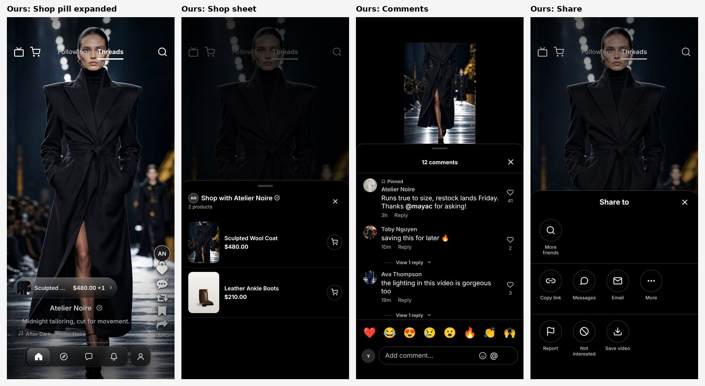

- **Shop pill → Shop sheet**: owned by `claude/tiktok-rail-no-repost` (pill, inside the caption) and `claude/polish-feed-sheets` (sheet). One line for them: opening a product takes two taps. The first tap only expands the pill into a truncated "Sculpted … $480.00 +1 ›" strip, and the second tap opens the sheet (`components/buyer-feed/ShopSideTab.tsx:216`, `onPress={expanded ? onPress : expand}`). TikTok's product anchor opens the product on the first tap.
- **Comments sheet / Share sheet**: owned by `claude/polish-feed-sheets`.
- **Feed rail** (count labels overlap the icons at 390 wide): owned by `claude/tiktok-rail-no-repost`. **Feed header**: owned by `claude/live-tab-in-header`.

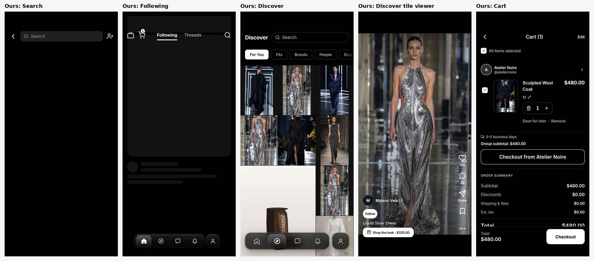

- **Search** (blank page with a person-plus icon), **Following** (stuck on the skeleton): owned by `claude/polish-feed-sheets`.
- **Discover grid + tile viewer**: owned by `claude/discover-loading-fix`. One line for them: the tile viewer is a second, different vertical player. It has a "Share" label, ••• at the bottom and a Follow pill under the name, all unlike the Home feed rail.
- **Cart**: owned by `claude/polish-bag-orders`.

---

### Product page (`/thread-product-detail` → `app/buyer-product-detail.tsx`)

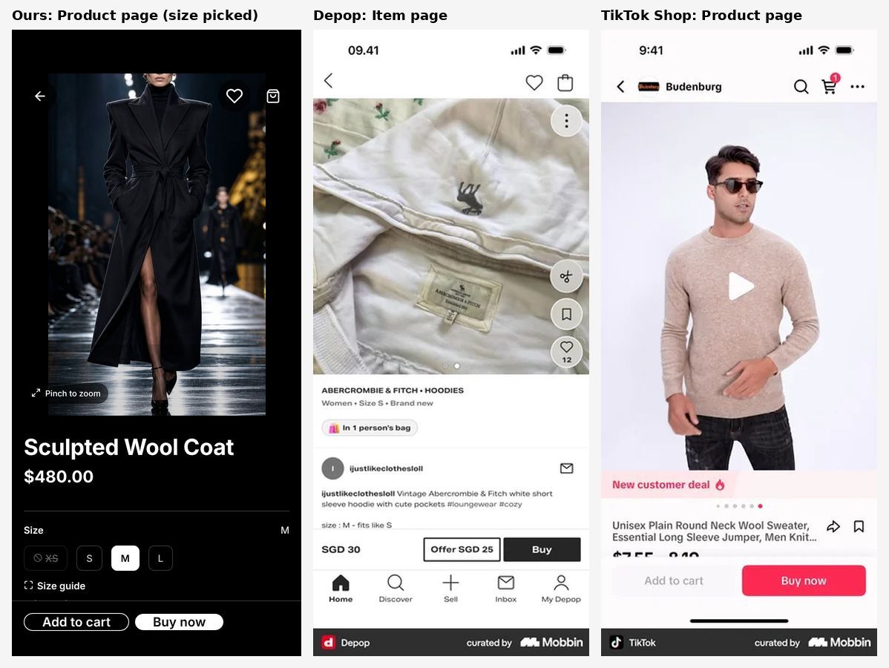

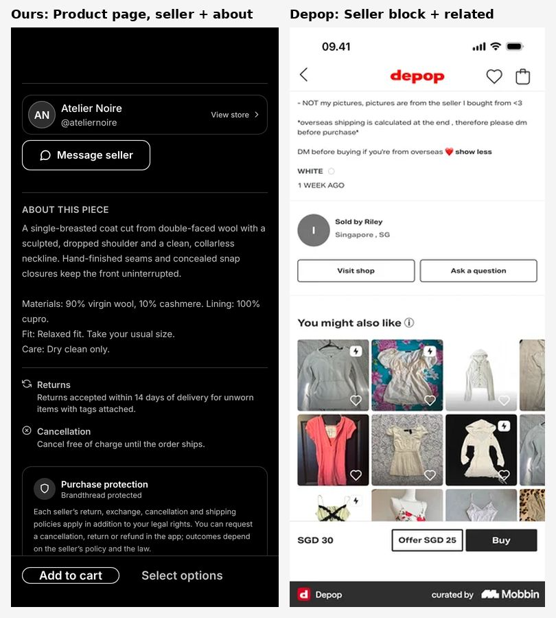

Reference: [Depop: Item page](https://mobbin.com/screens/9df6cb8e-4b6e-40cb-a3f2-43492a801962), [Depop: Seller block + You might also like](https://mobbin.com/screens/5a00d933-237b-46fc-ab14-4bd8128660da), [TikTok Shop: Product page](https://mobbin.com/screens/ee04feb5-e721-4cb2-902f-797b80e81619)

Not in any reference app:
- A "⤢ Pinch to zoom" chip sits permanently on the hero photo (`buyer-product-detail.tsx:341`).
- The sold-out size shows a ⊘ icon *and* a strikethrough. That is two signals for one state.
- An inline Qty stepper (−1+) and an "In stock" line on a single fashion item. Depop, Vinted and GOAT have no quantity on the item page.
- A "Purchase protection" legal card with a paragraph of policy text in the middle of the page, plus separate Returns/Cancellation rows.
- An "Ask a question" Q&A section. Depop puts "Ask a question" as a button beside "Visit shop", with no empty Q&A block.
- "Report listing · Report intellectual property infringement" as two text links in the page body. Every reference puts Report inside the ••• menu.

Layout / spacing / hierarchy / flow deviations:
- **Broken bottom CTA bar (bug).** "Add to cart" and "Buy now" render as about 24pt-tall pills. Their label text is bigger than the pill. Before a size is picked, the primary button collapses to plain grey text reading "Select options" (`buyer-product-detail.tsx:1422-1478`, `StickyFooter` + `Button`; the toolbar measures 358x24). The Qty stepper and "In stock" line also sit hidden *under* the footer at y=825.
- The hero image is pillarboxed: about 290pt wide, with black bars on both sides. Depop and TikTok Shop are edge to edge.
- The top-right icons sit on dark circles that don't line up (the heart circle is offset, and the bag circle is clipped by the image edge). There is no share or ••• button.
- The seller block is a boxed card, with a half-width outline "Message seller" button floating under it, left-aligned.
- The page has no brand/size/condition meta line (Depop: "BRAND • CATEGORY / Size S • Brand new") under the title.

Fix (in reference terms):
- Copy the Depop item page: a full-bleed 4:5 photo carousel with dots, and a top bar with ‹ back on the left and ♡ + bag on the right as plain glyphs (no circles). Add a vertical share / ••• stack on the photo's right edge, as Depop does.
- Under the photo: BRAND · CATEGORY in caps, then "Size · Condition", then the title. Below that, a seller row (avatar, name, rating, ✉ icon at the right edge), then the description.
- Pin Depop's bottom bar: the price on the left, then an outline "Offer" button and a filled "Buy" button, each 44pt tall. If offers aren't supported, use TikTok Shop's 50/50 "Add to cart" (outline) + "Buy now" (filled), both 48pt, with 16pt gutters above the home indicator. Disabled "Buy now" stays a filled button at 40% opacity, never plain text.
- Delete the Pinch-to-zoom chip, the Qty stepper, the "In stock" line and the policy card. Put returns in one "Returns · 14 days ›" row. Move both Report actions into the ••• sheet.
- Sold-out size: strikethrough only, no ⊘.
- Seller block: copy Depop's "Sold by" row with "Visit shop" + "Ask a question" as two equal outline buttons side by side, then "You might also like" as a 2-column grid (Depop), not a horizontal strip.

### In-feed product sheet (product view inside Shop sheet, `components/ShopProductSheet.tsx`)

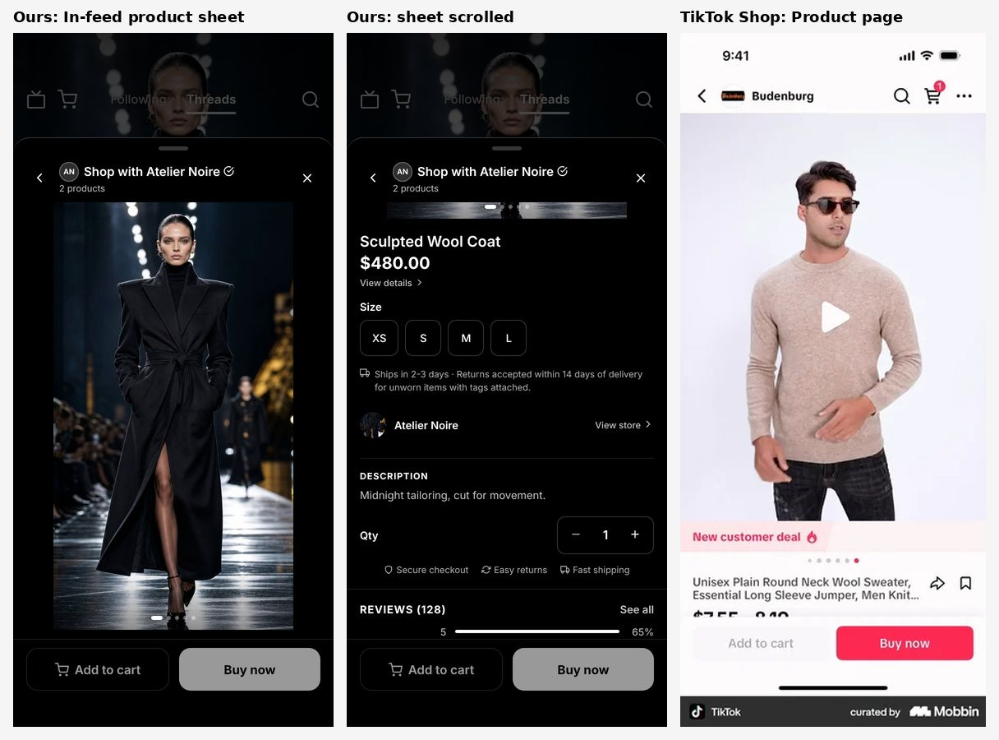

Reference: [TikTok Shop: Product page](https://mobbin.com/screens/ee04feb5-e721-4cb2-902f-797b80e81619)

(The sheet frame belongs to `claude/polish-feed-sheets`. These findings cover the product *content* it renders, which duplicates the product page.)

Not in any reference app:
- A "🛡 Secure checkout · ↻ Easy returns · 🚚 Fast shipping" trust-badge row (`ShopProductSheet.tsx:1245`).
- A Qty stepper on a fashion item.
- A "View details ›" link under the price *and* a "View full product details ›" link at the very bottom. That is two links to the same page.

Layout / hierarchy deviations:
- The sheet header keeps saying "Shop with Atelier Noire · 2 products" while a single product is showing.
- The product photo is pillarboxed and fills the whole first view. Title, price and size sit below the fold.
- The full 128-review breakdown (bars, review photos, "Helpful (12)") is inlined in a sheet.
- The sheet is a second, different product page (different size chips, different seller row, different CTA styling) from `/thread-product-detail`.

Fix: TikTok's product anchor opens a full product page; it has no mini page in a sheet. Either (a) a tap on a product row in the Shop sheet pushes the real product page (same screen as above), or (b) if the sheet stays, make it TikTok's compact SKU sheet: thumbnail, price and title in a row, size chips, then the 50/50 CTA, with no reviews, trust row or qty. In both cases, change the header to the product name while a product is open.

### Added to bag (sheet on product page)

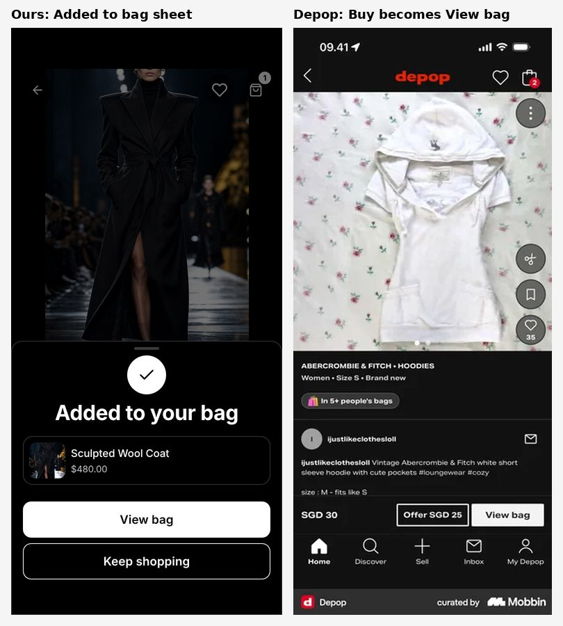

Reference: [Depop: Buy becomes View bag](https://mobbin.com/screens/2e0b78fa-e069-471b-a2bc-fc1d447f573b)

Not in any reference app: a large white ✓ circle with an "Added to your bag" headline, a boxed item card, and two stacked full-width buttons ("View bag" / "Keep shopping"). The flow adds a modal step after every add.

Deviation: the naming is inconsistent across one flow. The button says "Add to cart", this sheet says "bag", and the feed header and cart screen say "Cart".

Fix: copy Depop. Add to bag gives no modal. The bag icon in the header gets a count badge, and the primary CTA changes in place to "View bag". Pick one word app-wide; the feed header, cart title and buttons should all say **Bag** (Depop) or all say **Cart** (TikTok Shop).

### Size guide (sheet)

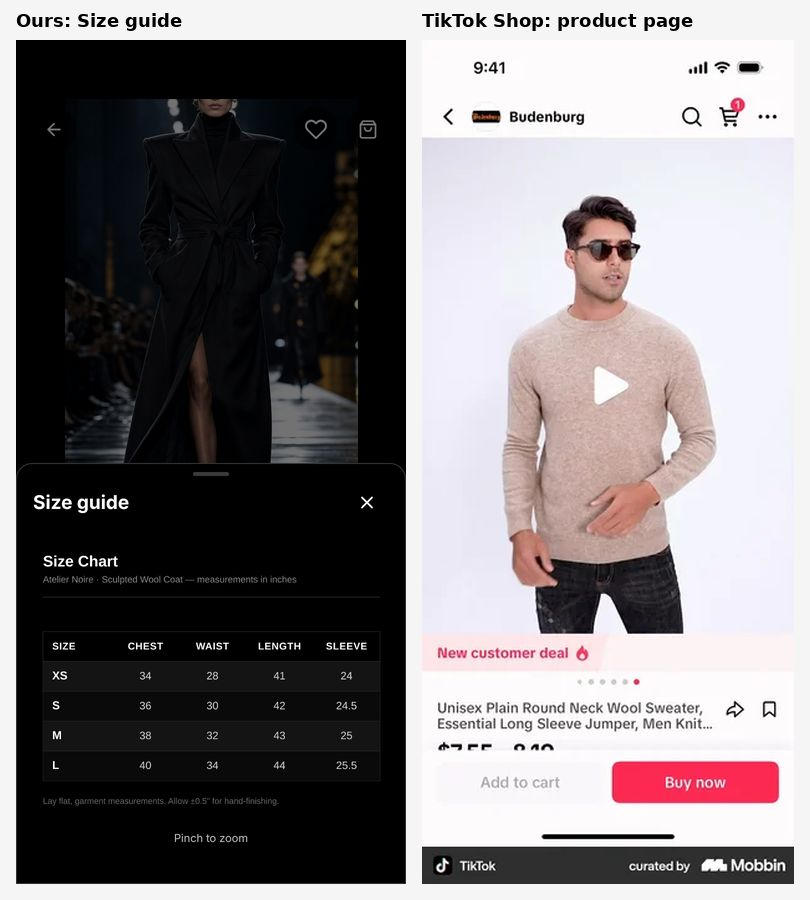

Reference: [TikTok Shop: Product page](https://mobbin.com/screens/ee04feb5-e721-4cb2-902f-797b80e81619) (size info lives in the SKU sheet; Mobbin has no dedicated size-chart frame for these apps)

Not in any reference app: two titles ("Size guide" in the sheet header, then "Size Chart" with a subtitle), and a "Pinch to zoom" hint at the bottom (`buyer-product-detail.tsx:1600`).
Deviation: the table renders in a different font from the rest of the app (it falls back to a system sans).
Fix: one title, "Size guide", in the sheet header. Put the inches/cm unit toggle top-right, then the table in the system font, then one footnote line. Delete "Size Chart" and the pinch hint.

### Checkout (`/thread-checkout?source=buynow|cart`)

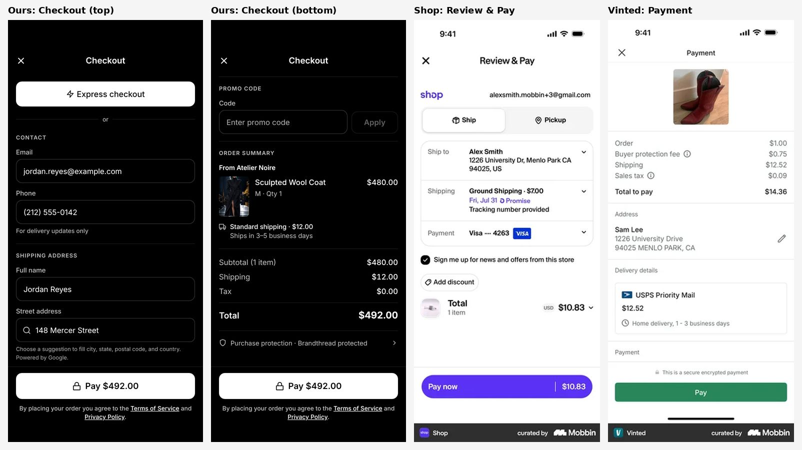

Reference: [Shop: Review & Pay](https://mobbin.com/screens/f1967508-9929-4234-b795-6e2a82b6b449), [Vinted: Payment](https://mobbin.com/screens/f145846c-fb81-4cd6-9f01-7504da0b04ec), [Vinted: Payment rows](https://mobbin.com/screens/413118cc-a756-4b16-b803-3c53b3fd13c9)

Not in any reference app:
- A generic white "⚡ Express checkout" button with a bolt icon and an "— or —" divider above the whole form. Native apps show the branded Apple Pay button, or nothing.
- A full web-style form (Email, Phone, Full name, Street, Apt, City, State, ZIP, Country) inline on the one checkout page, every time. In-app checkouts show *saved* rows and push an address form only when you edit.

Layout / hierarchy / flow deviations:
- The order summary (what you're buying) sits at the very bottom, under Promo code. Shop and Vinted put the item and total first, or as a collapsible header.
- Prefill is inconsistent. From Buy now, contact and address came prefilled; from the cart, minutes later, the same fields were empty. Nothing saves the address the buyer just used.
- "PAYMENT — ⓘ This order won't be charged." is the preview stub. **This is the slot Dev connects payments into.**

Fix: copy Shop's "Review & Pay":
- ✕ and title at the top, then one bordered group of three tappable rows: **Ship to** (name + address ›), **Shipping** (method · price + ETA ›), **Payment** (card •••• 4263 ›).
- Then "Add discount" as a small pill, then a **Total** row with the item thumbnail that expands to the breakdown.
- Then one full-width "Pay now | $492.00" button pinned at the bottom (filled; Dev's black/white).
- The address and card forms become pushed screens (Vinted "Address" / "Card details") shown only when no saved value exists.
- Apple Pay replaces the generic Express button, behind the payments flag.

### Order confirmation (`components/checkout/OrderConfirmation.tsx`)

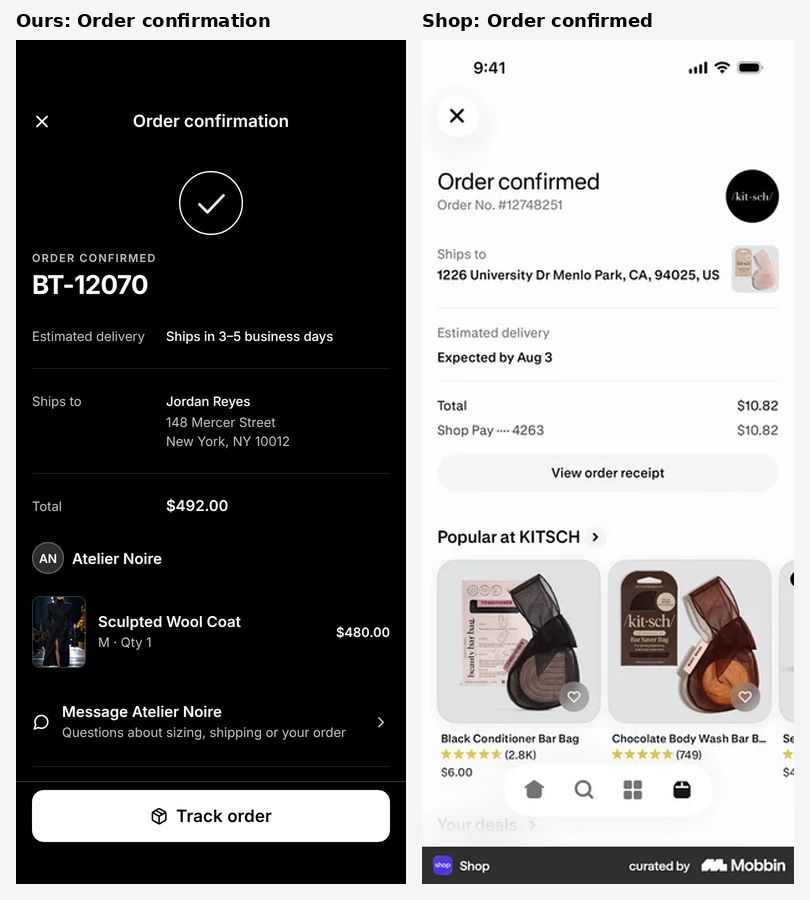

Reference: [Shop: Order confirmed](https://mobbin.com/screens/de8483f7-edf3-49ca-94d5-9501485c8c10)

Close to the reference already. Deviations:
- A large ✓ ring plus an "ORDER CONFIRMED" eyebrow plus a big "BT-12070". Shop shows the title "Order confirmed" with "Order No. #…" under it and the store avatar at the right.
- The page has four exits (Message seller, View receipt, Continue shopping, Track order) plus "Create an account to track orders faster". That last row shows because the preview isn't Clerk-signed-in (`OrderConfirmation.tsx:388`); fine for real guests.

Fix: copy Shop's layout. Title "Order confirmed" + "Order No. BT-12070" on the left with the seller avatar on the right. Then rows: Ships to (address + item thumb), Estimated delivery, Total / payment method. Then one grey "View order receipt" button, then "More from Atelier Noire" (product carousel). Drop the ✓ ring and the eyebrow. Keep "Track order" as the pinned primary button.

### Buyer order detail (`/buyer-order-detail`)

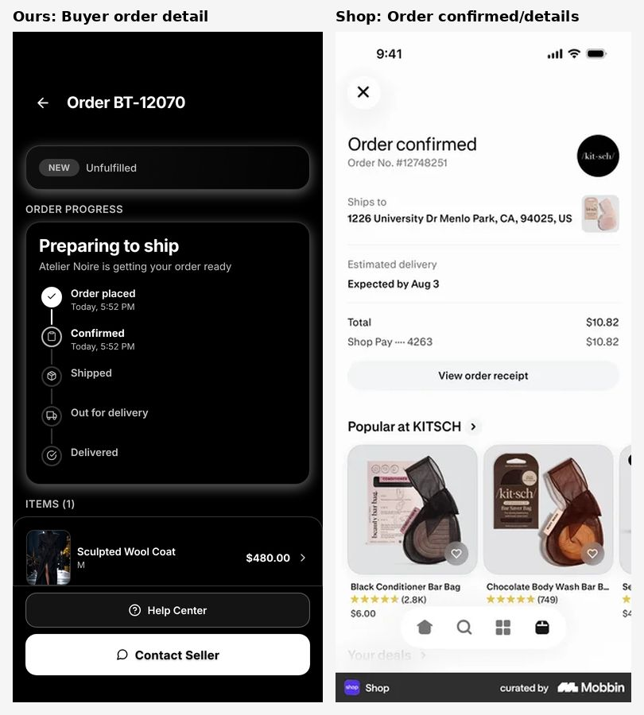

Reference: [Shop: Order confirmed / order page](https://mobbin.com/screens/de8483f7-edf3-49ca-94d5-9501485c8c10), [Vinted: Payment summary rows](https://mobbin.com/screens/413118cc-a756-4b16-b803-3c53b3fd13c9)

(The order *list* belongs to `claude/polish-bag-orders`. This is the detail screen.)

Not in any reference app:
- A "NEW" chip next to "Unfulfilled". That is Shopify *seller* back-office wording shown to a buyer, and two status labels in one card (`app/buyer-order-detail.tsx:140`).
- Glowing white outer shadows on dark cards.
- A different icon for every timeline step (clipboard, box, truck, check).

Deviations: an "ORDER PROGRESS" section label above a card that already has its own headline. The items card runs edge to edge while the other cards are inset. Two full-width pinned buttons ("Help Center" outline + "Contact Seller" filled) cover the item row.

Fix: a title "Order BT-12070", then one status headline ("Preparing to ship" + ETA line). Then a plain vertical timeline with filled and hollow dots (no per-step icons), then rows: Items, Ship to, Payment summary (Vinted's label/value rows). Put "Contact seller" as one pinned button, and move Help to the ••• in the header. Delete the NEW/Unfulfilled card and the glow shadows.

### Live: nobody live (`/live-feed`)

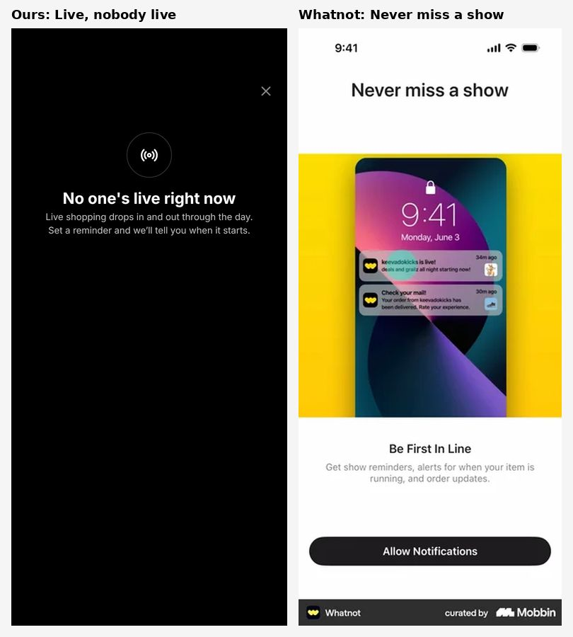

Reference: [Whatnot: Never miss a show](https://mobbin.com/screens/ec73d892-81b2-4d37-810d-af5762454af0)

Unfinished: the copy says "Set a reminder and we'll tell you when it starts", but the screen has no reminder or notify control (`components/live/LiveEmptyState.tsx:45`). The rest is a blank black screen with an ✕.
Fix: the Whatnot pattern. Title "Never miss a show", one line of copy, and a pinned "Turn on notifications" button that runs the push permission flow. If notifications are already on, show the followed sellers' upcoming shows list instead.

### Live viewer (`/live-feed?demo=1`)

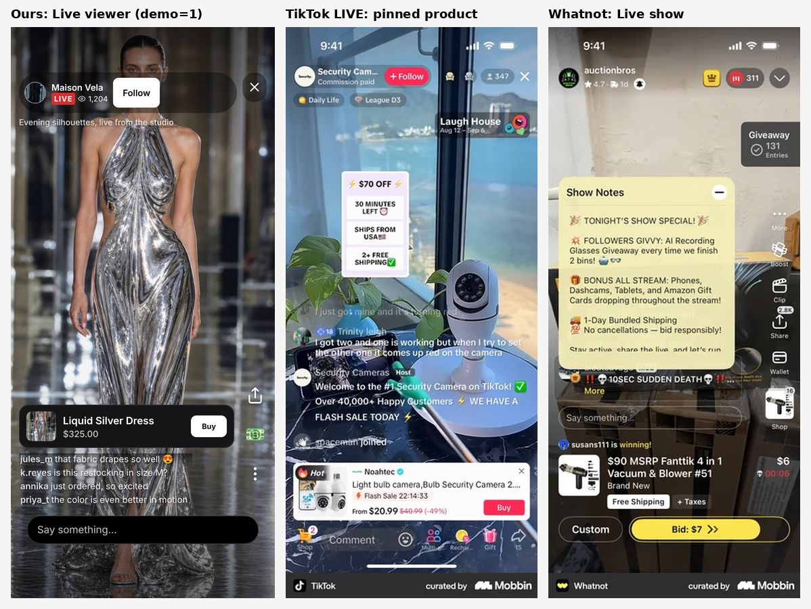

Reference: [TikTok LIVE: pinned product](https://mobbin.com/screens/f33fee80-53e2-4935-9d77-872575f09037), [Whatnot: Live show](https://mobbin.com/screens/f7f96444-b4c5-498b-8231-8fb3045cc401)

Not in any reference app:
- A green dollar-bill "Thread Cash" icon in the right column, off Dev's black/white/silver palette.
- The host capsule stretches about 330pt wide, with a large white rectangular "Follow" button and empty space.
- The stream title floats as loose text under the capsule.
- The first chat row has a partial dark highlight strip.

Deviations: the right column holds only share, Thread Cash and •••. Its icons are not vertically aligned with the composer, and it has no labels.

Fix: copy TikTok LIVE's top-left pill: avatar, name, viewer count, and a small "+ Follow" chip, all inside a pill about 200pt wide. Put the viewer count and ✕ at the top right, with no stream-title text. Chat runs bottom-left with no row backgrounds. The pinned product card ("Buy" filled chip) sits directly above the bottom bar. The bottom bar is Comment field + Gift + Share, as in TikTok, and the gift glyph replaces the green bill (monochrome).

### Live: Send Thread Cash (sheet)

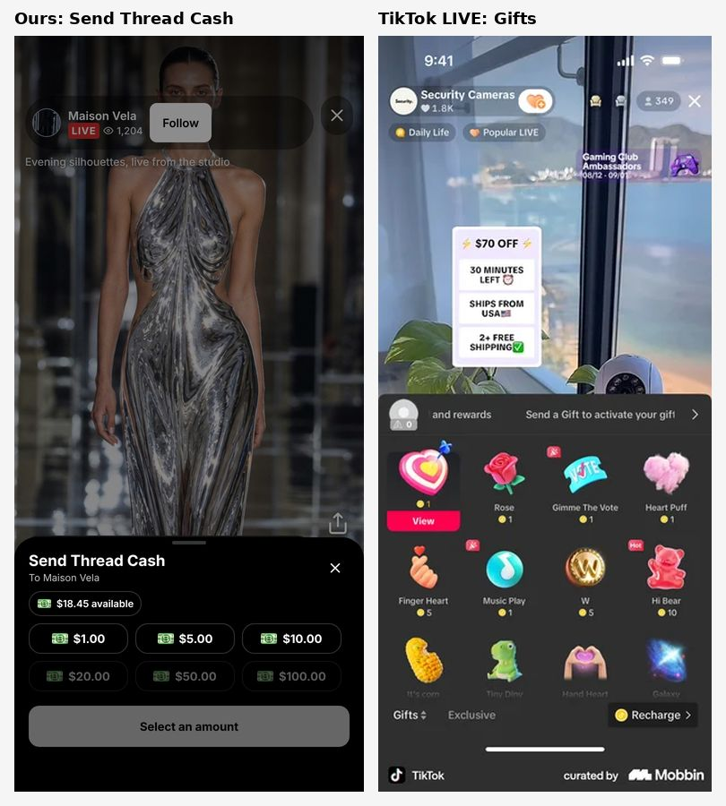

Reference: [TikTok LIVE: Gifts](https://mobbin.com/screens/6cd932ab-a754-4551-bba8-db1b086861e9)

Not in any reference app: a green bill icon repeated on every amount chip, plus a green "$18.45 available" chip.
Fix: TikTok's gift sheet structure, in monochrome. Show the balance at the bottom-left with "Recharge ›" at the bottom-right. Lay the amounts out as a 3-column grid of plain tiles (amount only), with tap to select and tap again to send. Drop the separate "Select an amount" button. Keep it behind the payments flag.

### Live: Buy sheet

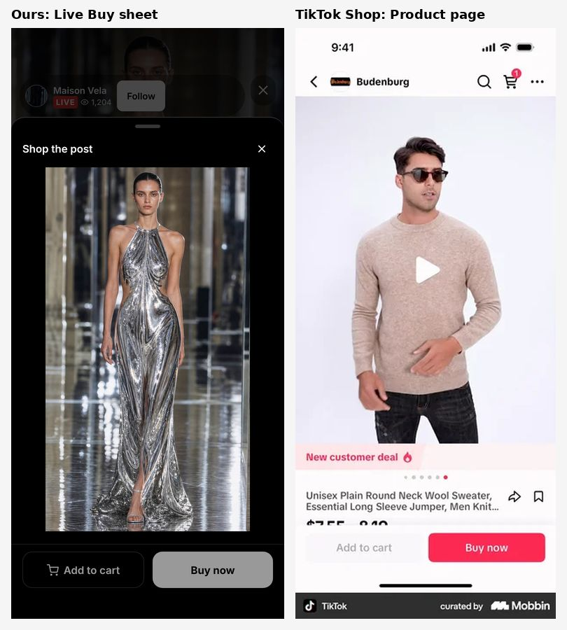

Reference: [TikTok Shop: Product page](https://mobbin.com/screens/ee04feb5-e721-4cb2-902f-797b80e81619)

Deviations: the sheet title "Shop the post" is the wrong copy inside a Live (`ShopProductSheet.tsx:1016` fallback). A pillarboxed photo fills the sheet, and the title, price and sizes are below the fold. It has the same CTA styling problem as the product page ("Buy now" greyed until a size is chosen, with no size visible).
Fix: TikTok LIVE's compact purchase sheet: a thumbnail, title and price row, then size chips, then a full-width "Buy now", all visible without scrolling. Title it with the product name.

### Live ••• menu

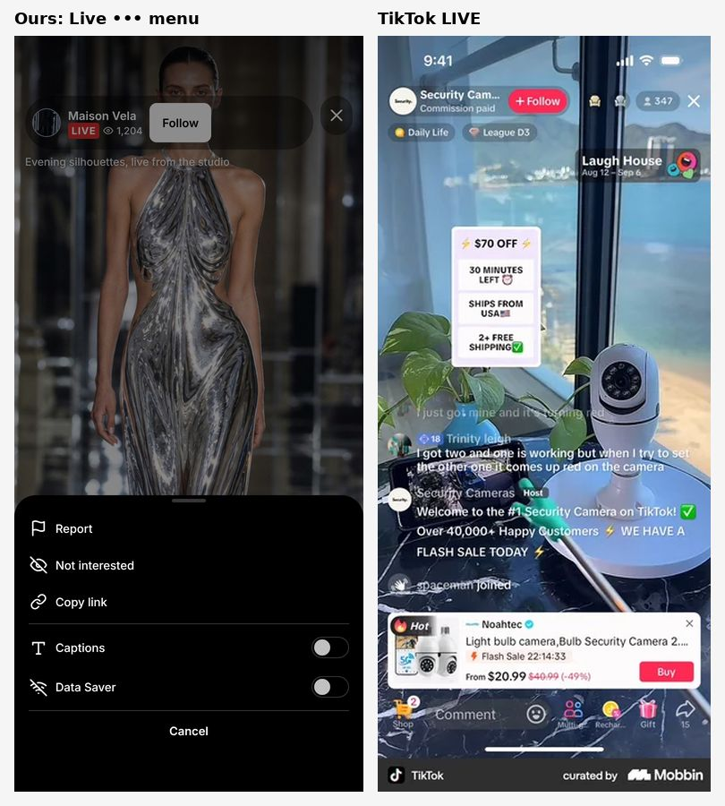

Reference: [TikTok LIVE](https://mobbin.com/screens/f33fee80-53e2-4935-9d77-872575f09037)
Matches the reference pattern (Report / Not interested / Copy link / Captions / Data saver). No changes.

### Report listing (`/buyer-report`)

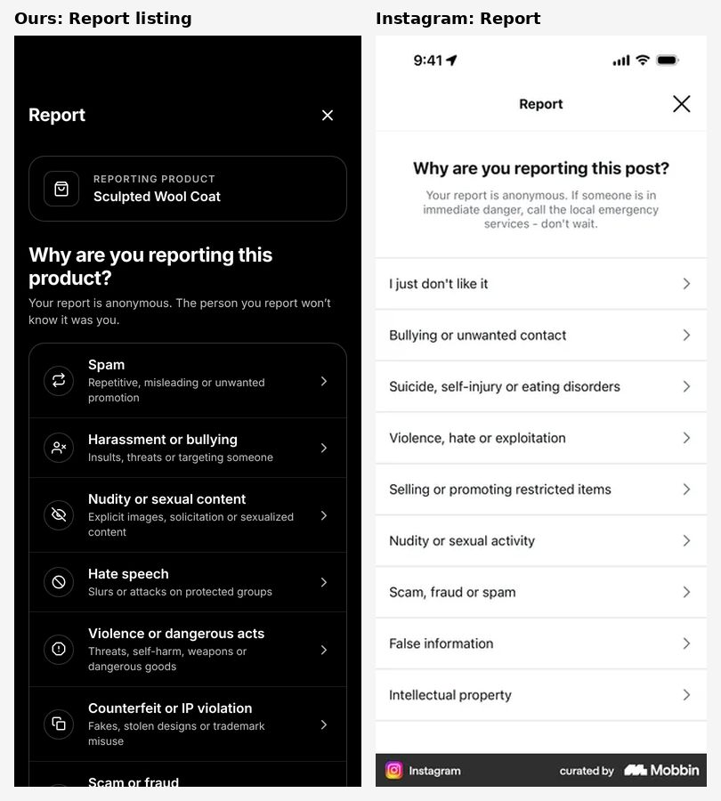

Reference: [Instagram: Report](https://mobbin.com/screens/2eae9c95-2e98-4456-9920-3635519ee07e)

Not in any reference app: a circled icon for every reason, a subtitle under every reason, and a "REPORTING PRODUCT" boxed card at the top.
Fix: copy Instagram. Title "Report" with ✕, then the centred headline "Why are you reporting this listing?" with one line of grey anonymity copy. Then a plain full-width list of one-line reasons with › chevrons and hairline separators. No icons, subtitles or card.

---

### Reachable but unfinished (Section A)

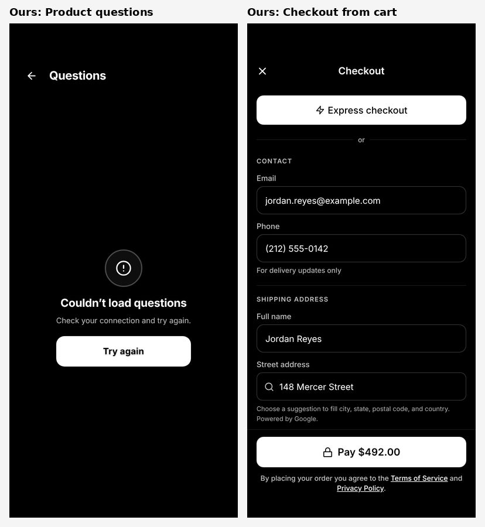

- **Product questions** (`/product-questions`, from "Ask a question"): a spinner, then "Couldn't load questions". In preview it should show the empty "No questions yet" state with an Ask field. (Local run had no API server; re-check against the live preview.)
- **Checkout from cart**: address and contact are empty again right after a Buy-now order filled them (see Checkout).
- **Live empty state**: the reminder copy has no control (see above).
- **Product page bottom bar**: the broken 24pt CTA bar makes the page look unfinished (see Product page).

### Bugs hit (Section A)

- Product page CTA toolbar renders 24pt tall, so the buttons overflow and the disabled primary becomes plain text (`app/buyer-product-detail.tsx:1422-1478`).
- Shop pill needs two taps to open products (`components/buyer-feed/ShopSideTab.tsx:216`).
- The sheet header doesn't update when a product opens (`components/ShopProductSheet.tsx:1016`).
- Recurring console error on feed and Live: "Failed to load because no supported source was found." (a video source failing on web).

---

## Buyer: Profile tab and everything behind it

Walked at 390x844 on local Expo web (`?bt_preview=buyer`, plus `demo=1` only to open a seeded order detail). Every header button, menu row, settings row and sheet on the buyer Profile tab was opened.

### Profile tab (owned by claude/polish-profiles)
`/(buyer)/profile` · 

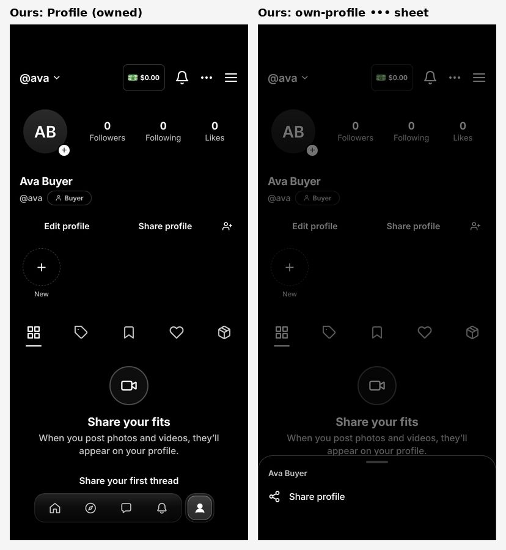

Owned, so it gets one line. Notes for the owner: the header has a wallet chip, a bell, a •••, and a hamburger: four controls where Instagram's own-profile header has two (+ and ☰). The bell duplicates the Activity tab and opens `/buyer-notifications`, which spins forever on "Loading notifications…". The own-profile ••• sheet has one row ("Share profile"), which duplicates the Share profile button and the menu row. The Orders tab is empty ("No orders yet") while the Orders screen lists 2 orders.

### Account switcher sheet (avatars owned by claude/seamless-avatars-crop)
Sheet from `@ava ⌄` · 

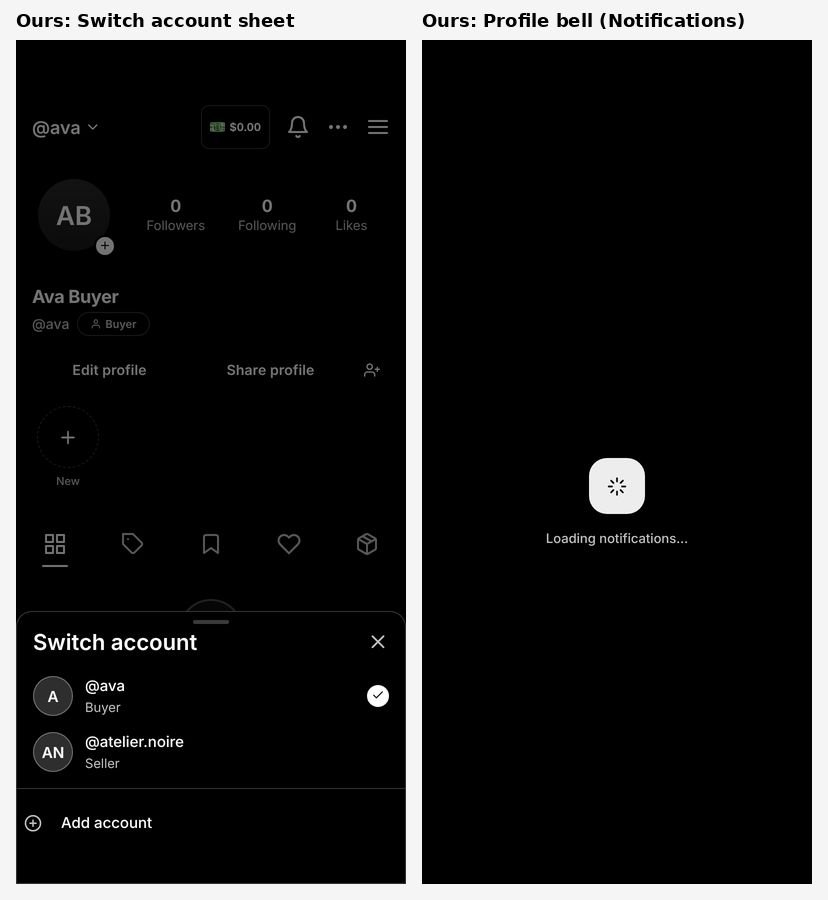

Reference: Instagram account switcher (same pattern as Instagram's "Add account" row at the bottom of [Settings and activity](https://mobbin.com/screens/feee12ed-78b5-4a5d-ac45-a33cd1550545))
- **Not in any reference app:** a large left-aligned "Switch account" title plus a ✕ button. Instagram's sheet has only a grab handle and no title or close button.
- **Deviations:** the "Add account" row's ⊕ icon sits at x≈17 while the avatars sit at x≈37, so the row doesn't line up with the list. The initials are inconsistent: "A" here, "AB" on the profile, "BT" in Settings, "B" in Accounts Center, "Y" in Inbox and Friends.
- **Fix:** drop the title and ✕, keep only the grab handle. Render "Add account" as a row in the same 56pt avatar column (a 44pt circle with +), then the label. Put an account's initials in one helper and use it everywhere (the avatar component itself is owned).

### Menu (hamburger)
`/buyer-settings-menu` · 

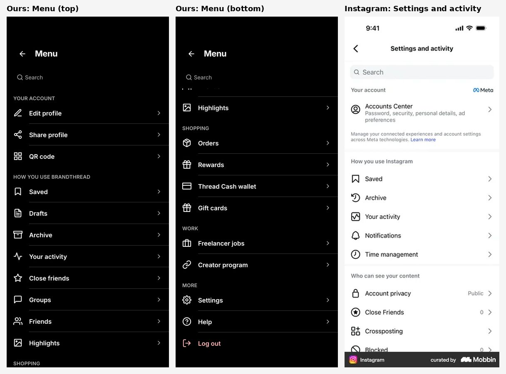

Reference: [Instagram Settings and activity](https://mobbin.com/screens/f08baa0d-fca5-4c2c-bbd1-a1e10c367714), [Instagram bottom (Log out)](https://mobbin.com/screens/feee12ed-78b5-4a5d-ac45-a33cd1550545)
- **Not in any reference app:** two separate settings hubs: this "Menu" (24 rows) and "Settings" (`/buyer-settings`, 48 rows) repeat most of the same rows (Edit profile, Saved, Archive, Your activity, QR code, Close friends, Orders, Thread Cash, Help, Log out). Instagram has one hub: ☰ → Settings and activity. The "WORK" section ("Freelancer jobs", "Creator program") appears for a buyer. The menu repeats "Edit profile" and "Share profile", which are already buttons on the profile.
- **Deviations:** the title is left-aligned at 24pt next to the back arrow, where Instagram uses a 17pt centered nav title. The search field is an outline with no fill, where Instagram uses a filled grey pill. Log out is pink/red with an icon, where Instagram uses plain red text in a "Login" section.
- **Fix:** merge Menu and Settings into one Instagram-style "Settings and activity" screen: a centered title, a filled search pill, then the sections *Your account* (Accounts Center), *How you use Brandthread* (Saved, Archive, Your activity, Notifications), *Who can see your content* (Account privacy, Close friends, Blocked), *Shopping* (Orders, Addresses, Payments, Sizes, Thread Cash), *Support & about*, and *Login* (Add account, Log out as red text with no icon). Remove Edit profile, Share profile and the WORK rows from the buyer hub. Point the ☰ button at it.

### Settings root
`/buyer-settings` (rows from `services/settingsCatalog.ts`) · 

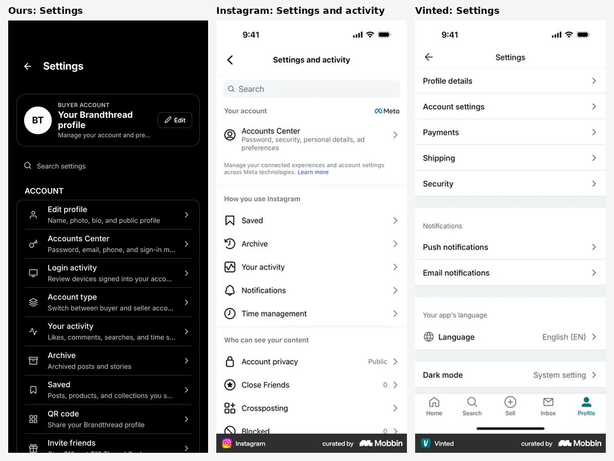

Reference: [Instagram Settings and activity](https://mobbin.com/screens/f08baa0d-fca5-4c2c-bbd1-a1e10c367714), [Vinted Settings](https://mobbin.com/screens/e7c5b021-0d7a-4a88-8ab1-cb84ae8e97c6)
- **Not in any reference app:** the profile summary card ("BUYER ACCOUNT / Your Brandthread profile / Manage your account and preferences" with an Edit button) shows a generic placeholder instead of the user's name, and "BT" initials instead of "AB". The "DANGER ZONE" section title (`settingsCatalog.ts:130`, `:274`) is developer vocabulary. A two-line subtitle on every one of the ~48 rows. Rounded bordered cards wrapped around each group.
- **Deviations:** several sections hold a single row (ADDRESSES, PAYMENT METHODS, THREAD CASH, NOTIFICATIONS, LOG OUT, DANGER ZONE), which makes the page about 4 screens long. Instagram groups 3–6 rows per section, separated by an 8pt grey gap with no card borders. Section headers are 15pt bold caps, where Instagram uses 13pt grey sentence case. Rows are 57pt tall with subtitles, where Instagram rows are 44pt with a single line.
- **Fix:** see Menu: make this the single hub. Remove the profile card (Instagram has none, and Accounts Center is the first row). Use single-line rows with value text on the right for state (e.g. "Account privacy … Public", Vinted's "Language … English (EN)"). Move Delete account into Accounts Center → Personal details → Account ownership (Instagram's path). Put the version string in a grey footer as Vinted does ("Vinted 25.13.2").

### Wrong-audience copy in buyer settings (Push notifications, Languages)
`/push-notifications`, `/languages` · 

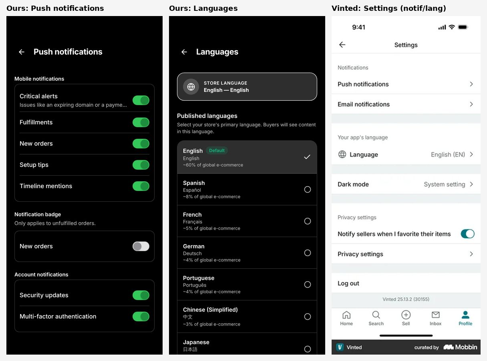

Reference: [Vinted Settings → Push notifications / Language](https://mobbin.com/screens/dfbb15d8-e156-47f5-8285-1a6c2c6e1620)
- **Not in any reference app (copied from the Shopify admin):** the buyer's Notifications row opens a merchant screen with "Critical alerts: Issues like an expiring domain or a payment failure", "Fulfillments", "New orders", "Setup tips", "Timeline mentions" and "Notification badge: only applies to unfulfilled orders" (`app/push-notifications.tsx:29`). The buyer's Language row opens "STORE LANGUAGE / Published languages / Select your store's primary language. Buyers will see content in this language" and "~60% of global e-commerce" (`app/languages.tsx:23`).
- **Fix:** split by audience. The buyer Notifications screen copies Vinted/Instagram: *Push notifications* → Messages, Orders & shipping, Price drops on saved items, New drops from brands you follow, Likes & comments, New followers, Live started. *Email notifications* is a separate row. The buyer Language screen is Instagram's plain list of app languages with a ✓ on the selected one and no market-share lines. The seller keeps the store-language screen.

### Privacy lists (Blocked, Muted, Restricted, Follow requests, Muted words, Close friends)
`/buyer-blocked`, `/buyer-muted`, `/buyer-restricted`, `/buyer-friend-requests`, `/muted-words`, `/buyer-close-friends` · 

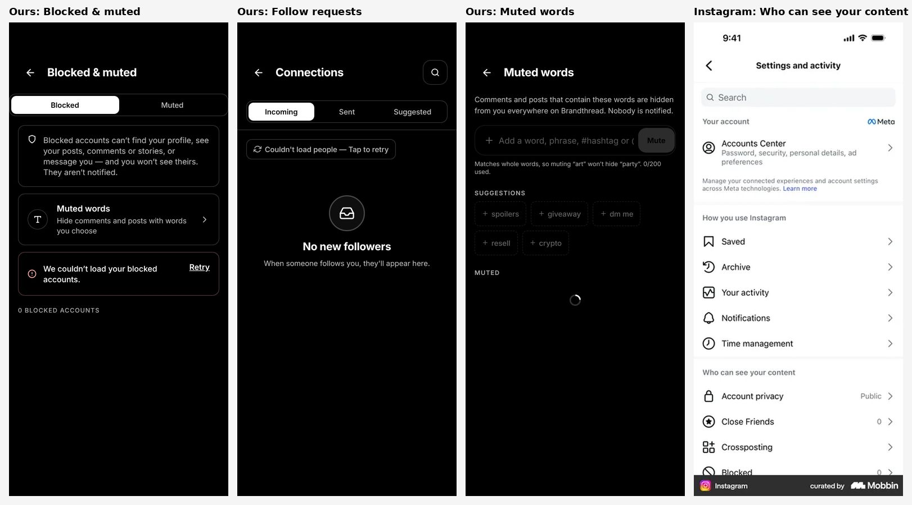

Reference: [Instagram Settings and activity → Who can see your content](https://mobbin.com/screens/f08baa0d-fca5-4c2c-bbd1-a1e10c367714)
- **Not in any reference app:** the "Blocked accounts" row opens a screen titled "Blocked & muted" with Blocked/Muted tabs plus an embedded "Muted words" card, while separate "Muted accounts" and "Muted words" rows also exist, so muting is reachable three ways. The "Follow requests" row opens a screen titled "Connections" with *Incoming / Sent / Suggested* tabs, and its empty state says "No new followers".
- **Bugs / unfinished:** Blocked shows "We couldn't load your blocked accounts. Retry", Follow requests shows "Couldn't load people — Tap to retry" (`app/buyer-friend-requests.tsx:388`), and Muted words spins forever under "MUTED". Preview has no API, but none of these screens has a preview fallback.
- **Fix:** follow Instagram: one row per list ("Blocked", "Muted accounts", "Restricted", "Close Friends"), each a plain account list with Unblock/Unmute pills, a count on the right of the row ("Blocked … 0") and Instagram's empty state ("You haven't blocked anyone"). Follow requests becomes a single list with Confirm/Delete buttons and no tabs. Muted words moves under Comments/Hidden words, as on Instagram.

### Small settings sub-pages (Messages & story replies, Content preferences, Accessibility, Saved)
`/buyer-settings-detail?section=messages|content|accessibility`, `/buyer-saved` · 

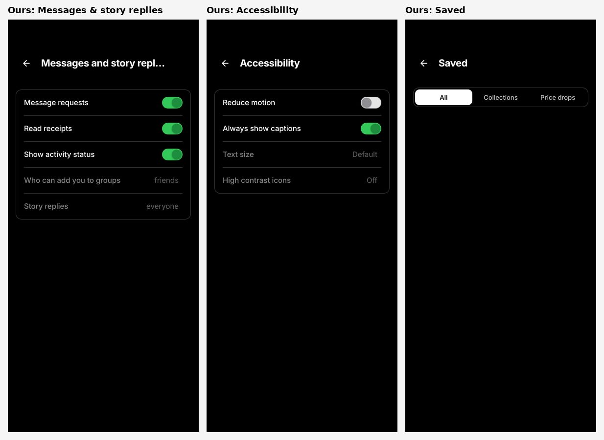

Reference: [Instagram Settings and activity](https://mobbin.com/screens/f08baa0d-fca5-4c2c-bbd1-a1e10c367714)
- **Unfinished:** raw lowercase enum values appear as row values ("friends", "everyone", "standard"). "Text size: Default" and "High contrast icons: Off" render greyed and disabled. The title "Messages and story repl…" is truncated. Saved shows the tabs *All / Collections / Price drops* over a blank screen with no empty state, and "Price drops" as a Saved tab is not an Instagram tab.
- **Fix:** label-map every value to title case ("Friends", "Everyone", "Standard"). Hide rows that aren't functional. Shorten the title to "Messages" (Instagram's row label is "Messages and story replies", but its screen title fits on one line). Saved copies Instagram Saved: a grid of collection tiles ("All posts" first) with an empty state, and Price drops moves to notifications.

### Shipping addresses and Payment methods
`/buyer-addresses`, `/buyer-payment-methods` · 

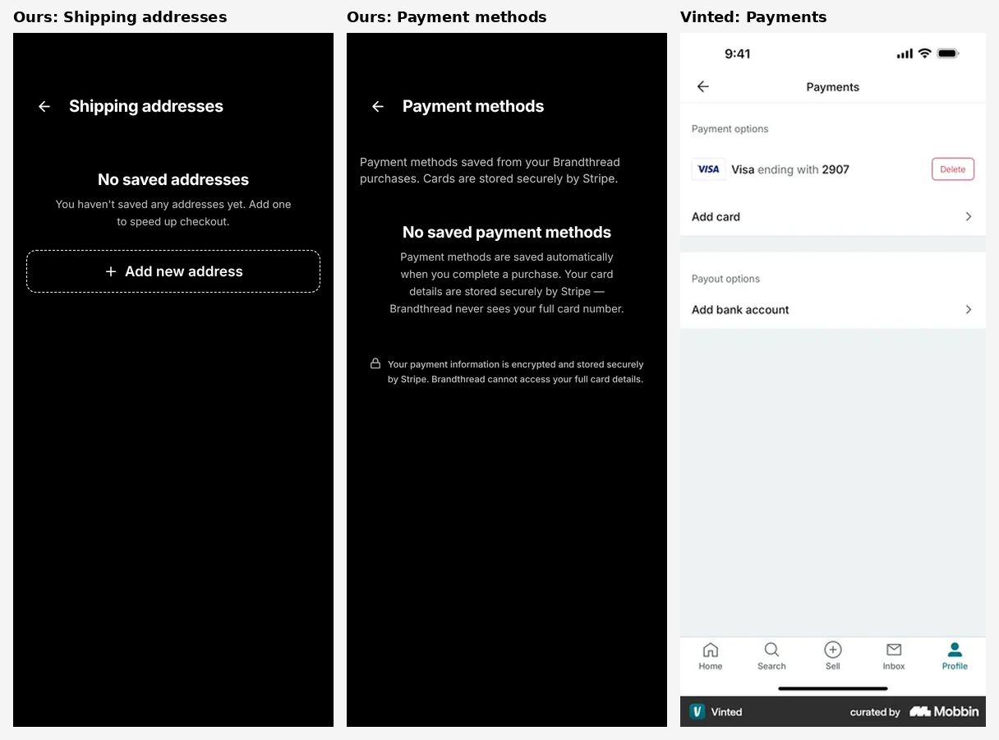

Reference: [Vinted Payments (with card)](https://mobbin.com/screens/e5bb66fd-03c1-45bf-8d79-0044580cf6a8), [Vinted Payments (empty)](https://mobbin.com/screens/b535c002-7b66-4116-beeb-d66754775d4e)
- **Not in any reference app:** a dashed-outline "+ Add new address" button. Payment methods has no way to add a card ("saved automatically when you complete a purchase"), plus two near-identical Stripe security paragraphs.
- **Fix:** copy Vinted's rows: under the section header "Payment options", each saved card is a row (brand logo, "Visa ending with 2907", Delete) and the last row is "Add card ›". Addresses work the same way: a row per address with Default and edit, then "Add address ›". Keep one grey footnote about Stripe. Gate "Add card" behind the payments flag so Dev only connects keys.

### Sizes: two competing screens
`/shopping-preferences` and `/buyer-my-sizes` · 

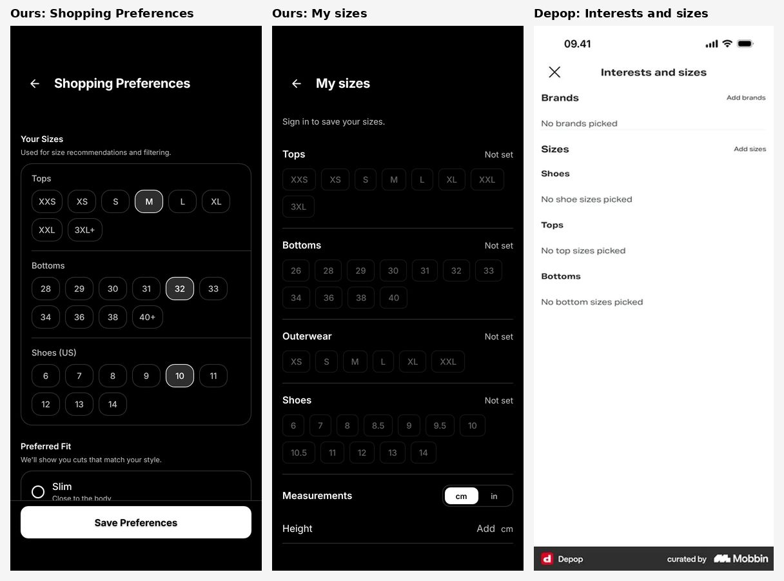

Reference: [Depop Interests and sizes](https://mobbin.com/screens/faca1859-22fb-4f0e-8fa5-5fee3a043a12)
- **Not in any reference app:** two separate size editors with different size sets. Shopping Preferences offers Tops/Bottoms/Shoes plus a "Preferred Fit" radio, and its state (M/32/10) is not reflected in My sizes. My sizes offers Tops/Bottoms/Outerwear/Shoes/Measurements and says "Sign in to save your sizes" while the user is signed in. The chip grids look disabled at 30% opacity.
- **Fix:** keep one screen, Depop's "Interests and sizes": sections *Brands* and *Sizes* (Shoes / Tops / Bottoms), each with an "Add sizes" link on the right that opens a picker sheet, and "No sizes picked" as the empty value. Delete the other route and point both rows (and checkout's size prompt) at it.

### Order detail
`/buyer-order-detail?id=…` · 

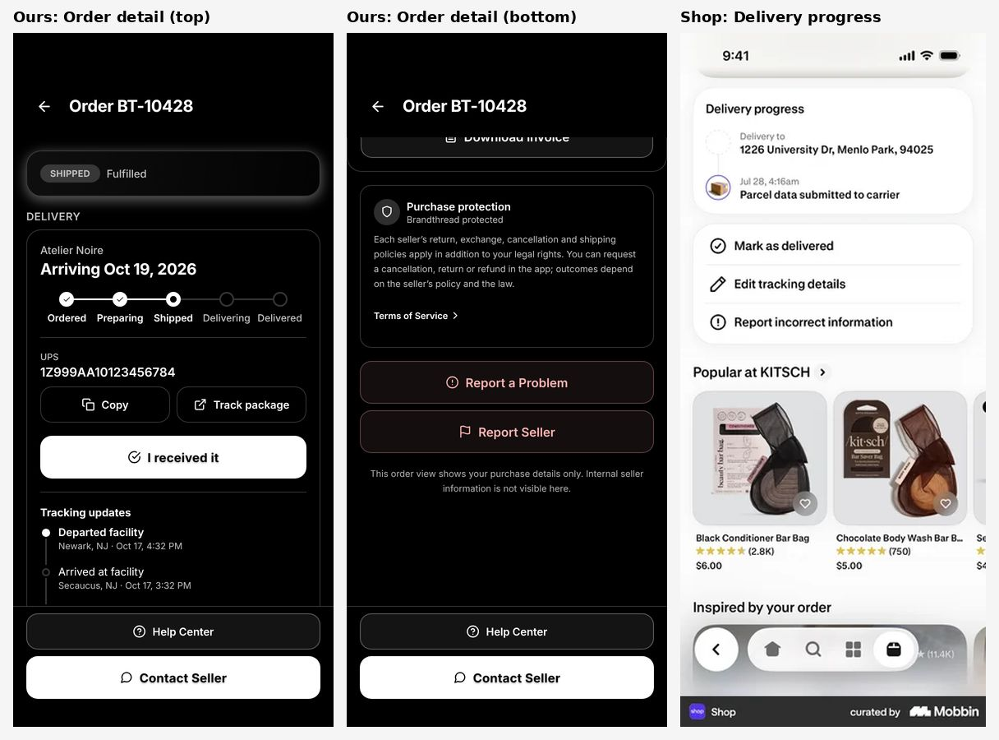

Reference: [Shop delivery progress / order actions](https://mobbin.com/screens/589ece7d-b2d6-4ce5-8cd4-3c0766abbd51)
- **Not in any reference app:** a double status ("SHIPPED" pill plus "Fulfilled", a Shopify-admin term, `buyer-order-detail.tsx:142`). Two full-width red-tinted buttons, "Report a Problem" and "Report Seller". The line "This order view shows your purchase details only. Internal seller information is not visible here." (`:1245`). Two stacked sticky footer buttons (Help Center + Contact Seller) take about 170pt. A "Purchase protection" legal paragraph box.
- **Deviations:** Shop puts actions in one grouped list ("Mark as delivered / Edit tracking details / Report incorrect information") under a "Delivery progress" card, followed by the item and the store. Ours repeats the actions as separate pill buttons.
- **Fix:** header "Order #BT-10428" with one status line ("Arriving Oct 19"). Then the Shop-style delivery-progress card (stepper plus latest scan, "Track package ›"), then the item row, then a grouped action list: *I received it*, *Contact seller*, *Return or refund*, *Get help*, with *Report seller* as the last row in plain text. Drop the sticky footer, the "Internal seller information" line and the "Fulfilled" label. Collapse purchase protection into a one-line "Brandthread purchase protection ›" row.
- **Preview gap:** the seeded orders on `/orders` have "View Order Details" disabled in preview (`app/(buyer)/orders.tsx:218` `disabled={isPreview}`). `/buyer-order-detail?id=preview-order-01` without demo=1 shows "Could not load order details", and Activity's "Your order shipped" row points there. Return request shows "Couldn't load this order". Order detail and the return/dispute flow are only reachable with `demo=1` or after a preview checkout.

### Followers / Following
`/connections?type=followers` · 

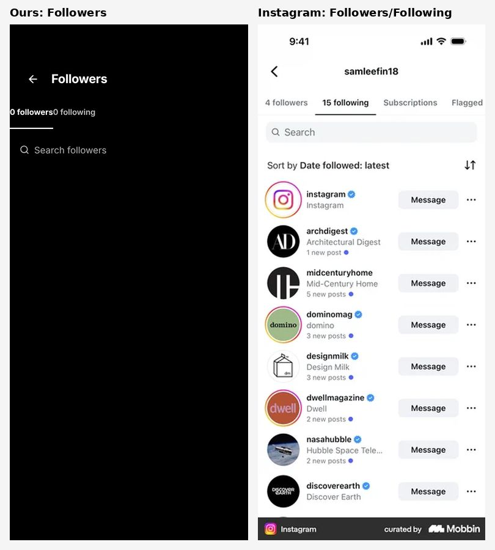

Reference: [Instagram followers/following tabs](https://mobbin.com/screens/a531bddf-d79c-4cf9-867c-f7d5a4213a65)
- **Unfinished:** the tab labels run together ("0 followers0 following") flush against the left edge with no padding or even distribution. The list area is blank with no empty state.
- **Fix:** copy Instagram: centered username nav title, evenly spaced tabs ("0 followers · 0 following") with a 1pt underline under the active one, a filled search pill, then rows of avatar, name and a "Remove" (own followers) or "Following" pill and •••. Empty state: "Followers / You'll see all the people who follow you here."

### Discover people (+person icon) and "Following brands" row
`/friends`, `/(buyer)/following` · 

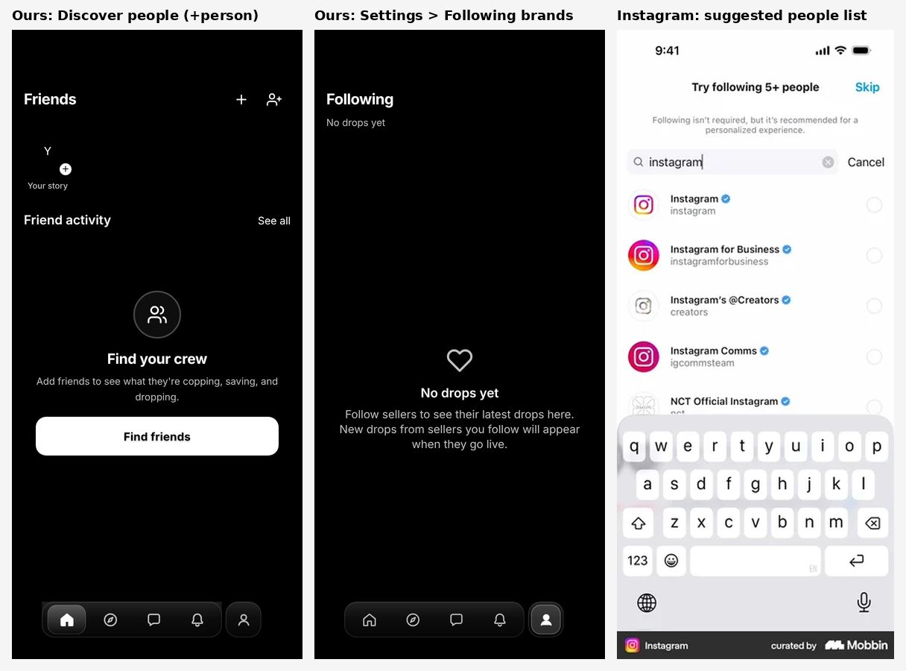

Reference: [Instagram suggested people list](https://mobbin.com/screens/feaee0a1-d3ad-46a0-8219-0a3015c52c7e)
- **Bugs:** the profile's "Discover people" button pushes the root "Friends" screen with a stories row ("Y / Your story", the wrong initial), and the tab bar highlights Home while the user is on a Profile sub-screen. The Settings row "Following brands" routes to the Following feed tab (`settingsCatalog.ts:45`, `route: '/(buyer)/following'`), which shows "No drops yet" with no back button instead of the list of brands followed.
- **Fix:** Discover people becomes Instagram's "Discover people" list: a pushed screen with a back arrow and rows of avatar, name, "Followed by …", a Follow button and ✕. "Following brands" opens `/connections?type=following` (Instagram's Following tab), or drop the row since the profile's "Following" count already gets there.

### Edit profile (avatar/crop owned by claude/seamless-avatars-crop)
`/edit-profile` · 

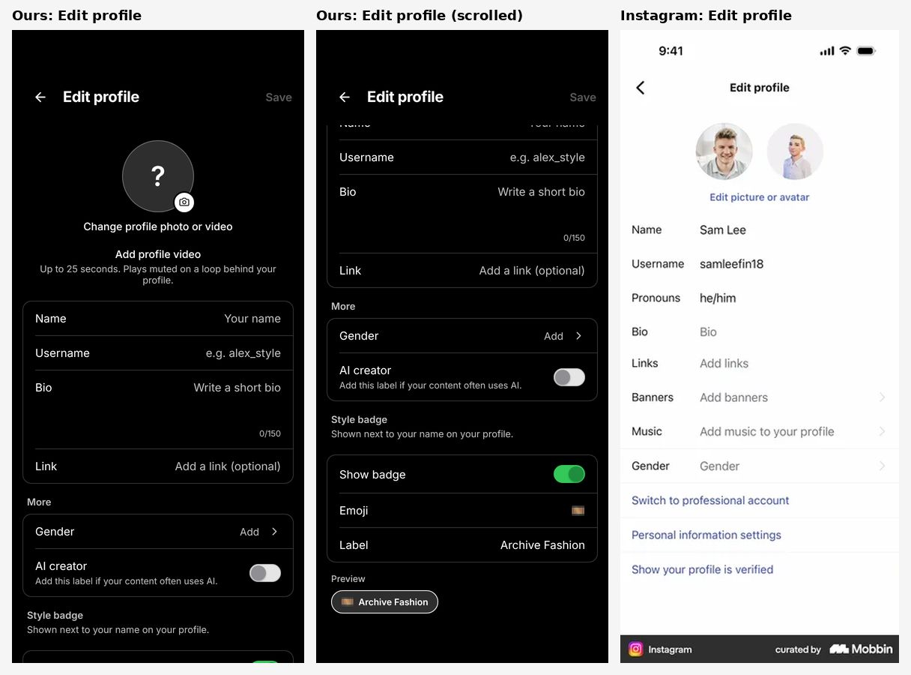

Reference: [Instagram Edit profile](https://mobbin.com/screens/7b5bf7cb-71e1-4561-ad9e-6d6b0547cd67)
- **Bug:** Name, Username, Bio and Link open empty (placeholders "Your name", "e.g. alex_style") even though the profile shows "Ava Buyer @ava". Real data isn't prefilled, so pressing Save would blank the fields.
- **Not in any reference app:** "Style badge" (Show badge toggle, Emoji, Label and a "🎞️ Archive Fashion" preview pill) and the "Add profile video: up to 25 seconds" block.
- **Deviations:** values are right-aligned inside a bordered card. Instagram puts labels in a fixed-width left column, left-aligns values right after them, and separates rows with hairline dividers and no card. Save sits top-right as grey text, where Instagram puts the back arrow left and "Done" right only on field sub-screens.
- **Fix:** prefill from the profile. Use Instagram's layout: avatar and "Edit picture" link, then rows Name / Username / Pronouns / Bio / Links / Gender, each opening its own field screen with "Done". Remove the Style badge block (or move it behind a flag if it's a planned loyalty feature).

### Sign out confirmation
Settings → Sign out · 

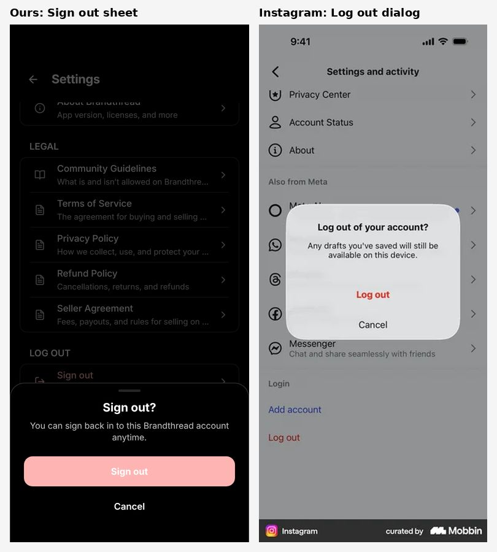

Reference: [Instagram Log out dialog](https://mobbin.com/screens/f3f4faa3-961a-4634-9a2f-5ba985ccf800)
- **Not in any reference app:** a salmon-pink filled "Sign out" button that reads as disabled. Pink is outside the black/white/silver palette.
- **Fix:** Instagram's centered alert: "Log out of your account?", one line of body text, "Log out" in red text and "Cancel" in regular text, with no filled button. Use the same word, "Log out", for the row and the button (the menu currently says "Log out" and settings says "Sign out").

### Delete account and Accounts Center
`/delete-account`, `/buyer-account-center` · 

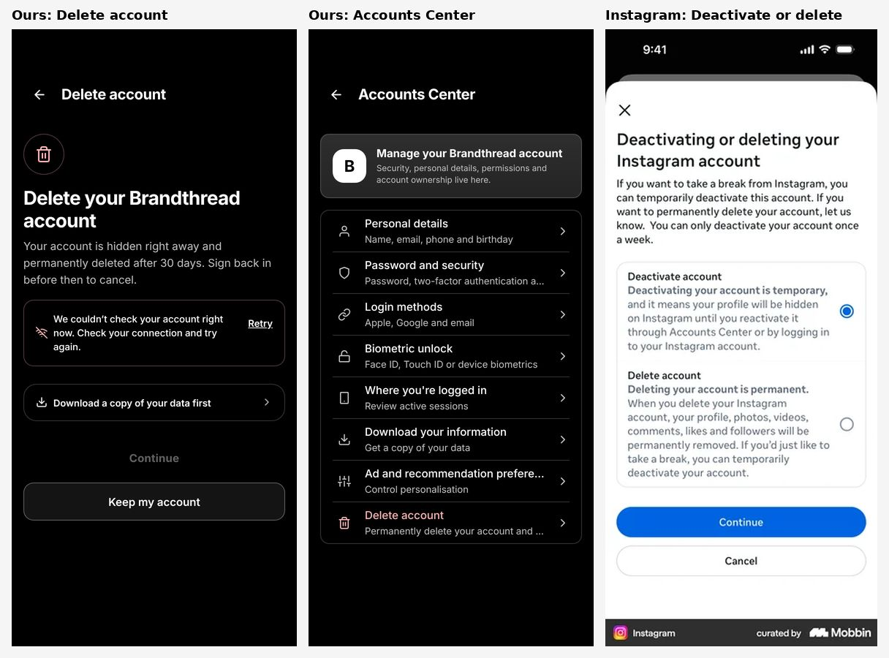

Reference: [Instagram Deactivating or deleting](https://mobbin.com/screens/fb075aad-dd4f-4f6d-9582-839b2fe23c95), [Instagram Accounts Center](https://mobbin.com/screens/853e0780-c818-444e-a006-ef752ef466e5)
- **Not in any reference app:** Delete account appears both as a root Settings row ("DANGER ZONE") and as an Accounts Center row. Accounts Center has a "Where you're logged in" row that duplicates the root "Login activity" row. Its header card uses a "B" avatar.
- **Unfinished:** Delete shows "We couldn't check your account right now… Retry" and a dead "Continue".
- **Fix:** keep it in one place, Accounts Center → Personal details → Account ownership and control → Deactivation or deletion. That screen copies Instagram: two radio cards (Deactivate / Delete), a primary "Continue" and a secondary "Cancel". Remove the root rows.

### Share profile / QR code / Invite friends
Profile "Share profile", `/buyer-qr-code`, `/buyer-invite` · 

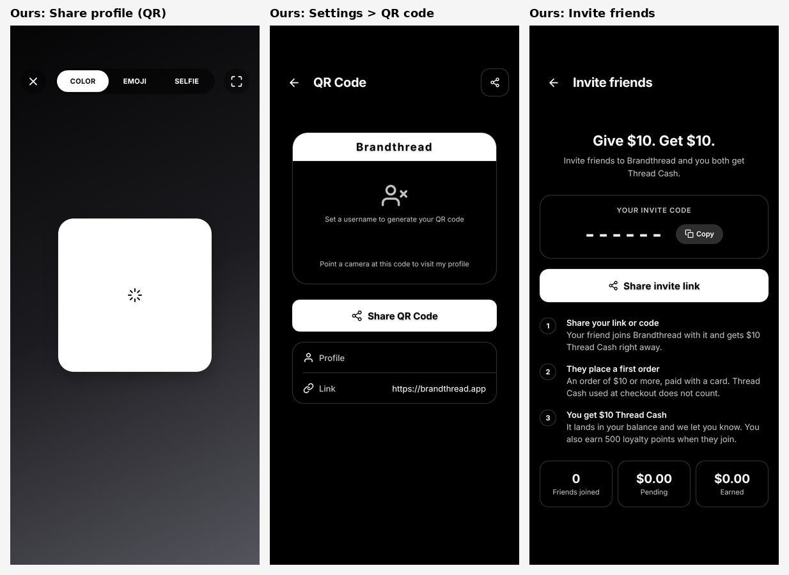

Reference: Instagram QR code (COLOR / EMOJI / SELFIE toggles: our Share profile already copies it). Mobbin didn't return that exact frame, so the closest is the [Instagram profile header](https://mobbin.com/screens/fd46bbb4-f06b-4ef9-83aa-461daa667c15).
- **Bugs:** the Share profile QR card spins forever (a white card with a spinner). Settings → QR code says "Set a username to generate your QR code" for @ava (`app/buyer-qr-code.tsx:82`: `profile?.username` isn't loaded in preview). Two different QR screens exist. Invite code renders "------".
- **Fix:** keep one QR screen (the Instagram-style Share profile), fed by the same profile source as the header. Delete `/buyer-qr-code` and point its rows at Share profile. Invite: show the real code, or hide the code box until it loads.

### Thread Cash and Appearance
`/thread-cash`, `/appearance` · 

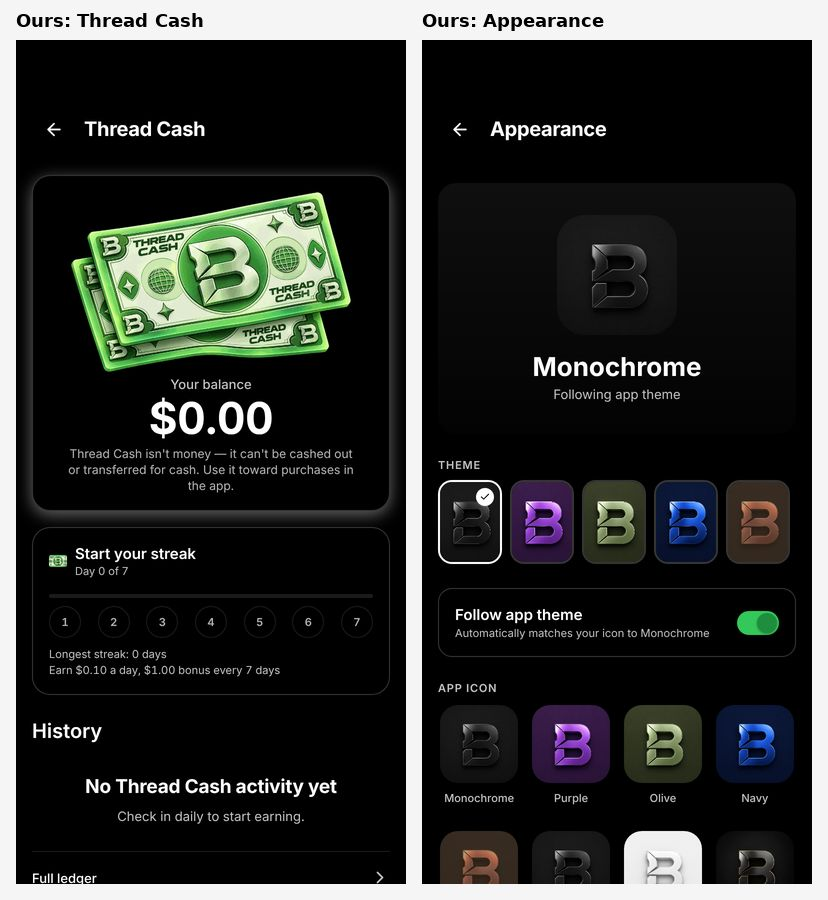

Reference: Cash App balance (a big centered balance number in plain type, with no illustration)
- **Not in any reference app:** the green 3D "THREAD CASH" bill artwork, the green streak chip, Appearance's purple, olive, navy and champagne app themes, and the coloured 3D "B" icons. The green toggles used across all of settings are iOS green, outside the black/white/silver palette.
- **Fix:** Thread Cash copies Cash App: "$0.00" large and centered, a monochrome caption, a list of activity rows, and "Full ledger ›". Drop the bill illustration. Appearance offers only Light / Dark / System, as Vinted's "Dark mode … System setting" does, and only the Monochrome/Silver icons. Make toggles white-on-black when on.

### Legal pages and About
`/terms`, `/community-guidelines`, `/refund-policy`, `/seller-agreement`, `/buyer-settings-detail?section=about` · 

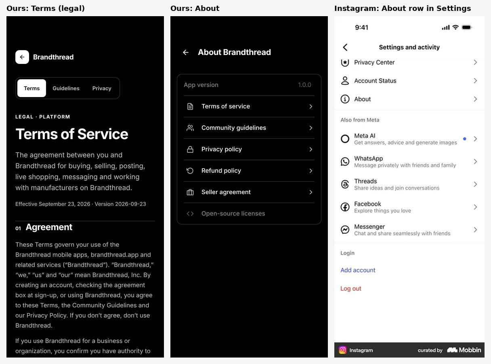

Reference: [Instagram Settings → About](https://mobbin.com/screens/feee12ed-78b5-4a5d-ac45-a33cd1550545)
- **Not in any reference app:** the in-app legal pages render the marketing website: a "Brandthread" wordmark header with a white square back button, a segmented Terms/Guidelines/Privacy/Refunds/Sellers switcher that overflows past the right edge, and a 34pt display title. "Seller Agreement" is listed in buyer settings.
- **Fix:** a native nav bar (back arrow and a centered "Terms of Service" title) and body text only. Reach the pages from About ("Terms of Use", "Privacy Policy", "Open source libraries") as Instagram's About screen does, and remove the five legal rows from the root. Show Seller Agreement only to sellers.

### Inbox, Activity (owned)

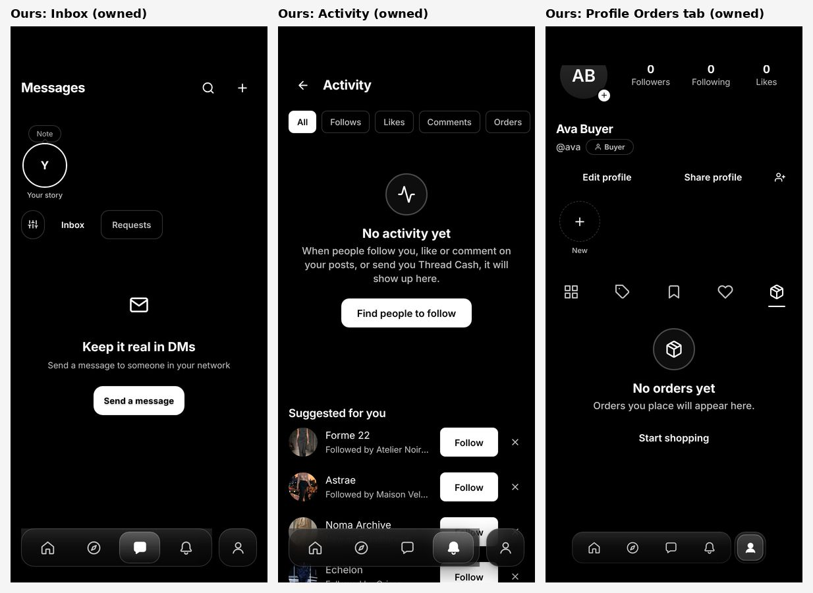

. Inbox is owned by claude/brandthread-ai-inbox (it shows a "Y" story initial). Activity is owned by claude/activity-trending-inline (a root tab with a back arrow). The profile Orders tab is owned by claude/polish-profiles. The orders list is owned by claude/polish-bag-orders (empty grey thumbnails and raw "PREVIEW-ORDER-01" IDs in preview).

### Reachable but unfinished (buyer profile area)
- Profile bell → `/buyer-notifications`: spinner forever ("Loading notifications…").
- Share profile QR card: spinner forever. Settings → QR code: "Set a username…" for a user who has one.
- `/connections` followers/following: broken tab layout and no empty state.
- `/muted-words`: spinner forever under MUTED. `/buyer-blocked` and `/buyer-friend-requests`: load errors with no preview fallback.
- `/delete-account`: an error banner and a dead Continue.
- `/buyer-settings-detail?section=accessibility`: two disabled rows (Text size, High contrast icons).
- `/buyer-saved`: blank under the tabs, with no empty state.
- Edit profile: fields not prefilled.
- Settings → "Following brands" lands on the Following feed tab with no back button.
- `/buyer-my-sizes`: "Sign in to save your sizes" while signed in.
- Order detail and return request: unreachable in preview without demo=1 (the button is disabled, and the Activity row's target fails).
- `/account-type-settings`: blank spinner for about 3s before the content appears, with no skeleton.

---

## Seller: Studio menu (left tab-bar button), its destinations, AI button, dashboard links

Walked at 390x844 on `?bt_preview=seller` (fresh) and `?bt_preview=seller&demo=1` (populated), local Expo web build of `dev` @ 409ddcdc. The Replit preview host is blocked by this environment's proxy.

**How the menu opens (as built on this base):** a **tap** on `#seller-bottom-menu` (left circle, 45,791) opens it. Swiping up or sideways on that button does nothing here. The menu is a full-screen "Your store" carousel with **one giant icon per page** and 14 cards in this order: Create post, Add product, Go Live, Analytics, Payouts, Customers, Community, Manufacturer Hub, Design Studio, Mockup to Model, Remove BG, AI Design, Campaign (Create Ad), AI Photoshoot (`components/SellerStudioRadialMenu.tsx:177-185`, items in `lib/sellerControlCenter.ts`). The tab-bar trigger, glow and look are out of scope (Dev's rule). This section audits only the menu **content**.

Owned elsewhere (link only): seller Dashboard, Products, Orders and Profile tabs are owned by `claude/polish-seller`. Tab bar look and active state are owned by `claude/tabbar-over-video`: on every screen pushed from the Studio menu the **Dashboard** tab stays highlighted (Payouts highlights **Profile**). Media quality is owned by `claude/full-quality-media`.

---

### Studio menu: "Your store" card carousel (`SellerStudioRadialMenu`)

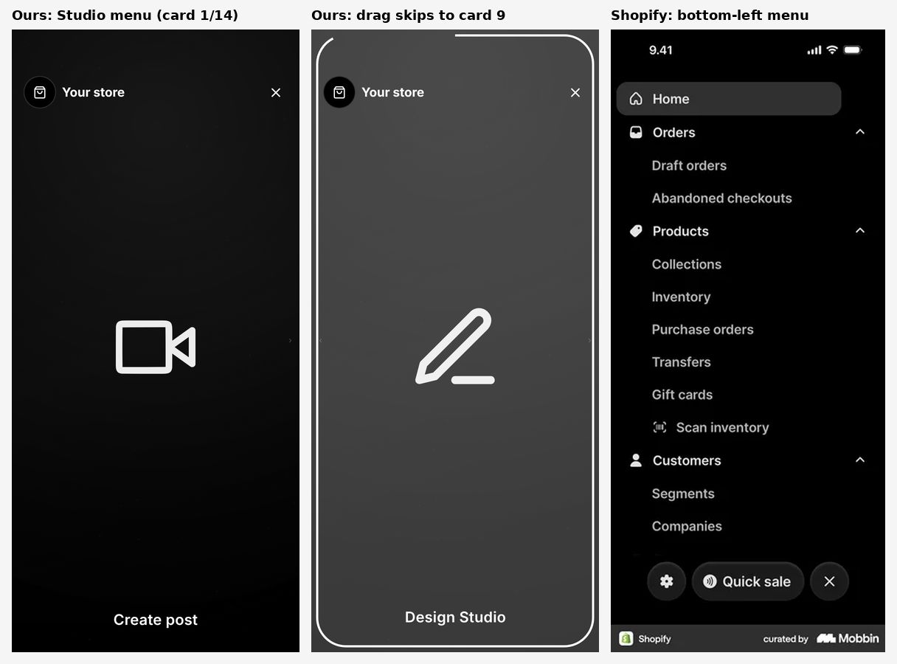

Reference: [Shopify: bottom-left menu (full-height section list)](https://mobbin.com/screens/09e2a4bc-86c1-4d83-a3a6-823a67979c80), [Instagram: Create → New post](https://mobbin.com/screens/fc7a0968-2267-43fd-922c-97dbab51e467)

**Not in any reference app**
- A full-screen pager where each destination is one 120pt line icon plus a label at the bottom, so you can only see 1 of 14 items at a time. No reference app hides its menu behind a one-item-per-page carousel.
- A white rounded "trace" outline that animates around the screen edge while dragging (second frame).
- 9pt edge chevrons (`#seller-studio-edge-chevron-left/right`) as the only sign that more cards exist.
- A header pairing a "Your store" title with a shopping-bag avatar, with no store name or handle.

**Layout / hierarchy / flow deviations**
- You can't see what's in the menu without paging through it. A mouse or finger drag skipped straight from card 1 (Create post) to card 9 (Design Studio). A short drag registered as a **tap** and opened Design Studio by accident.
- Create actions (post, product, live) are mixed in with admin destinations (Payouts, Customers) and six AI tools, with no grouping.

**Fix (in reference terms)**
- Keep the trigger exactly as it is, but render the content as **Shopify's menu**: a full-height dark list.
  - Rows are 44pt with a 20pt leading icon, 17pt label and 16pt side gutter.
  - Collapsible group headers: **Create** (Create post, Add product, Go Live), **Store** (Analytics, Payouts, Customers, Community, Manufacturer Hub) and **Design Studio** (Design Studio plus the 5 AI tools as indented sub-rows).
  - Close (×) sits bottom-right in the thumb zone, as in Shopify.
- Remove the pager, the edge chevrons and the edge-trace outline.

---

### Create post: camera (`/create-post`, `components/create-post/CreateCamera.tsx`)

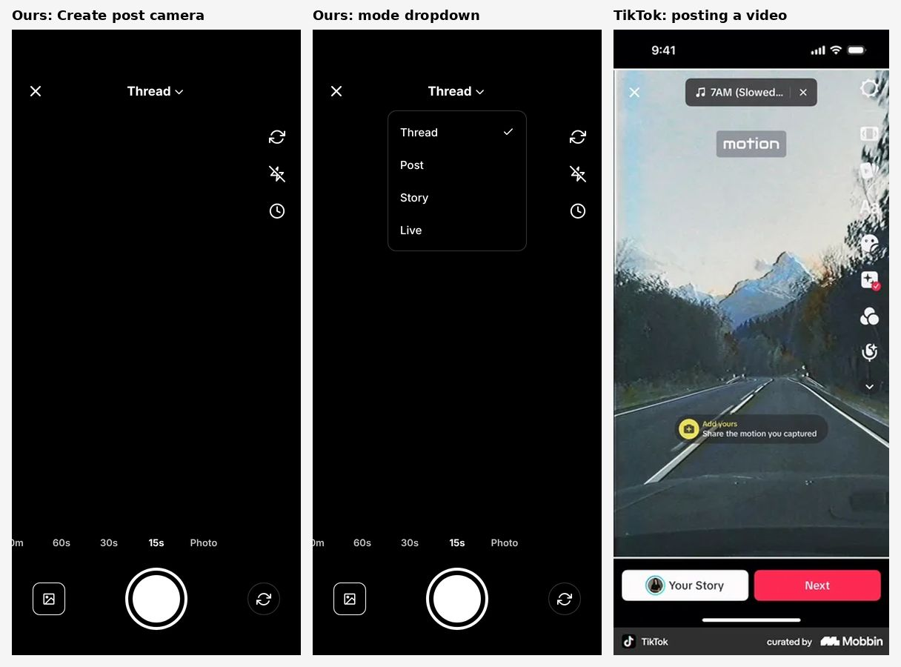

Reference: [TikTok: Posting a video (flow)](https://mobbin.com/flows/c581911b-7f7d-45b9-9bf5-f595727dac59), [Instagram: New post (POST/STORY/REEL switcher)](https://mobbin.com/screens/fc7a0968-2267-43fd-922c-97dbab51e467)

**Not in any reference app**
- A top-center **"Thread ▾" dropdown** that switches between Thread, Post, Story and Live. IG and TikTok switch modes with a bottom text carousel (POST · STORY · REEL · LIVE) beside the shutter.
- **Two flip-camera buttons**: one at the top of the right rail (358,145) and another at bottom-right (340,768, `CreateCamera.tsx:620`).

**Layout / hierarchy / flow deviations**
- The duration row (10m / 60s / 30s / 15s / Photo) is clipped: "10m" is cut off at the left edge (`#create-camera-chips`, `CreateCamera.tsx:532`).
- There is no "Add sound" pill at top center, unlike TikTok.
- The bottom-right slot should be TikTok's **Upload** (gallery) square, and the left slot Effects. Ours puts gallery on the left and a second flip on the right.

**Fix (in reference terms)**
- Replace the "Thread ▾" dropdown with TikTok's bottom mode switcher under the shutter: centered, snap-scrolling text tabs with the active one in white.
- Put durations in the same switcher, as TikTok does (10m · 60s · 15s · Photo · Text), and center-snap the active item so nothing clips.
- Remove the bottom-right flip and keep the right-rail flip. Move the gallery square to bottom-right as TikTok's "Upload".
- Add a top-center "Add sound" pill.

---

### Create post: camera roll / picker (`/create-post` → "Open camera roll")

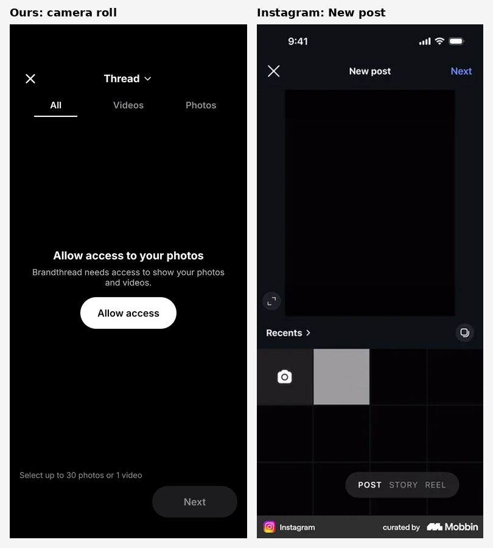

Reference: [Instagram: New post (preview + Recents grid)](https://mobbin.com/screens/fc7a0968-2267-43fd-922c-97dbab51e467)

**Deviations:** All / Videos / Photos is a full-width tab row. IG and TikTok use a "Recents ▾" album dropdown above a 4-column grid, with **Next** top-right in the header. Ours puts Next as a large pill at bottom-right, plus a helper line ("Select up to 30 photos or 1 video").
**Fix:** Header row: × left, mode title center, **Next** text button top-right. Below it, a square preview, then a "Recents ▾" row with a multi-select toggle on the right, then a 4-column 1pt-gap grid. Drop the bottom helper line and the bottom Next pill. The permission empty state matches iOS and is fine.
*Unreached on web:* caption, product tagging and post steps need real media, and web has no file picker in the preview. Their native reference is [Instagram: New reel details](https://mobbin.com/screens/fbdea489-9a1d-4564-831a-2e5ddbf8c1cd): cover, caption, rows (Tag people / Tag products / Audience) and a sticky **Save draft | Share** footer.

---

### Add product (`/add-product`)

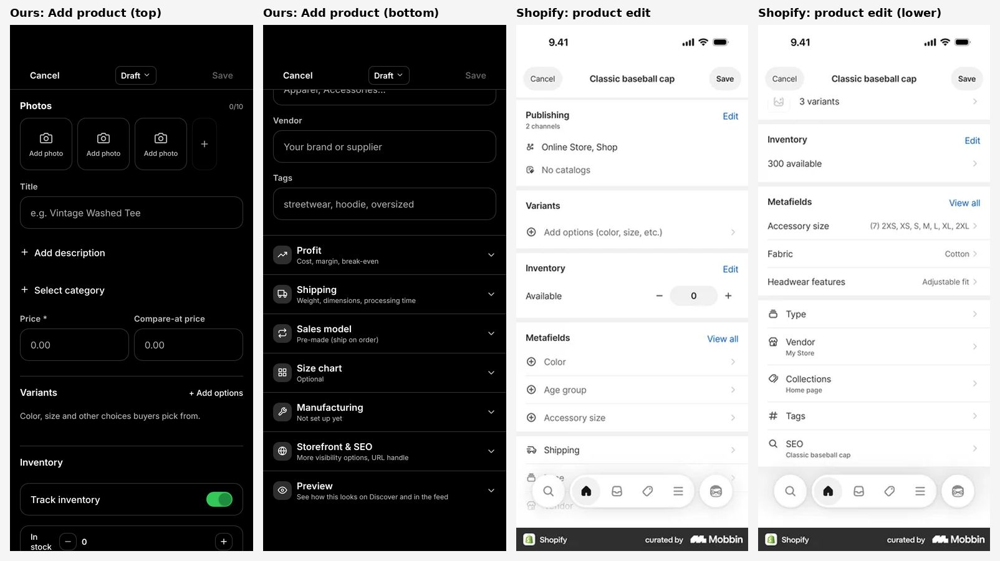

Reference: [Shopify: product edit (top)](https://mobbin.com/screens/f8f0f9a9-62e3-4729-9eb8-ae750918e069), [Shopify: product edit (lower)](https://mobbin.com/screens/f736b711-925d-41d8-8750-a7ca6298ca42)

**Not in any reference app**
- A **green** switch tint on "Track inventory" and "Allow overselling" (system green). Dev's palette is black, white and silver, and Shopify's dark toggles are neutral.
- A narrow 40pt "+" slot after three photo tiles (`#add-product-add-slot`).
- Accordions for **"Sales model: Pre-made (ship on order)"** and **"Manufacturing: Not set up yet"**, and a **"Preview" accordion** as the last item. Shopify's product form has none of these.
- A "Draft ▾" status pill in the header center. Shopify keeps the product title in the header center and puts status in its own "Status / Publishing" card.

**Layout / hierarchy / flow deviations**
- The "In stock" label wraps onto two lines inside the stepper card.
- Product type, Vendor and Tags are always-open text inputs. Shopify uses **tappable rows with chevrons** that push a picker.
- Price inputs show "0.00" with no currency prefix.
- There is no bottom primary action. "Save" sits only in the header and is greyed out until a title exists, and no hint says why.

**Fix (in reference terms)**
- Copy Shopify's layout 1:1:
  - Grouped full-width section cards separated by 8pt gaps, each with a 17pt semibold section title.
  - Media is a horizontal row of equal 84pt tiles with the last one a "+". Drop the narrow slot.
  - Title, then Description, then a **Status** card (Active / Draft).
  - Price with a "$" prefix and Compare-at side by side.
  - Variants → "⊕ Add options (color, size, etc.) ›" row.
  - Inventory: "Available  − 0 +" stepper on one line.
  - Then rows with chevrons for Shipping, Type, Vendor, Collections, Tags and SEO.
- Remove the Sales model, Manufacturing and Preview accordions from this form, or move them into "More options ›".
- Make switches white/silver on black.
- Header: Cancel (left pill), product title (center), Save (right pill), as in Shopify.

---

### Add product: Select category and + Add options pickers

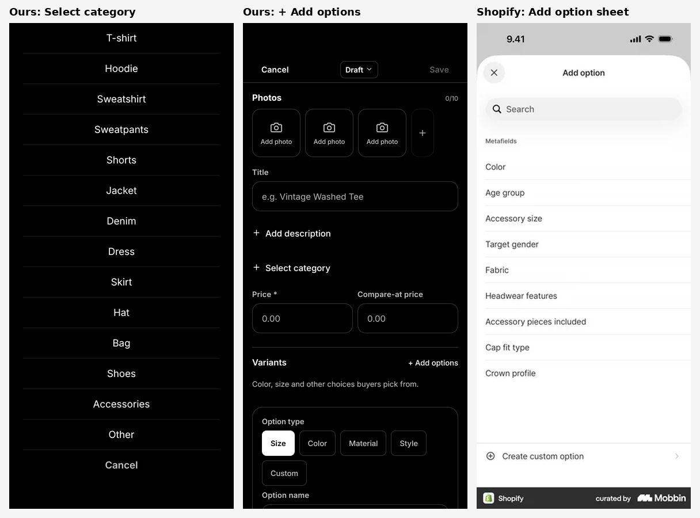

Reference: [Shopify: Add option sheet (search + list)](https://mobbin.com/screens/f647a325-0678-4dda-a11e-3da65ba2fc7a)

**Not in any reference app:** The category picker is a full-height list of centered action-sheet buttons with no title, no search, and no top inset (the first item, "T-shirt", touches the status bar).
**Deviations:**
- "+ Add options" expands an inline card with Size / Color / Material / Style / Custom chips inside the form. Shopify instead pushes an "Add option" sheet.
- Status uses a centered iOS-style action sheet with an "Active — visible and purchasable" sentence. That's acceptable, but it should be a card (see above).

**Fix:**
- Both pickers become Shopify's **sheet**: × top-left, centered title ("Category" / "Add option"), search field, then a left-aligned 44pt list with separators and a "⊕ Create custom option ›" footer row.
- Category should be hierarchical (Women › Tops › T-shirts), as in Depop and Vinted.

---

### Go Live (`/seller-go-live`)

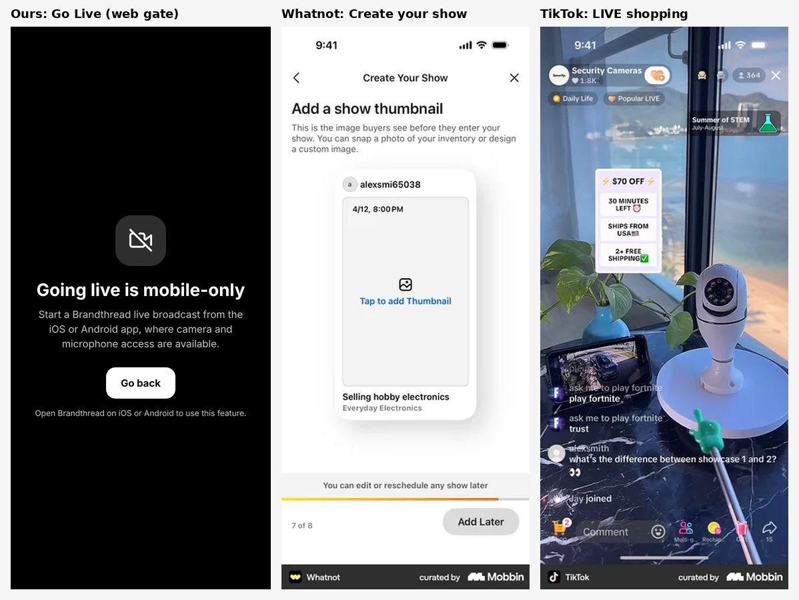

Reference: [Whatnot: Create your show (setup step)](https://mobbin.com/screens/f53b6fb0-df32-49e5-a594-bdbb64e54fea), [TikTok: LIVE shopping room](https://mobbin.com/screens/fc619fa4-5f16-4ad1-965f-c559374b6849)

**Web:** shows "Going live is mobile-only" with a "Go back" pill. That's acceptable for web. Native layout audited from code (`app/seller-go-live.tsx:225-330`):
- **Not in any reference app:** the flash icon turns **amber `#FBBF24`** when on (`seller-go-live.tsx:240`), which is off-palette. The "Go Live" button has a pulsing white dot.
- **Deviations:** Title and description inputs float over a gradient, followed by two stacked bordered rows ("Feature products ›", "Schedule for later ›"), then a full-width red button. Whatnot and TikTok put a cover thumbnail and title on one card at the top, with settings rows (Products, Category, Schedule) in a bottom sheet.
- **Fix:** Use TikTok's LIVE setup layout: top-left cover tile, title field beside it, and a row of icon buttons (Flip · Products · Schedule) above a full-width **Go LIVE** button. Make flash white-on and white-off with a slash. Keep the LIVE red only on the Go LIVE button.

---

### Analytics (`/analytics`, card "Analytics")

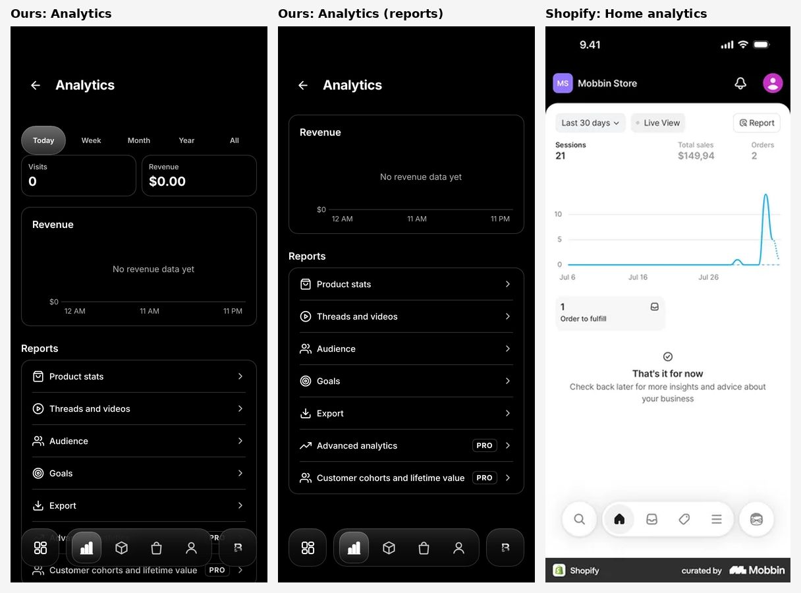

Reference: [Shopify: Home analytics (Last 30 days + metric switch + one chart)](https://mobbin.com/screens/2063df51-e95a-4a2d-a384-792cc2053144)

**Not in any reference app:** "PRO" badges on two report rows ("Advanced analytics PRO", "Customer cohorts … PRO").
**Deviations:**
- Revenue appears twice: a "Revenue $0.00" KPI tile, then a "Revenue" chart card right under it.
- The range control is the dashboard's 5-segment pill (Today / Week / Month / Year / All), duplicated here.
- The chart axis reads "12 AM · 11 AM · 11 PM". The midpoint should be 12 PM.
- The last report row sits under the floating tab bar without bottom inset (first frame).

**Fix:**
- Use Shopify's layout: a "Today ▾" date-range chip top-left, then a 3-metric header (Sessions · Total sales · Orders) where tapping one switches a **single** line chart.
- Then a "Reports" grouped list with chevrons. Show plan gating inside the destination with a lock, not as a badge on the row.
- Add bottom content inset equal to the tab-bar height.

---

### Store Analytics (dashboard "See all" under Traffic sources → `/analytics-store`)

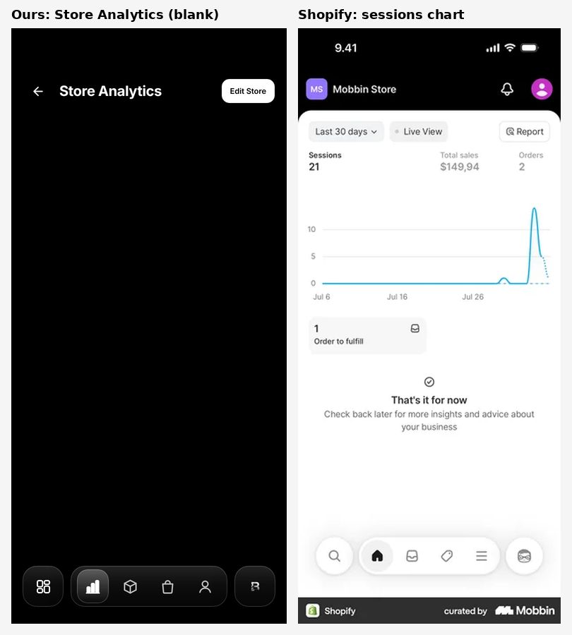

Reference: [Shopify: sessions chart](https://mobbin.com/screens/2063df51-e95a-4a2d-a384-792cc2053144)

**Unfinished:** The page body is **completely blank** in both fresh and demo=1 previews. Only the header renders. `app/analytics-store.tsx:81-95` keeps `loading` true while auth isn't loaded and renders a skeleton that's invisible on black. Preview users never get data or an empty state.
**Not in any reference app:** a white **"Edit Store"** pill in an analytics header.
**Fix:** Render Shopify's sessions breakdown: a "Today ▾" chip, a Sessions number with a line chart, then "Sessions by source" rows (Direct / Social / Search with counts). Show the existing EmptyState ("No store visits yet") when there's no user or data. Remove "Edit Store" from this header, since Store builder lives in Settings.

---

### Share store (dashboard "Share store" → `/share-store`)

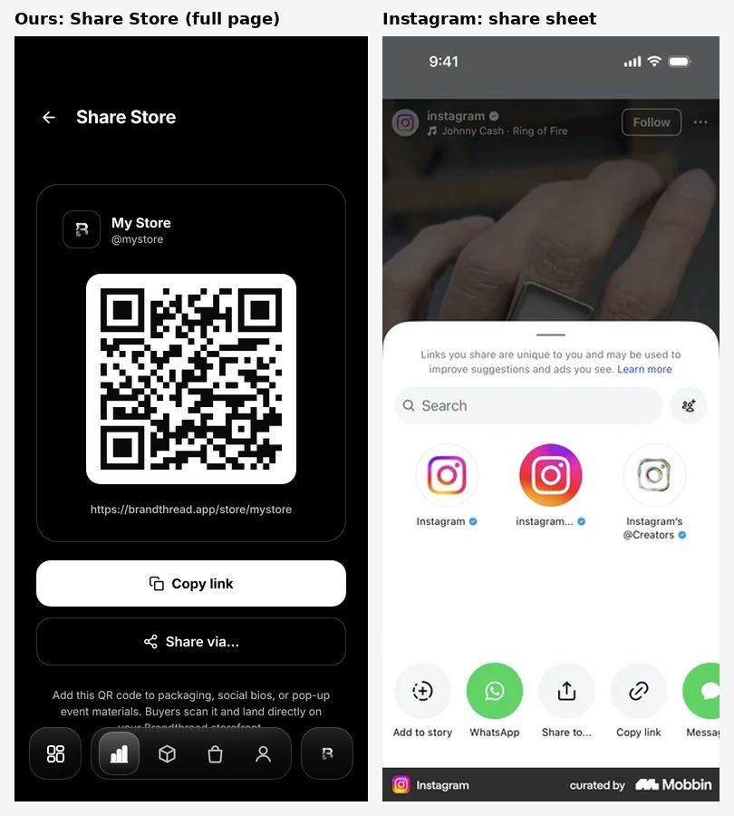

Reference: [Instagram: share sheet (Copy link / Share to… / WhatsApp)](https://mobbin.com/screens/eecbdb17-6854-4041-9821-7cc9e9fb13c2)

**Deviations:**
- A dashboard "Share" action pushes a **full page**. IG, TikTok and Depop open a **bottom share sheet** in place.
- The footer copy ("Add this QR code to packaging…") runs under the floating tab bar.
- In fresh preview the card shows placeholder "My Store / @mystore", fine for preview.

**Fix:** Open IG's share sheet: drag handle, search, recent DM recipients row, then an action row (Copy link · Share to… · QR code · WhatsApp · Messages). The QR becomes one action that pushes the current QR page. Drop the explanatory paragraph.

---

### Payouts (`/payouts`, card "Payouts")

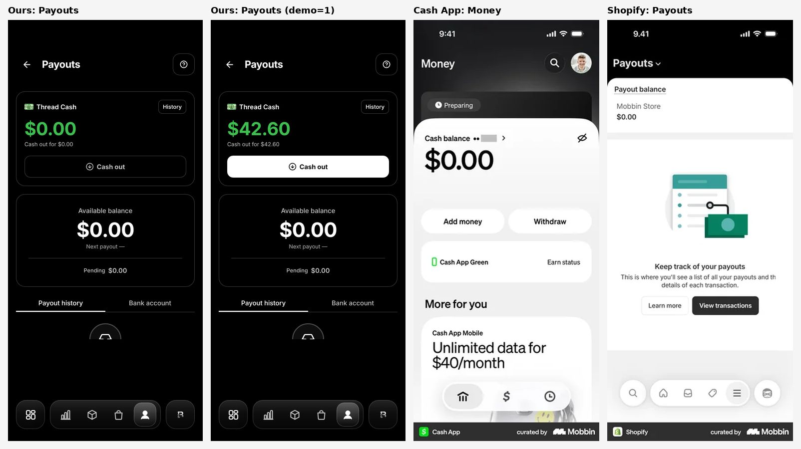

Reference: [Cash App: Money (one balance + 2 buttons)](https://mobbin.com/screens/fad7dfb6-293e-44ed-805c-0078f8dd4afd), [Shopify: Payouts](https://mobbin.com/screens/c64a7249-ff6e-42a5-b8ce-3f7a98304421)

**Not in any reference app**
- **Two balance cards stacked**: a "Thread Cash $0.00" card in **green** with a cash-bill emoji icon and its own History and Cash out buttons, then an "Available balance $0.00" card. In demo=1 they contradict each other ($42.60 vs $0.00).
- A boxed "?" help button in the header. Other headers use bare icons.

**Layout / hierarchy / flow deviations**
- **Bug:** the Payout history / Bank account tabs live in a ScrollView squeezed under both fixed cards. On 844pt only ~100pt remains, so the empty-state icon is **cut in half** and its text is invisible (`app/payouts.tsx:315-321`, with `flexGrow:1, justifyContent:'center'` in a tiny viewport). This happens in fresh and demo.

**Fix (Cash App / Shopify)**
- Make the whole page one ScrollView.
- One balance hero: "Balance" label, $ amount in 48pt white, "Next payout · date" subline.
- Two equal pills under it: **Cash out** and **History**. Thread Cash becomes a line inside the balance breakdown ("Includes $42.60 Thread Cash").
- Then "Payouts" list rows (date · amount · status ›) and a "Bank account ›" row.
- No green, no emoji.

---

### Payouts → Bank account tab

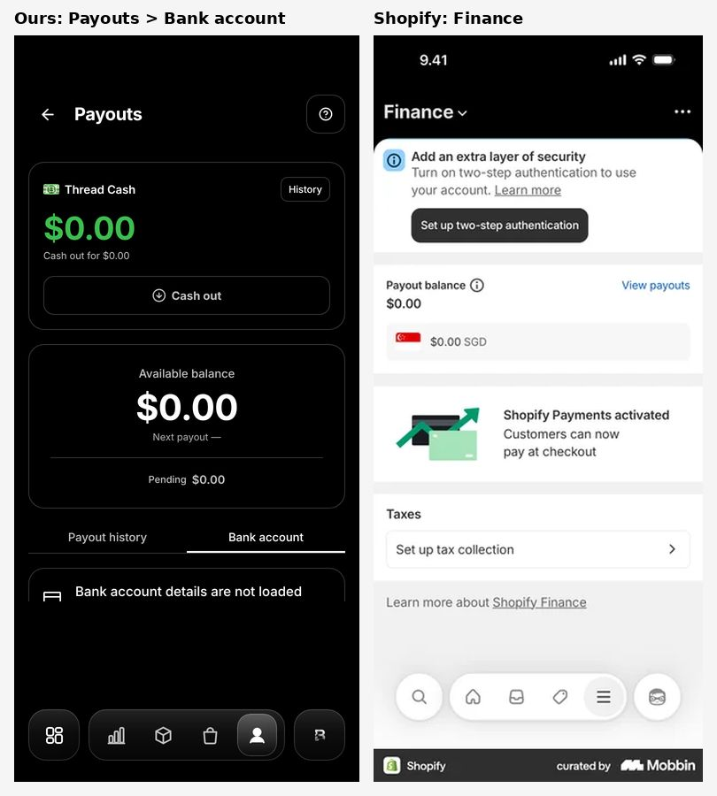

Reference: [Shopify: Finance (Payout balance + Set up rows)](https://mobbin.com/screens/4d049521-0dbf-4de6-b1bb-ee508426a6e7)

**Unfinished:** "Bank account details are not loaded / Account information unavailable / Bank setup unavailable / Method: Not loaded / Schedule: Not loaded". That's four "unavailable" messages stacked.
**Fix:** Show one Shopify-style card: "Payout account" with a "Set up payouts ›" row. It deep-links to the Stripe Connect onboarding behind the payments flag, so Dev only pastes keys. Schedule appears as a row only once connected.

---

### Customers card → `/customer-accounts` (wrong destination)

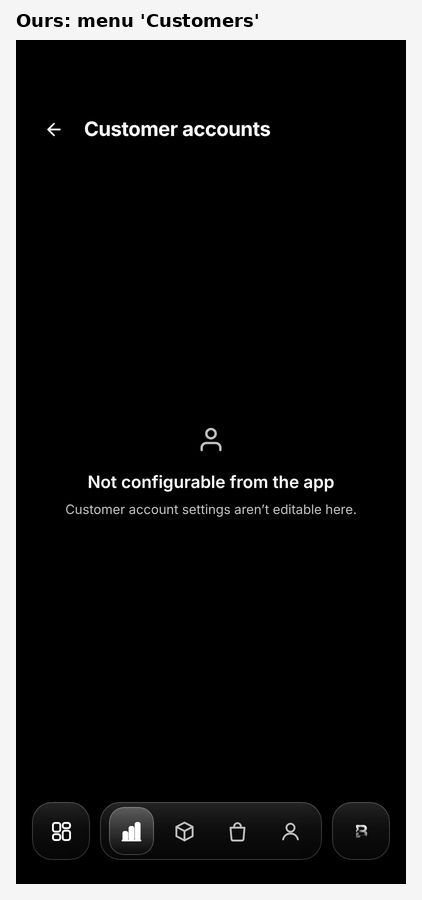

**Bug:** The menu card says "Customers: Browse your customer list" but routes to `/customer-accounts`, a settings stub reading **"Not configurable from the app"** (`lib/sellerControlCenter.ts:169`). The real list is `app/customers.tsx`.
**Fix:** Point the item at `/customers`. Reference for that list: [Shopify: menu → Customers](https://mobbin.com/screens/09e2a4bc-86c1-4d83-a3a6-823a67979c80) (search + rows of name · orders · spent).

---

### Community (`/community`, card "Community")

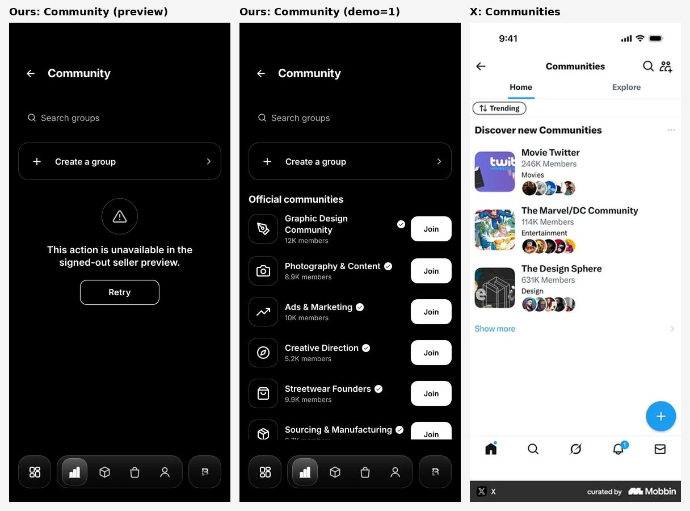

Reference: [X: Communities (Home / Explore)](https://mobbin.com/screens/ec66dace-27f8-4c39-942c-5a5d116de956)

**Unfinished (fresh preview):** the body is a warning-triangle error, "This action is unavailable in the signed-out seller preview.", with a Retry button that can't succeed.
**Deviations (demo=1):**
- Each row has a 44pt outlined line-icon tile instead of a community cover image.
- The verified checkmark drifts away from the name when the name wraps ("Graphic Design Community").
- A full-width "＋ Create a group ›" card sits above the list. X uses a floating "+" or a header icon.

**Fix:**
- Use X's layout: Home | Explore tabs, then "Discover new Communities".
- Rows: 64pt rounded cover image, name (bold), "12K Members", category, and a member-avatar stack.
- Join appears inside the community page header, not as a white button on every row.
- Move Create into a header "people+" icon.
- Fresh preview: show the real empty list, not an error.

---

### Design Studio, Mockup to Model, Remove BG, AI Design, Create Ad, AI Photoshoot (cards 9-14)

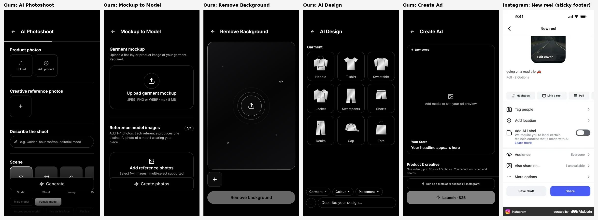

Reference: [Instagram: New reel details (form + sticky Save draft / Share footer)](https://mobbin.com/screens/fbdea489-9a1d-4564-831a-2e5ddbf8c1cd), [Instagram: More options (settings rows)](https://mobbin.com/screens/195e4b8e-d6a4-42f3-8754-b98bd52e869a)

**Not in any reference app**
- **Remove Background:** twinkling star sparkles and triple concentric rings around the upload icon.
- **AI Design:** chrome 3D garment illustrations as picker tiles, plus a chat composer with "Garment ▾ / Colour ▾ / Placement ▾" chips (two ways to set the same thing).
- **Create Ad:** a Meta "f" glyph button ("Run as a Meta ad (Facebook & Instagram)") above "Launch · $25".

**Deviations**
- **Floating CTAs overlap content with no footer background**:
  - AI Photoshoot "Generate" covers the Scene tiles.
  - Mockup to Model "Create photos" covers the "Add reference photos" card.
  - Create Ad's two buttons cover "Product & creative".
- Every tool uses a different upload affordance (square tiles, big dashed card, ringed circle, small "+").

**Fix:**
- All six use one IG-style form: section titles at 17pt semibold, one standard 84pt upload tile row, and setting rows with chevrons (Scene ›, Model ›, Aspect ratio ›, Shots ›).
- One **sticky footer** with a solid black background and hairline top border holding the primary action. Content gets a bottom inset of footer height plus safe area.
- Remove the sparkles, rings and 3D illustrations: use plain monochrome line icons or text chips.
- Create Ad should follow IG "Boost post": Goal ›, Audience ›, Budget & duration ›, then Review → "Boost post", with payment behind the payments flag.

---

### Manufacturer Hub (card 8) and Design Studio home (card 9)

Reference: no reference app has a manufacturer marketplace. The closest structure is [X: Communities (tabs + discover list)](https://mobbin.com/screens/ec66dace-27f8-4c39-942c-5a5d116de956).
**Manufacturer Hub deviations:**
- Five tabs (Discover / My Mfgs / Quotes / Samples / Orders) overflow and get cut off ("Samples" clipped, Orders hidden).
- Two tiny 36pt icon buttons (search, filter) sit on their own row above All / Favorites chips.
- A **white** promo card ("Request for Quotation") follows, then two outlined pills (My RFQs, Compare Suppliers), then category chips. That's five stacked control rows before content.
- The header has a boxed "+" button.

**Fix:**
- A search field in the header area (X Explore style) with the filter icon inside the field on the right.
- Max 3 tabs (Discover · My manufacturers · Quotes); Samples and Orders move under My manufacturers.
- The RFQ promo becomes a single row in the list or the header "+" action.
- One chip row, then results.

**Design Studio home (`/design`) deviations:** "Select / Import / Photo" are bare text links under the large title. The empty state is fine. **Fix:** Use iOS Photos/Files-style header actions: "Select" top-right text button, "+" top-right. Import and Photo move into the "+" menu.

---

### Brandthread AI (`#seller-bottom-ai` → `/ai-brain`)

Reference: [Shopify: Sidekick chat](https://mobbin.com/screens/120567fb-6ff2-48d7-b809-ae02594c2000)

**Not in any reference app:**
- The header title is the **context label** ("Seller Home"), not the assistant or conversation name.
- A circular-arrow icon means "Clear conversation" but reads as refresh/undo.
- AI Settings uses **green** switches throughout (screenshot `ai-settings.png`).

**Deviations:**
- × is top-right. Shopify Sidekick puts × top-left, the conversation title center (with a ▾ history menu), and a compose / new-chat icon top-right.
- Suggested prompts are bordered full-width boxes. Fine, but they should sit just above the composer, as Sidekick does, not mid-screen.

**Fix:**
- Header: × left, "Brandthread AI ▾" center (opens history), new-chat (pencil-square) right. Move AI settings into the ▾ menu.
- Composer gets "+" and mic as in Sidekick.
- Make switches white/silver.

---

### Reachable but unfinished (this area)
- `/analytics-store` (dashboard → Traffic sources "See all"): blank body (above).
- `/payouts` → Bank account: four stacked "unavailable / not loaded" messages.
- `/payouts` → Payout history: empty-state icon cut in half by the squeezed ScrollView.
- `/customer-accounts` reached from the "Customers" card: "Not configurable from the app" stub (wrong route).
- `/community` in fresh preview: "unavailable in the signed-out seller preview" error with a dead Retry.
- Create post beyond the picker, Go Live and Live room aren't reachable on web (camera-gated). Native needs its own device pass.

---

## Seller: detail screens and the Settings tree

Walked at 390x844 with `?bt_preview=seller&demo=1` (the populated demo store) and plain `?bt_preview=seller` (fresh store). The Studio tools menu (left tab-bar button) is covered in its own section.

**Owned elsewhere (link only):**
- Seller Dashboard, Products, Orders and Profile top-level tabs are owned by `claude/polish-seller`. Two things they should know:
  - In demo mode the Dashboard says "15 orders to ship" but the Orders tab and Customers both show "No orders yet". They read different datasets: `app/(tabs)/orders.tsx:741` calls `allPreviewSellerOrders()`, which comes back empty while the dashboard sums generated orders.
  - The profile ••• sheet holds a single item, "Share profile", which repeats the share icon right next to it. Instagram's profile header has `+` and `≡` only.
- Seller inbox and Messages: owned by `claude/brandthread-ai-inbox`.
- Avatar and logo upload in Edit profile: owned by `claude/seamless-avatars-crop`.
- Tab bar: owned by `claude/tabbar-over-video`. On Settings sub-pages the active pill jumps between Dashboard and Profile. Login activity, AI settings, Store settings and Domains highlight **Dashboard**; Security, Subscription and Roles highlight **Profile**. Every Settings child should keep Profile active (route map in `components/SellerGlobalTabBar.tsx:116`).

**Preview tooling bug (not a design item):** `isPreviewDemoMode()` only reads `window.location.search` (`lib/devPreview.ts:167-176`). Every in-app navigation drops `&demo=1`, so the first tab tap switches a "demo" session back to the fresh store. Products, Orders and Edit product all turn empty mid-walk. Persist the flag the way `bt_preview` is persisted (`lib/devPreview.ts:146`), otherwise design review of demo data is unreliable.

---

### Product detail (`/product-detail?id=…`)

Reference: [Shopify: Product](https://mobbin.com/screens/f8f0f9a9-62e3-4729-9eb8-ae750918e069), [Shopify: Product, scrolled](https://mobbin.com/screens/f736b711-925d-41d8-8750-a7ca6298ca42)

**Not in any reference app**
- Two edit affordances: an `Edit` pill in the header **and** a floating white pencil FAB on every tab.
- Five horizontal tabs (Overview / Variants / Inventory / Orders / Production), with the 5th cut off at the screen edge.
- A coloured `ACTIVE` chip (green) next to a grey `IN STOCK` chip, plus a second green `ACTIVE` in the Details list.
- The placeholder line "Margin: — (add cost to calculate)" sits inside the hero card.
- Variants tab: every variant gets its own outlined `Edit` button and a **pink-filled** `Delete` button. Inventory uses green `+` and red `−` steppers and an amber lock icon.
- Raw SKUs such as `PREVIEW_PRODUCT_1_0` are shown in the UI.
- The ••• menu calls `Alert.alert('Product Options', …)` (`app/product-detail.tsx:209`). On iOS that renders a centred alert with five stacked buttons. On web it does nothing (RN-web `Alert` is a no-op), so in the preview the button is dead.

**Layout / spacing / hierarchy deviations**
- The stat cards row (Revenue, Sold, Stock) overflows: the 3rd card is clipped at x=390. The 4-card Inventory summary on the Inventory tab overflows the same way.
- The back, Edit and ••• buttons are 44pt boxed squares with borders. Shopify uses borderless circular glyph buttons.
- The Orders tab is blank, with no empty state.
- Demo data mismatch: "Classic Crew Tee" shows a runway coat photo.

**Fix (in reference terms)**
- Copy Shopify's product screen. It is one scrolling page of grouped sections, in this order: Media, Title, Price, Publishing/Status, Variants (one row per variant with a chevron), Inventory (`Available − n +`), Organization rows (Type, Vendor, Collections, Tags, SEO), each section with a blue-text `Edit` that becomes white-text in our palette.
- Drop the tab strip and the FAB. Keep exactly one `Edit` entry point in the header, plus `•••`.
- Make ••• a bottom action sheet: Duplicate, Share, Archive, and Delete in red as the last item. Use `ActionSheetIOS` or the app's BottomSheet, not `Alert.alert`.
- Show status as a single neutral chip (silver outline) such as "Active". No green.
- Delete a variant from inside the variant row's detail page, as Shopify does, not with a filled pink button on the list.
- Stats: a 2-up row or a plain row list (Revenue / Sold / Stock as label–value rows) so nothing clips.

---

### Edit product (`/add-product?editId=…`)
Reference: [Shopify: Product edit](https://mobbin.com/screens/f8f0f9a9-62e3-4729-9eb8-ae750918e069)

The form layout itself is the Add product form (Studio menu section). Issues specific to editing:
- Tapping `Edit` on a demo product opens an **empty** form: Title placeholder, Price 0.00, status Draft. This is the dropped demo flag above, since `getProduct` returns null in fresh mode (`app/add-product.tsx:387`). Re-check with real data. If a real product can ever fail to load, show "Couldn't load product" instead of a blank form that would save over it.
- The In-stock stepper label wraps onto two lines ("In / stock"). The Track-inventory switch is iOS green.
- **Fix:** match Shopify's edit screen, which has `Cancel` and `Save` text buttons in the header and a title that is the product name. Prefill every field. Use the monochrome (white-thumb, silver-track) switch.

---

### Products ••• sheet (Products tab header)

Reference: [Depop: Shop + Bulk actions](https://mobbin.com/screens/fdcf2020-9db2-4a8a-8765-313614d015ea), [Depop: select listings](https://mobbin.com/screens/f7d13417-f13f-4972-acca-3e69fdae6825)

**Not in any reference app:** the sheet has a centred "Products / Choose an action" title and 7 actions: Select, Import CSV, Import from Shopify, Export, Scheduled launches, Waitlist demand, Size charts. Three of those are destinations, not actions (Scheduled launches, Waitlist demand, Size charts).

**Fix:**
- Follow Depop: a persistent `Bulk actions` pill at the bottom of the listings grid leads to the select mode with "n selected" and a bottom `Mark sold` / `Delete` bar.
- Keep ••• to Import / Export only.
- Move Scheduled launches, Waitlist and Size charts into rows in Settings → Products (Shopify keeps these under Products → More).

---

### Order detail (`/order-detail?id=…`)

Reference: [Shopify: Orders (status chips)](https://mobbin.com/screens/ff016813-d7d7-4e02-b27d-4170390b6225), [Shopify: Mark as fulfilled](https://mobbin.com/screens/0e400f39-42a6-4e3d-90b3-700bdda50927), [Shopify: Customer card](https://mobbin.com/screens/eef0daad-490b-4e23-862c-2f97c11f1b6a)

**Not in any reference app**
- **Seven** tabs: Overview, Customer, Payment, Fulfillment, Timeline, Returns, Disputes. The first one is a filled boxed pill, the rest are plain text.
- A refresh button in the header (no reference has one; they use pull-to-refresh).
- A stack of five full-width buttons: Message Buyer (disabled), Refund, Mark Ready to Ship (white), Fulfill Order, Cancel Order (pink text). "Mark Ready to Ship" **and** "Fulfill Order" are two steps for one job.
- Orange `PROCESSING` and green `PAID` chips.
- The order number appears twice: in the header and again as the H1 in the card.

**Fix**
- Copy Shopify's order page as one scroll with no tabs:
  1. Header `#BT-18490` with `•••`.
  2. Chips `Paid` · `Unfulfilled` in silver and white outline.
  3. An "Unfulfilled" card with the line items and a single primary `Fulfill items` button.
  4. Payment summary rows.
  5. Customer card (name, contact, address).
  6. Timeline at the bottom.
- Put Refund, Cancel order and Message in the header ••• sheet.
- Merge "Mark ready" into fulfilment, as Shopify's single `Mark as fulfilled` with tracking number and carrier does.

---

### Order actions: Fulfill / Refund / Cancel

Reference: [Shopify: Mark as fulfilled](https://mobbin.com/screens/0e400f39-42a6-4e3d-90b3-700bdda50927), [Shopify: Edit order](https://mobbin.com/screens/f7844fba-b65f-4a38-9534-89b69ab3d3c0)

- **Fulfill Order** and **Issue Refund** both show "Couldn't load this order" for the same demo order that Order detail just rendered. Refund adds "Check your connection", which is the wrong cause. Both screens need the preview-order lookup that `order-detail.tsx:525` already has. Otherwise the fulfilment flow can't be reviewed at all.
- The **Cancel order sheet** is an invented pattern: 8 reason chips in a wrapped grid, a pink-tinted warning box, and `Go Back` / pink `Confirm Cancel` buttons that are left-aligned and not full width.
  - **Fix:** Shopify-style form. A `Reason` row opens a picker list. Add toggles for `Refund payment` and `Restock items`, and `Notify customer`. Use one full-width primary `Cancel order` and close with ✕ in the header.

---

### Dispute / Chargebacks (`/disputes`, `/dispute-detail`)

Reference: [Cash App: Money](https://mobbin.com/screens/fad7dfb6-293e-44ed-805c-0078f8dd4afd)

- The list is fine: a two-tab segmented control and rows with amount, reason and status.
- The Settings row is called "Disputes" but the screen title is "Chargebacks". Pick one; the Shopify term is "Chargebacks".
- Dispute detail:
  - The coloured header card (red border and glow, pink amount, orange "Evidence Needed" chip) and the lowercase title "product not received" are invented.
  - The claim text is repeated in "Customer Claim".
  - A **dev error toast** appears: "React has detected a change in the order of Hooks" (`app/dispute-detail.tsx`). A conditional hook needs fixing before launch.
- **Fix:** white-on-black header with the amount as the large number (Cash App balance style), the status as a neutral chip, the vertical timeline as is, and one `Submit evidence` primary button pinned at the bottom.

---

### Statements (`/statements`)
Reference: [Cash App: Money](https://mobbin.com/screens/fad7dfb6-293e-44ed-805c-0078f8dd4afd)

Matches the reference pattern: month rows with total and chevron. No change needed.

---

### Settings root (`/seller-settings`)

Reference: [Shopify: Settings](https://mobbin.com/screens/7007b793-2530-47a7-945f-9c639a1c010d), [Shopify: Settings, scrolled](https://mobbin.com/screens/78928fa9-ca77-4487-84f3-226d569d1fc8), [Instagram: Settings and activity](https://mobbin.com/screens/feee12ed-78b5-4a5d-ac45-a33cd1550545)

**Not in any reference app**
- **~55 rows in 15 sections.** Shopify has about 20 rows; Instagram groups by intent.
- Duplicate rows that land on the same or overlapping screens:
  - `Shipping and delivery` = `Shipping methods`: same screen.
  - `Store details` vs `Store settings` vs `Edit seller profile`: three identity forms.
  - `Team and permissions` vs `Users` vs `Roles`.
  - `Subscription` vs `Compare plans`.
  - `Payouts` vs `Payment settings`.
  - `Discounts` here and also in Marketing.
  - The Legal section's 5 rows duplicate the ones inside `About Brandthread`.
- Developer-style section headers: "Team/staff", "Plan/subscription", "Shipping & returns policies".
- A ✕ close button on a pushed screen. Instagram and Shopify use a back chevron and a centred title.

**Fix**
- Shopify's structure: search field, then "App settings" (Notifications, App icon/Appearance, App Lock), then "Store settings" (General, Plan, Billing, Users & roles, Payments/Payouts, Shipping and delivery, Taxes and duties, Locations, Domains, Notifications, Customer privacy, Policies), then Help, About, Log out.
- Merge the duplicates above into one row each.
- Use a back chevron with a centred "Settings" title.
- Put Log out as a red text row at the bottom with an iOS alert confirm ([Instagram: Log out](https://mobbin.com/screens/f3f4faa3-961a-4634-9a2f-5ba985ccf800)).

---

### Security / Login methods / Login activity

Reference: [Instagram: Settings rows](https://mobbin.com/screens/feee12ed-78b5-4a5d-ac45-a33cd1550545)

- **Security:** each row carries its own outlined button (View / Change / Change / Manage / Open). No reference does this; they use a chevron row. "Download my data" appears here and again in Help.
- **Login methods:** an infinite spinner, so the page is unfinished.
- **Login activity:** close to reference. The green "This device" chip should be neutral.
- **Fix:** Instagram's "Password and security" pattern. Plain rows (Change password, Two-factor authentication, Where you're logged in, Login alerts), each with a chevron and no inline buttons. Login methods needs a real list (Apple / Google / Email rows showing Connected or Connect) or should be removed from the menu.

---

### Store details / Store settings

Reference: [Shopify: General](https://mobbin.com/screens/f92ef9f8-0a97-4e2d-af46-c6f077a39ecc)

- "Change log" and "Hire a Brandthread Partner" rows are Shopify-isms with no Brandthread meaning (there is no partner program).
- Store settings repeats Store name and URL and adds a currency chip row, with an inline `Save` pill in the header.
- **Fix:** one "General" screen, Shopify style: a "Store details" card (name, contact email, address) with chevron rows that open edit sheets, then "Store defaults" (currency). Remove the partner and change-log rows.

---

### Store Builder / Storefront theme

Reference: [Shopify: Online Store theme](https://mobbin.com/screens/f78aa66a-0c91-4e37-9237-108652e813b1)

- **Store Builder** is a light-mode marketing page ("Build your brand's home.") inside the dark app, with a boxed light back button. It is a landing page, not a settings screen.
- **Storefront theme:** the theme previews are grey gradient placeholders (unfinished), and "CURRENT" is in green text.
- **Fix:** Shopify's Online Store screen. A real preview image of the current theme, the theme name, a neutral "Current theme" chip, a primary `Edit theme` button and a secondary `Manage all themes` button, then rows (Pages, Password protection). Fold Store Builder into `Edit theme`.

---

### Domains / Brand assets

Reference: [Shopify: General (row card)](https://mobbin.com/screens/f92ef9f8-0a97-4e2d-af46-c6f077a39ecc)

- **Domains:**
  - The button reads "**+ +** Connect Custom Domain": a Feather plus icon followed by a literal "+" in the label (`app/store-domain.tsx:248-249`).
  - The button has a dashed outline.
  - "Not Started" and "★ Primary" chips sit together.
  - The input bleeds past the card edge (".brandthrea…").
- **Brand assets:** three ways to add on one screen: the header `+`, the "Add your first asset" CTA, and a floating `Upload asset` pill.
- **Fix:**
  - Domains as a Shopify-style list: one row per domain (`yourstore.brandthread.app`, "Primary"), then a plain `Connect existing domain` row.
  - Remove the duplicate "+".
  - Brand assets: keep the empty-state CTA, drop the floating pill.

---

### Vacation mode (`/vacation-mode`)

Reference: [Instagram: Sleep mode](https://mobbin.com/screens/f8b42799-ac3c-4b4b-ac00-44ef039e637b)

- **Bug:** the Save button is **blank**. It is a white button with white text (`app/vacation-mode.tsx:210-211`: `PURPLE` background with `color: '#fff'`).
- Invented elements: emoji status "🟢 Store Open" or "🏖 Currently Away" (`:97`) plus a green dot and a green border, and a "What Vacation Mode Does" list with amber, red and green icons.
- **Fix:** Instagram Sleep mode one-to-one. A `Vacation mode` toggle row, one caption line underneath ("Buyers see an Away banner; new orders are paused"), optional Start and End date rows, and a full-width `Save`. Use monochrome only.

---

### Payouts / Payment settings

Reference: [Cash App: Money](https://mobbin.com/screens/fad7dfb6-293e-44ed-805c-0078f8dd4afd)

(Payouts also opens from the Studio menu; this covers the Settings entry.)
- **Two balances on one screen:** a "Thread Cash $0.00" card with a green amount and a green banknote icon, then a second "Available balance $0.00" card. There are also a `History` pill and a `?` button.
- **Payment settings:** shows "Couldn't load **drops** — Tap to retry" on the Payments page, which is the wrong copy (`app/payments.tsx:506`).
- **Fix:** Cash App's Money screen. One "Balance" card with a large white amount and two equal buttons (`Cash out`, `Add bank`), then "Next payout" and "Pending" rows, then history. Merge Payment settings into it as a "Payout account" row.

---

### Billing / Subscription / Compare plans

Reference: [X: Subscribe](https://mobbin.com/screens/337683fc-842d-430e-a21c-748e3b8acecd), [Shopify: Settings → Plan/Billing](https://mobbin.com/screens/7007b793-2530-47a7-945f-9c639a1c010d)

- **Billing history:** "Owner access required" is shown **to the owner** of the preview store (`RoleLockedView`). Check that the role gate passes for real owners.
- **Subscription:** contradictory. The top card says "Starter · **Free**" and the list below says "Starter · **$29/mo** · CURRENT PLAN" in green. It is also a Plan/Billing two-tab view.
- **Compare plans:** a marketing landing page with a fake dashboard mock showing "Revenue $4,210 / Orders 86". Those are hard-coded numbers on a real pricing page. It has both a ← back and an ✕ close.
- **Fix:**
  - One "Plan" screen modelled on X Premium: horizontally paged plan cards, a feature list per plan, a Monthly / Annual selector and a single `Subscribe` button.
  - Show the current plan as a neutral "Current plan" chip.
  - Remove the fake revenue mock and keep a single dismiss.
  - Billing history becomes a row list of invoices.

---

### Shipping and delivery / Taxes and duties / Locations

Reference: [Shopify: Settings → Shipping and delivery](https://mobbin.com/screens/78928fa9-ca77-4487-84f3-226d569d1fc8)

- "Shipping and delivery" and "Shipping methods" open the **same** "Shipping & Fulfillment" screen.
- That screen mixes operational counters (Pending, In transit, Delivered, Returns in orange, white, green and red) with settings (Ship from, Zones).
- Taxes has a wall-of-text disclaimer card. Locations is fine.
- **Fix:** split it the Shopify way. Shipping settings means Ship-from address, Shipping zones/rates rows and Packages. Shipment counters belong on the Orders tab filters, not in Settings. Shorten the tax disclaimer to one caption line under the toggle.

---

### Team / Users / Roles

Reference: [Shopify: Settings (Users, Roles rows)](https://mobbin.com/screens/7007b793-2530-47a7-945f-9c639a1c010d)

- Three rows for one concept.
- Team shows "Couldn't load your team" next to static "Approval workflows" (Refunds > $100: Owner approval) and an "Audit log". These are enterprise extras no reference mobile app shows.
- Users is a bare "No team members yet." with a ••• menu, so it is unfinished.
- **Fix:** one "Users and permissions" screen (Shopify): owner row, staff rows, `Add staff` button, and a Roles row that opens the role list. Drop approval workflows and the audit log from mobile.

---

### Integrations / Email marketing / Fulfillment connections

Reference: [Shopify: Settings (Apps, Sales channels)](https://mobbin.com/screens/0235744d-9530-4d75-89ab-cbdcafa2b61e)

- Integrations: "Couldn't load your integrations" in preview, with no cached list.
- The row labelled "Email marketing" opens a **Klaviyo private-API-key form** with a `pk_xxxx…` placeholder. Asking sellers to paste a private key is not a reference pattern; Shopify uses an OAuth "Connect" sheet.
- Fulfillment connections is a long instructional essay (3 numbered steps plus italic footnote).
- **Fix:**
  - Integrations becomes a list of app rows (logo, name, Connected / Connect).
  - Each connect goes through an OAuth web sheet, with keys server-side from env per the launch rule.
  - Replace the essays with a single caption line.

---

### Notifications / AI settings

Reference: [Etsy: Push notifications](https://mobbin.com/screens/e139cb91-9e0e-462f-b5b7-95b45400457e)

- All switches are iOS green, which is off-palette (black, white, silver).
- Seller notifications include buyer items ("Brand announcements: pushes that brands you follow send") and "Trial reminders".
- **Fix:** Etsy/Instagram list with monochrome switches. Seller categories only: Orders, Messages, Payouts, Disputes, Inventory, Reviews.

---

### Appearance / Languages

Reference: [Shopify: App icon](https://mobbin.com/screens/f5a198b9-ad50-42d1-b280-12836d97251a)

- Appearance shows both a "Theme" row and an "App icon" row of purple, green, blue and copper icon variants. These are off-brand next to Dev's black/white/silver, and the same tiles appear twice.
- Languages lists invented market-share stats under each language ("~60% of global e-commerce", "~8%…").
- **Fix:** Shopify App icon grid (tiles with a checkbox and label), with silver/chrome variants only, in one section. Languages becomes a plain checklist (language name and native name) with no stats.

---

### Customer privacy / Muted words / Blocked

Reference: [Instagram: Your activity / privacy rows](https://mobbin.com/screens/f4598faa-8dfb-4acd-a417-05ddf383d245)

- **Customer privacy** is "Not available yet": an unfinished page reachable from Settings. Hide the row until it ships.
- **Muted words:** the "Muted" list spins forever. The dotted-outline suggestion chips (spoilers, giveaway, crypto) are invented.
- **Blocked:** fine (segmented Blocked / Muted).
- **Fix:** Instagram "Hidden words" pattern. A text field plus a list of muted words with a remove ✕, and no suggestion chips.

---

### Switch to buyer / Sign out / Invite friends

Reference: [Instagram: Log out alert](https://mobbin.com/screens/f3f4faa3-961a-4634-9a2f-5ba985ccf800)

- **Switch to buyer** opens "Account type" with an **infinite spinner**, so the switch is broken in preview.
- **Sign out** uses a bottom sheet with a pink-filled `Sign out` button.
- **Invite friends** (a buyer referral, "Give $10. Get $10.") sits in seller settings, and the code shows as `------` placeholder dashes.
- **Fix:**
  - Switch mode via Instagram's account-switcher sheet (avatar header → accounts list).
  - Sign out via a centred iOS alert with a red "Log out" text button.
  - Move Invite friends to the buyer side, or show a seller referral with a real code.

---

### Discounts / Marketing

Reference: [Shopify: form sections](https://mobbin.com/screens/f8f0f9a9-62e3-4729-9eb8-ae750918e069)

- **New discount code:** the percentage has both a slider and a numeric input. Type is a 2×2 chip grid. Placeholders read as values ("50.00", "2").
- **Marketing:** a tiny 2-stat header, a "Connect Klaviyo" bar, Campaigns, and **Discount codes again** (duplicating Settings → Discounts). The "Create a Meta ad" copy is for a feature that doesn't exist.
- **Fix:**
  - Shopify discount flow: first pick a type from a list (Amount off products / Amount off order / Free shipping), then a sectioned form (Code with Generate, Value as a single input with a %/$ segmented control, Minimum requirements, Usage limits, Active dates).
  - Keep Discounts in one place (Marketing).
  - Remove the Meta-ad copy until that feature exists.

---

### Analytics sub-pages / Promote / Reviews

Reference: [Shopify: row lists](https://mobbin.com/screens/f736b711-925d-41d8-8750-a7ca6298ca42)

- `analytics-sales`, `analytics-products`, `analytics-customers`, `analytics-store`, `analytics-marketing` and `analytics-profit` all render a **blank black page** under the header in preview. `load()` returns early without a userId (`app/analytics-sales.tsx:44`), and `AnalyticsSkeleton` is invisible on black. Give the preview demo data and make the skeleton visible (silver blocks).
- **Promote (`/boost`):** the "Choose a post to promote" tiles have no thumbnails, only captions on black. Unfinished.
- **My reviews / Product reviews / Customer orders:** infinite spinner or empty skeleton rows.

---

### Reachable but unfinished (seller)
- Login methods: infinite spinner (Settings → Login methods).
- Account type ("Switch to buyer"): infinite spinner.
- Customer privacy: "Not available yet".
- Users: a bare one-line empty state.
- Team: "Couldn't load your team" next to static enterprise workflow cards.
- Integrations: "Couldn't load your integrations".
- Storefront theme: gradient placeholders instead of theme previews.
- Promote: post tiles with no images.
- Product detail → Orders tab: blank.
- Fulfill Order and Issue Refund: "Couldn't load this order" for demo orders.
- Analytics sub-pages: blank. My reviews and Customer orders: spinner.
- Vacation mode: the Save button is invisible (white on white).
- Invite friends: placeholder `------` code.
- Muted words: list spinner.

---

## Auth & onboarding

> **Base note:** the Mobbin-based onboarding rework in PRs [#1045](https://github.com/externaldev21-sketch/brandthread/pull/1045) (shared), [#1046](https://github.com/externaldev21-sketch/brandthread/pull/1046) (buyer: Curate your feed, Grailed 1:1, sizes, straight to the feed), [#1047](https://github.com/externaldev21-sketch/brandthread/pull/1047) (seller: store + handle, what you sell, first product, payouts, store live) and [#1049](https://github.com/externaldev21-sketch/brandthread/pull/1049) (polish) is **not on dev**: `git merge-base --is-ancestor pr/104x dev` fails for all four. Everything below is what dev ships today. If those PRs land in `replit-sync-2026-10-17`, re-check each item against them before working on it; many of the fixes below are exactly what #1046/#1047 do.
>
> **How it was walked:** `/sign-in` and `/onboarding` came from a fresh web context. Post-auth steps were opened through the dev-only `?deviceProbe=1&deviceFlow=buyer|seller&deviceStep=N` probe, because no real Clerk session is possible in this container. All shots are 390x844.

### Welcome (`/onboarding`, step 0 `WELCOME`; also served at `/account-type` and `/thread-explainer`, which redirect here when signed out)

- Reference: [Depop: Welcome](https://mobbin.com/screens/aeb6b5b3-ab09-4fdb-8a87-54de341e2049) · [Hypelist: Welcome back](https://mobbin.com/screens/d96461fe-6ec6-4fe1-b002-3ae3373b9e19)
- **Not in any reference app:**
  - A spaced-out "BRANDTHREAD" wordmark sits top-left *and* a large chrome "B" logo sits mid-screen. That's two brand marks on one screen.
  - A white sine-wave "thread" line runs behind the logo.
  - The last word of the headline ("people.") is a lighter, gradient grey.
- **Deviations:**
  - The welcome screen shows no auth providers. Depop and Hypelist put Continue with Google, Continue with Apple and Continue with email right on it. Ours makes you tap Get started → buyer/seller → a long form before you see an auth option.
  - Our "Create an account" on `/sign-in` lands on this screen, which offers "I already have an account" again. That's a sign-in ↔ welcome loop.
  - There's no "By continuing you agree…" legal line under the buttons.
- **Fix (Depop Welcome 1:1):**
  - One centered logo (drop the wordmark row and the wave).
  - A one-line value prop.
  - Stacked buttons: Continue with Apple (iOS), Continue with Google, a divider "or", then Continue with email (outlined).
  - "Skip"/"Browse as a guest" as a small top-right text link, as in Depop's "Skip".
  - The legal line at the bottom.
  - "Create an account" on sign-in should go straight to the email step, not back to Welcome.

### Sign in (`/sign-in`)

- Reference: [Instagram: Log in](https://mobbin.com/screens/f58993f9-06e7-4cea-a346-bd439ac0d6af) · [Depop: Sign up or login (email-first)](https://mobbin.com/screens/f6be3377-6f07-4518-ac80-e1f4fdb31c8b)
- **Not in any reference app:**
  - The logo and a letter-spaced "BRANDTHREAD" wordmark sit in a row above the "Welcome back." headline.
  - Four stacked full-width CTAs of equal weight follow the input: Send code, Use password instead, Create an account, Browse as a guest. The dev-only "Continue as preview user" makes five (it's correctly `__DEV__ && web` gated).
- **Deviations:**
  - The primary action, "Send code", is a plain grey text link. The secondary actions are outlined full-width buttons. That inverts the hierarchy: Instagram's primary "Log in" is the only filled button.
  - With an empty field, "Use password instead" shows a red validation error ("Enter a valid email address or phone number first") instead of switching modes.
  - There's no "Forgot password?" on the default view.
- **Fix (Instagram Log in):**
  - One "Username, email or phone" field, plus a Password field revealed in place.
  - A filled primary "Log in" (or "Send code" in code mode).
  - "Forgot password?" as a text link.
  - "Create new account" as the single outlined button at the bottom.
  - Move "Use a code instead" to a text link under the primary button.
  - Drop the wordmark row and keep the centered logo only.

### Buyer or seller (`/onboarding`, step 1 `ACCOUNT_TYPE`)

- Reference: [Substack: What brings you here?](https://mobbin.com/screens/fbb0f72a-66db-4e8b-beb0-dd79ddf29a11) · [Realtor.com: How can we help you](https://mobbin.com/screens/6e8e9a21-16e1-451c-8501-1c922357003b)
- **Not in any reference app:**
  - The progress indicator is a "needle and thread" line: a solid white stroke with a dashed tail and ~10 hollow nodes. Every reference uses a plain segmented bar, dots, or "Step 2 of 5".
  - Letter-spaced kickers ("E x p l o r e", "C r e a t e") sit above each card title.
  - Each card carries a 2x2 checklist of four marketing bullets ("AI-powered design studio", "Global manufacturer network", …).
- **Deviations:**
  - The cards are ~220–240pt tall, so the seller card runs under the sticky Continue button at 390x844 (its last row, "Launch your storefront / Analytics & growth tools", is clipped).
  - Substack's two cards are ~70pt each: icon, title, one-line subtitle, radio.
- **Fix (Substack 1:1):**
  - Two compact rows: icon, "Shop" / "Sell", a one-line subtitle, and a radio on the right.
  - Remove the kickers and the checklists.
  - Replace the thread progress line with a thin segmented bar (Depop's "Start selling" uses "Step 2 of 5" text; Pinterest uses dots).
  - The progress line also appears on every later step, so fixing it once fixes the whole flow.

### Create your account (`/onboarding`, step 2 `AUTH`, `SharedAuthStep`)

- Reference: [Depop: Sign up or login (email-first)](https://mobbin.com/screens/f6be3377-6f07-4518-ac80-e1f4fdb31c8b) · [Depop: Welcome with OAuth](https://mobbin.com/screens/aeb6b5b3-ab09-4fdb-8a87-54de341e2049)
- **Not in any reference app:**
  - Eight fields on one scrolling page: email, first, last, password, confirm password, username, referral code, date of birth.
  - A divider line with a gap in the middle (two half-lines, no "or" label) separates password from username.
  - There are **two** legal consents: a required checkbox paragraph *and*, below the button, a "By continuing you agree to our Terms, Privacy Policy and Community Guidelines" line.
  - Validation copy sits under the disabled button ("Add a valid email, your first name, a password (8+ characters) and a username to continue.").
- **Deviations:**
  - The subtitle reads "Build your brand on Brandthread." even for **buyers**. That's wrong copy on the buyer path.
  - "Continue with Google" sits at the very bottom, after the whole form. Every reference puts OAuth first.
  - First name is collected here **and** again on the next step ("What should we call you?").
  - `BuyerAuthStep` (a stacked-OAuth sign-up screen, `app/onboarding.tsx:644`) is dead code: nothing renders it.
- **Fix (Depop email-first):**
  - OAuth buttons on Welcome (above).
  - This step becomes one field ("Email address") with Continue, then password on its own step.
  - Name, username and DOB each go on their own one-field step (Depop and Instagram ask one thing per screen).
  - Referral code moves behind a "Have a referral code?" text link.
  - Keep one consent: the "By continuing…" line. Drop the checkbox unless legal requires an explicit opt-in.
  - Make the subtitle role-aware, and delete `BuyerAuthStep`.

### What should we call you? (`/onboarding`, step 3 `NAME`)

- Reference: [Depop: single-field step](https://mobbin.com/screens/f6be3377-6f07-4518-ac80-e1f4fdb31c8b)
- **Not in any reference app:** none (the layout matches the one-field pattern).
- **Deviations:**
  - It duplicates First name from the previous step.
  - With the probe-prefilled "Alex", Continue still renders in the disabled grey style.
- **Fix:** keep this step and remove First/Last name from the auth form, or drop this step. Continue must turn solid white once the field is valid.

### What do you want to see? (`/onboarding`, buyer step 4 `STYLE`)

- Reference: [Whatnot: Let's find you something to shop for](https://mobbin.com/screens/6c141413-f738-43dd-9357-bea357bcf256) · [Depop: Show these brands in search](https://mobbin.com/screens/d4d76cbf-174b-4f5a-9c7a-df5521f6d0b1) · [Pinterest: interests grid](https://mobbin.com/screens/acb4ba2c-6b67-4302-b41e-81c9baaebaa3)
- **Not in any reference app:** an emoji on every chip (🏙️ 💎 🕰️ 🏃 👕 👜 👟 🧥 🎨 ◻️ 🌀 🌿). Depop's chips are text-only; Whatnot and Pinterest use photo tiles.
- **Deviations:** the chips are left-aligned in a ragged wrap with lots of dead space below.
- **Fix:** choose one reference. Either text-only pill chips (Depop: black filled with a ✓ when selected, outlined otherwise), or a 3-column photo tile grid with a ✓ corner badge (Whatnot/Pinterest; PR #1046 does the Grailed equivalent). Remove the emoji.

### What sizes do you wear? (`/onboarding`, buyer step 5 `SIZES`)

- Reference: [Depop: Sizes](https://mobbin.com/screens/b1033b65-657a-46ab-892e-ce3fc8b85e3b)
- **Not in any reference app:** none.
- **Deviations:**
  - With nothing selected, the primary CTA reads "Skip for now" as a solid white button, so the skip is the primary action.
  - Depop has a counter bar ("You've picked 0 sizes" + "Ok").
  - Shoes is cut off below the fold with no scroll hint.
- **Fix:** a Continue button that's disabled until a pick is made, a "Skip" text link in the header (top-right, as in Depop and Pinterest), and Depop's "You've picked N sizes" footer.

### Follow a few brands (`/onboarding`, buyer step 6 `BRANDS`)

- Reference: [X: Suggested for you](https://mobbin.com/screens/aebb416e-f4cb-4cb4-80da-2b1e31de6825)
- **Not in any reference app:** n/a.
- **Deviations:** when the brands API fails, the whole step is one grey sentence ("Couldn't load brands right now…") centered in an empty screen. There's no retry and no skeleton. *(Locally the API server isn't running, but this is the shipped error state.)*
- **Fix:**
  - X "Suggested for you" list rows: avatar, name + verified, @handle, one-line bio, Follow pill.
  - "Follow 3 or more accounts" subtitle and a sticky Continue.
  - On error, show the standard empty state with a "Try again" button, or skip the step automatically.

### Loading (`/onboarding`, buyer step 7 / seller step 8 `LOADING`)
- Reference: none. No reference app inserts a fake "Learning your style… Curating your Thread…" progress screen (`BUYER_LOADING_STEPS`/`SELLER_LOADING_STEPS`, `app/onboarding.tsx:165`).
- **Not in any reference app:** the whole step.
- **Fix:** remove it. Go from the last question straight to the notification prompt or the feed (TikTok and Instagram land straight in the feed).

### Never miss what matters (`/onboarding`, buyer step 8 / seller step 9 `NOTIFICATIONS`)

- Reference: [Beli: Stay connected](https://mobbin.com/screens/441290e3-2ea8-4b7a-8017-40aefe806713) · [Zocdoc: Turn on notifications](https://mobbin.com/screens/624436bd-5176-4fb7-99af-161f59d3ac99)
- **Not in any reference app:**
  - The sine-wave thread line with a bell bubble threaded on it.
  - The progress bar is still visible on a permission screen.
- **Deviations:**
  - The copy talks about web ("Browser notifications are not enabled here… from the Brandthread app"). It's a web-only branch, but it shows in the preview.
  - The bullet list is left-aligned while the references center a short paragraph.
  - The CTA says "Continue", not "Turn on notifications".
- **Fix (Beli/Zocdoc):** centered illustration (a static bell or a phone mock with a notification), centered title, a 2-line paragraph, a primary "Turn on notifications", and a "Not now" text link. Hide the progress bar.

### Welcome to Brandthread (`/onboarding`, buyer step 9 / seller step 10 `SUCCESS`)

- Reference: [TikTok: lands directly in the feed](https://mobbin.com/screens/7d1897a6-1e73-49f3-8310-69af88c3e2d9)
- **Not in any reference app:** a celebratory end card with a glowing chrome logo and a four-item ✓ checklist ("Thread — your personal brand feed", …). The seller version claims "Manufacturer network unlocked / Analytics dashboard activated" before anything is set up.
- **Fix:** delete the step and land in the feed (buyer) or the dashboard (seller), as TikTok, Instagram and Depop do. PR #1046 already does "straight to the feed".

### Seller: Brand name + Brand stage (`/onboarding`, seller steps 4–5)

- Reference: [Shopify: I am running my store as… (radio list)](https://mobbin.com/screens/c6e64236-9325-4812-b08f-e083aa084093) · [Depop: Start selling, Step 2 of 5](https://mobbin.com/screens/f1309ebc-8e30-48ea-8d56-0b72b1692c1e)
- **Not in any reference app:** a dashed line drawn across the top edge of the selected "Just an idea" card (a visual artifact).
- **Deviations:**
  - The brand-name helper line says "Brandthread AI will use this to shape your workspace". Shopify asks for the store name with no AI pitch.
  - The radio cards are fine, but each has a heavy border while Shopify uses plain radio rows.
- **Fix:** Shopify plain radio rows (radio left, bold title, grey description) and a "Step N of M" header. Remove the dashed artifact. PR #1047 replaces these steps with "store + handle / what you sell".

### Seller: Goals + "Make it feel like yours" (`/onboarding`, seller steps 6–7)

- Reference: [Depop: Start selling, Step 2 of 5](https://mobbin.com/screens/f1309ebc-8e30-48ea-8d56-0b72b1692c1e) · [Depop: brand chips](https://mobbin.com/screens/d4d76cbf-174b-4f5a-9c7a-df5521f6d0b1)
- **Not in any reference app:**
  - A storefront **accent colour** picker with "Purple" and "Olive" swatches. These are off the black/white/silver palette, and no reference has this in onboarding.
  - "ONE FREE AI SAMPLE": generate a logo inside onboarding. The developer-facing copy "This calls the real generator." is shipped (`app/onboarding.tsx:1802`).
  - A lightning icon floats at the right of the section header.
  - The button label "Skip sample · Continue to plans" uses a mid-dot.
- **Fix:**
  - Remove the accent picker and the AI sample from onboarding. They belong in store settings, after launch.
  - Goals chips become Depop text chips. Better: drop Goals and follow PR #1047's "what you sell → first product → payouts" (Depop "Start selling" 5-step flow).

### Seller: Plan recommendation (`/onboarding`, seller step 7 after sample)

- Reference: [Revolut: Select plan](https://mobbin.com/screens/1af3056a-424f-4d82-8f48-b5797a1e3171) · [Oura: Select a membership](https://mobbin.com/screens/a69e0bbf-3dee-43cc-90fb-d0b7d97c4ccc)
- **Not in any reference app:**
  - A letter-spaced "YOUR PERSONALIZED PLAN" kicker.
  - The explanatory sentence is assembled from the goals and reads ungrammatically: "your goals around create designs and build content".
  - A "This is guidance, not a gate…" disclaimer.
- **Deviations:**
  - The headline says "We recommend Growth", but **Starter** is the card shown selected (✓). That's a contradictory state.
  - Starter's card has ~90pt of empty space at the bottom.
  - The cards are full feature lists stacked vertically, so the CTA is far below the fold.
  - There's a "5-day free trial" pill but no sticky "Start free trial" button.
- **Fix (Revolut Select plan):**
  - Segmented plan tabs (Starter | Growth | …) and one plan hero card.
  - "Included" feature rows.
  - A sticky "Start free trial" button with the billing fine print under it, and "Not now" top-right.
  - Pre-select the recommended plan.
  - Payments are Dev's to connect; the button only needs to route to the existing billing screen.

### Invite code (`/access-code`)

- Reference: [Depop: single field + Continue](https://mobbin.com/screens/f6be3377-6f07-4518-ac80-e1f4fdb31c8b)
- **Not in any reference app:** none.
- **Deviations:** a nav title ("Access") plus a centered H1 ("Enter your invite code") is a double title. The pill-shaped input doesn't match the rounded-rect inputs used everywhere else in auth.
- **Fix:** Depop layout. Small nav title or none, left-aligned H1, the standard rounded-rect labeled input, a solid primary Continue, and "Join the waitlist" as a text link.

## Reachable but unfinished (route sweep)

**Method:**
- Every static route in `artifacts/mobile/app` was loaded at 390x844: 358 routes, skipping `[param]` routes, `_layout`, `+html` and tests.
- Seller-named routes and `(tabs)/*` were loaded with `?bt_preview=seller`; everything else with `?bt_preview=buyer`.
- Each route got 5.5s to settle and a screenshot (the sweep script is in the session scratchpad; the screenshots aren't committed).
- "Reachable from" means a `router.push`/`href` to the route exists in `app/`, `components/` or `lib/` (excluding tests and the screen itself). **orphan** means none was found.

**Caveat:** the API server isn't running in this container, so every "Couldn't load X" error state below is an environment artifact, *not* a finding. Rows flag such a screen only for its *design*, where the error state itself breaks the pattern (see the "inline retry pill" row). Screens owned by other sessions (feed, Discover, Inbox, Activity, profiles, bag/orders list, seller Dashboard/Products/Orders/Profile tabs) are skipped here.

### A. Blank or stuck screens (header only, a spinner that never resolves, or an unlabeled button)
| Route | What's wrong | Reachable from | Fix (reference) |
|---|---|---|---|
| `/analytics-customers`, `/analytics-marketing`, `/analytics-production`, `/analytics-products`, `/analytics-profit`, `/analytics-sales` | Header only, empty body: no empty state, no skeleton. `analytics-marketing` also has an unexplained white "Marketing" pill in the header, and `analytics-production` a "Mfr. Hub" pill. | **orphan**: registered in `_layout.tsx` but nothing links to them. The Analytics tab links to Product stats, Audience, etc. instead. | Delete the six routes. Shopify Analytics keeps everything as report rows inside one Analytics screen, which `(tabs)/analytics` already does. |
| `/analytics-store` | Header plus an "Edit Store" pill, empty body. | `components/SellerHomeCommerceDashboard.tsx` | Render the Shopify "Online store sessions" report, or remove the link. |
| `/featured-slot` | Title "Featured", empty body. | `app/boost.tsx` ("Featured on Discover" row) | Whatnot/Etsy "Promote" detail: explanation, price, date picker, primary CTA. Or hide the row until it ships. |
| `/link-in-bio`, `/link-in-bio-stats` | Title plus a stats icon, empty body. | `(tabs)/marketing.tsx` → `link-in-bio` | Either a Linktree-style list editor with a phone preview, or hide the entry. |
| `/buyer-saved` | Segment tabs (All / Collections / Price drops), empty body: no empty state. | `(buyer)/profile.tsx`, `buyer-settings-menu.tsx` | Instagram Saved: 2-column collection grid. Empty state: "Save posts and products you love" plus a bookmark icon. |
| `/rfq-list` | Title "My RFQs" plus "+", empty body. | `manufacturer-hub.tsx` | Standard list empty state (icon, title, "New request" button). |
| `/share-profile` | Title only. | **orphan** | Delete. `buyer-qr-code` and the native share sheet cover it (Instagram QR / Share profile). |
| `/customer-orders`, `/login-methods`, `/freelancer-jobs`, `/freelancer-profile`, `/manufacturer-profile`, `/launch-checklist`, `/product-questions`, `/post-captions-edit`, `/seller-reviews`, `/muted-words` (list) | The spinner never resolves. No timeout, error or empty state. | various (see `reach` column in the sweep data) | Swap to an empty or error state after the request settles. A skeleton list is the Instagram/X pattern. |
| `/quote-detail`, `/sample-detail`, `/product-reviews` | Grey skeleton blocks forever. | `manufacturer-hub.tsx`, `ProductReviewsSection` | Same as above. |
| `/buyer-notifications` | "Loading notifications…" next to an odd white rounded-square spinner tile, forever. | `(buyer)/profile.tsx`, `(tabs)/feed.tsx` | Instagram Notifications list with a skeleton. Drop the white tile. |
| `/quote-request` | "Loading your manufacturers…" forever. The footer has two tiny "Back" / "Next" pills in the bottom-left corner. | `manufacturer-hub.tsx`, `manufacturer-profile.tsx` | Full-width sticky primary "Next" (Shopify step forms). Back belongs in the nav bar. |
| `/store-from-logo`, `/store-from-moodboard` | "Restoring your latest analysis…" spinner forever. | `store-editor.tsx`, `store-generate.tsx` | Time out to the upload state. |
| `/camera-capture` | The web fallback's primary button has an **invisible label**: "Back to upload options" renders white on white. | **orphan** | Black text on the white button (or drop the screen, since it's an orphan). |
| `/vacation-mode` | The "Save Changes" button renders as a **blank white bar** (same white-on-white). The status shows both a 🟢 emoji *and* a green dot (double indicator), and the explainer list uses red, green and grey icons. | `services/settingsCatalog.ts` (Settings search) | Etsy "Vacation mode": one toggle row plus a short paragraph, auto-saved. Monochrome icons, no emoji. |

### B. Placeholder or "coming soon" screens shipped as destinations
| Route | What's wrong | Reachable from | Fix |
|---|---|---|---|
| `/automation` | "Automations are coming. Soon you'll set restock alerts…" plus "Back to dashboard". | **orphan** | Delete the route. |
| `/customer-accounts`, `/customer-events`, `/customer-privacy` | "Not configurable from the app" / "Not available yet". | `(tabs)/more.tsx` → `customer-accounts`; the others via the Settings catalog / parent fallback | Remove these rows from More and the Settings catalog. Shopify mobile hides admin-only settings rather than linking to dead ends. |
| `/metafields` | A Shopify-admin clone listing Products, Variants, Companies, Company locations, Transfers, Pages, Blogs, Blog posts… none of which exist in Brandthread. | **orphan** | Delete. |
| `/mobile-app-builder` | "Launch your own app" (PRO): drag-and-drop screens, one-tap App Store publishing. That's a feature promise with no backing flow. | **orphan** | Delete. |
| `/brand` | "Brand Creation" with a 0% badge, an AI brand-name generator and an AI logo generator. | **orphan** | Delete (the onboarding/Studio tools cover it). |
| `/ai-assistant` | Pixel duplicate of `/ai-brain`. | **orphan** | Delete. |
| `/ai-credits`, `/ai-helper`, `/buyer-my-sizes`, `/buyer-qr-code` | In preview they show only "Sign in to see your AI credits" / "Sign in to use AI helpers" / "Sign in to save your sizes" / "Set a username to generate your QR code", with an otherwise empty screen. | `seller-settings.tsx`, `content.tsx`, `add-product.tsx`, buyer settings | Preview needs fixture data behind `bt_preview` so these render. For real signed-out users, gate the entry point rather than the screen. |
| `/community`, `/product-seo`, `/products-bulk-edit`, `/manufacturer-messages` | The user-facing copy says "This action is unavailable in the **signed-out seller preview**". That's developer wording; in `products-bulk-edit` it's red error text. | `buyer-settings-menu.tsx`, `(tabs)/products.tsx`, `manufacturer-hub` | Move preview-only messaging to a dev toast. Real users should never see "preview". |
| `/billing`, `/finance` | "Owner access required: only the store owner can view…" shown to the preview store **owner**. | Settings catalog, `lib/sellerControlCenter.ts` | Fix the role check for the owner. Shopify shows Billing to owners. |
| `/store-theme-picker`, `/design-templates` | The theme and template thumbnails are placeholder gradients (grey; blue/teal/green/orange with a generic layers icon) instead of real previews. A green "Current" label is overlaid on the gradient. | `store-editor.tsx`, `(tabs)/studio.tsx` | Real screenshot thumbnails (Shopify Themes / Canva templates), monochrome. |
| `/payout-schedule`, `/statements` | "Connect Stripe to choose a schedule" / "Connect Stripe to get statements" with **no button**. | `payouts.tsx` | Add a primary "Set up payouts" button that routes to `/payout-setup`. That's Dev's Stripe wiring; the button only routes. |
| `/launch-publish` | "Ready to go live" plus "Publish store" for a store with 0 products and no name (`store-publish` lists 2 blocking errors for the same store). | `lib/launchChecklist.ts` | Reuse `store-publish`'s checklist and disable Publish until it passes. |

### C. Visible bugs and pattern breaks
| Route | What's wrong | Reachable from | Fix |
|---|---|---|---|
| `/store-domain`, `/store-nav` | **Double plus**: a plus icon *and* a literal "+" in the label ("+ + Connect Custom Domain", "+ + Add Item", "+ + Add Menu Item"; `store-domain.tsx:249`, `store-nav.tsx:354`). The subdomain field also truncates ".brandthrea". | `store-builder.tsx`, `(tabs)/more.tsx` | Drop the "+" from the label strings. |
| `/connections` | The tab labels collide: "0 followers0 following", flush against the left edge with no padding. | `lib/profileNavigation.ts` | Instagram followers/following: two equal-width tabs under the username header. (Owned by profiles: flag to `claude/polish-profiles`.) |
| `/conversation-privacy-safety`, `/conversation-nicknames` | Raw `undefined` and missing names: "Block undefined", "Blocking stops  from finding…", "Set a nickname for . Only you will see it." | `conversation-details.tsx` | Fall back to "this account". **Owned by `claude/brandthread-ai-inbox`**: link only. |
| `/conversation-details` | A blank white avatar circle. | `conversation-details` | Owned by Messages: link only. |
| `/plans` | The hero shows a fake dashboard mock with **fabricated numbers** ("Revenue $4,210 / Orders 86"), which breaks the real-data rule. Plans marks **Starter** "RECOMMENDED" while onboarding recommends **Growth**. | `ai-credits.tsx`, `analytics-advanced.tsx`, `lib/proPerks.ts` | Revolut "Select plan": real plan cards, no fake metrics. One recommendation source. |
| `/subscription` | The current plan appears twice: a white "Starter / Current plan" card, then a green-bordered "CURRENT PLAN Starter" card below it. | `team.tsx`, `seller-settings.tsx`, `finance.tsx` | Revolut/Shop "Your plan" header plus a list of other plans. Monochrome border. |
| `/store-ai-improve` | Shows generic AI "PROBLEM / RECOMMENDATION / Apply" cards ("Too many top-level menu items…", "Images are too small on mobile") for an **empty** store with no nav and no images. That's invented content. | `store-builder.tsx` | Only show suggestions derived from real store data. Empty state otherwise. |
| `/store-builder` | A white band across the top, behind the status bar. | `(tabs)/more.tsx`, `product-import.tsx` | Black safe-area background. |
| `/design-ai-photoshoot` | The floating "Generate" button overlaps the Scene tiles and the model chips. | `(tabs)/studio.tsx`, `(tabs)/more.tsx` | Sticky footer button with content inset (Shopify product form). |
| `/shipping-label` | The seller route renders the **buyer** "My Orders" list (with preview orders). | **orphan** | Delete or point it at the seller label flow. |
| `/checkout` | Named `checkout` but it's seller "Checkout settings", with unstyled browser checkboxes. | **orphan** | Delete or rename to `checkout-settings`, with standard toggle rows. |
| `/payments` | The Payments screen shows "Couldn't load **drops** — Tap to retry" (wrong copy). | Settings catalog | Copy fix: "Couldn't load payouts". |
| `/payouts`, `/thread-cash` | Off-palette **green**: the Thread Cash "$0.00", the icon, and a large 3D green banknote illustration on `/thread-cash`. A "Start your streak — Day 0 of 7" daily check-in gamification has no reference in a commerce app. Payouts stacks two balances (Thread Cash *and* Available balance). | `payments.tsx`, `(buyer)/profile.tsx` | Cash App balance screen: one big white number and Cash out, monochrome. Remove the streak. Keep Thread Cash on its own screen, not on seller Payouts. |
| `/shipping`, `/shipping-delivery` | Duplicate screens. Their stat counters are coloured (orange Pending, green Delivered). | `(tabs)/more.tsx` | Keep one. Shopify uses monochrome counters. |
| `/team` | Hard-coded "Approval Workflows" rows ("Refunds > $100 → Owner approval") show while the team itself failed to load. That's static fake config. | `roles.tsx`, `users.tsx`, `(tabs)/more.tsx` | Render workflows from data or hide them. |
| `/settings` (seller preview) | Shows the **buyer** Settings hub ("BUYER ACCOUNT · Your Brandthread profile") inside the seller app. | `delete-account.tsx`, `design-canvas.tsx`, `buyer-settings-menu.tsx` | Route by role. See duplicates below. |
| `/setup` | "Store setup 0%" lists "Create your seller account — Now" as the first task for a user who is already a seller. Every row has a "Skip". | `lib/navigation/flowOrigin.ts` | Shopify setup guide: completed steps checked, no per-row Skip. |
| `/buyer-personal-details` | Placeholder text reads like values ("Your name", "@username"). "Birthday — Set in Login methods" points to the wrong place. | `buyer-account-center.tsx` | Instagram Personal details rows: grey "Add" affordance; birthday editable here. |
| `/buyer-friend-requests` | The title says "Connections", the empty state says "No new followers". Three names for one thing. | `buyer-notifications.tsx`, `(buyer)/friends.tsx` | Instagram "Follow requests". |
| `/activity-people` | The title says "People", the copy talks about blocked accounts. | `lib/activity.ts` | Title "Blocked accounts". |
| `/buyer-invite` | The invite code renders as "– – – – – –" when the code is missing. | `(tabs)/marketing.tsx`, `invite/[code]` | Skeleton, or hide the code card until it loads. |
| Inline retry pill (`/email-audience`, `/email-campaign-results`, `/email-settings`, `/fees`, `/disputes`, `/buyer-drops`, `/buyer-trending`, `/thread-cash-history`, `/payments`, `/seller-drops`) | Error renders as a tiny bordered chip ("Couldn't load X — Tap to retry") in the top-left, with the rest of the screen empty. | various | Instagram/X centered error state: icon, one line, "Try again" button. |
| Plain one-line errors (`/dispute-detail`, `/refund-detail`, `/fulfill-order`, `/gift-card-buy`, `/giveaway`, `/seller-giveaway-detail`, `/seller-creator-detail`, `/find-friends-contacts`, `/live-moderation`, `/users`, `/creator-program-join`) | A single grey sentence ("Order not found.", "Dispute not found.") with no icon, no action and no way back except the nav arrow. | various | The same centered error/empty state with a "Go back" button. |
| Grey-text primary CTAs (`/change-email`, `/change-phone`, `/disable-two-factor`, `/seller-schedule-live`, `/rfq-post`, `/quote-post`, `/store-setup-brand`/`-name`/`-socials`, `/size-chart-template-apply`, `/sign-in` "Send code") | The screen's primary action is plain grey text with no button shape, while secondary actions are outlined buttons. | various | One filled white primary button per screen, full width, bottom-pinned for forms (Instagram/Shopify). |
| `/(tabs)/marketing`, `/(tabs)/more`, `/(tabs)/studio` | The last list row and button sit **under** the seller tab bar ("Create a discount" is half hidden). No bottom content inset. | seller tabs | Add tab-bar height plus safe-area to the scroll `contentInset` (the tab bar itself stays untouched). |
| `/(tabs)/studio`, `/design-project`, `/product-import`, `/drafts` | Off-palette accents: coloured "NEW" pills; red, orange, green and purple tool icons; coloured "Open →" links; green "Supported/Available" pills; an orange "Step 1/10" label, a green progress bar and a red Discard. | `(tabs)/more`, `(tabs)/products` | Monochrome icons and pills (black/white/silver). Shopify mobile uses grey badges. |
| `/app-icon`, `/app-theme`, `/appearance` | Three routes render the same screen. The theme and icon choices include Purple, Olive, Navy and Copper, off the black/white/silver brand. | settings | One "App icon" screen (Instagram's hidden icons pattern) limited to the silver/chrome set. |
| `/bg-removal`, `/design-bg-removal` | Duplicate routes. The empty canvas carries decorative twinkle-star sparkles. | Studio | One route. Plain upload dropzone (Canva/Shop "Remove background"). |

### D. Duplicate screens (same job, two or more routes)
Each pair below renders the same or near-identical UI from separate files. Every duplicate is a place where one copy will drift, so pick one and delete or redirect the rest:
- **Settings hubs:** `settings`, `buyer-settings`, `buyer-settings-menu`, `seller-settings`, `(tabs)/more`. That's five hubs. Keep Instagram's "Settings and activity" (buyer) and Shopify's "Settings" (seller).
- **Delete account:** `delete-account`, `buyer-account-control`.
- **Login activity:** `login-activity`, `buyer-login-activity`. **Security:** `security`, `buyer-security`.
- **Activity:** `activity-center`, `(buyer)/activity`. **AI chat:** `ai-assistant`, `ai-brain`.
- **Go live:** `seller-go-live`, `seller-live`. **Manufacturer hub:** `manufacturer`, `manufacturer-hub`.
- **Compare quotes:** `quote-compare`, `rfq-compare`. **Thread Cash history:** `thread-cash-history`, `thread-cash-ledger`.
- **Store generate:** `store-generate`, `store-generating`. **Team:** `team`, `users`.
- **Shipping:** `shipping`, `shipping-delivery`. **Product editor:** `add-product`, `product-editor`.
- **Sizes:** `buyer-my-sizes`, `shopping-preferences`. **Creator program:** `creator-program`, `seller-creator-program`.
- **Notifications:** `notifications-settings`, `notification-channels`, `push-notifications`.
- **Meta ads:** `meta-ads-connect`, `meta-ads-manage`, `meta-ads-setup`.
- **Sign-in variants:** `sign-in`, `splash`, plus `account-type` / `thread-explainer` (which serve Welcome while signed out).

### E. Dead code / orphan routes (no UI entry point found)
Remove these, or wire them in deliberately:
- `account-type` (serves Welcome), `ai-assistant`, `ai-studio`, `analytics-customers`, `analytics-marketing`, `analytics-production`, `analytics-products`, `analytics-profit`, `analytics-sales`
- `app-icon`, `app-theme`, `automation`, `brand`, `buyer-account-control`, `buyer-drops`, `buyer-refund-request`, `buyer-return-request`
- `camera-capture`, `checkout`, `design-export`, `design-project`, `design-prompt-edit`, `design-upload-sketch`, `design-versions`, `drafts`
- `manufacturer`, `manufacturer-onboard`, `metafields`, `mobile-app-builder`, `product-bundles`, `product-size-chart`, `seller-drops`, `share-profile`, `shipping-label`
- `BuyerAuthStep` in `app/onboarding.tsx`

*(The grep is literal-path based. Routes pushed with a computed path could show as orphans, so verify a route before deleting it.)*

`/navigation-isolation-probe` correctly redirects to `/` in this build, so it is not exposed.
