# Cutoff audit — buyer side + shared screens (October 2026)

Every buyer-side and shared screen was loaded in the web preview (demo
data, fake API — no real account or paid API touched) at **375×667**
(iPhone SE), **390×844** and **430×932** (Pro Max), then again at SE with
text scaled to the largest standard Dynamic Type size, and again with
long names and big counts. The scan is `artifacts/mobile/scripts/cutoff-audit.mjs`:

```sh
cd artifacts/mobile
node scripts/cutoff-audit.mjs --routes /buyer-settings,/cart          # 3 sizes
node scripts/cutoff-audit.mjs --sizes se --dynamic-type               # largest text
node scripts/cutoff-audit.mjs --sizes se --stress                     # long names, 12.4K-style counts
node scripts/cutoff-audit.mjs --routes "/profile >> Share profile"    # a sheet opened by a tap
```

It flags text clipped by its own box, single-line labels clipped on a
button, text past the left/right screen edge, and — after scrolling every
list to its end — text still stuck under the tab bar or a pinned footer.

## Results

| Pass | Before | After |
| --- | --- | --- |
| 3 sizes, demo data | 116 | 24 (all triaged below) |
| SE + largest Dynamic Type (web) | 98 | 84 — the rest is iOS shrink-to-fit the web build ignores, deliberate ellipses, or other sessions' areas |
| SE + long names / big counts | 74 | 60 — all deliberate "…" on cards and rows |

Bottom clearance: after scrolling to the end, **no screen leaves content
under the tab bar or a pinned footer** (cart, checkout, product page,
order detail, refund / return / problem report, shopping preferences, …).
Top: every header sits below the simulated notch on every route.

### Fixed (one PR per area)

| Area | PR branch | Fix |
| --- | --- | --- |
| Settings & account | `claude/wizardly-lovelace-fo0dzm` | ListRow titles/subtitles wrap to 2 lines (Settings, Accounts Center, Privacy, Notifications, Push); Edit profile "Usern…" label; QR code link |
| Keyboard | `claude/wizardly-lovelace-fo0dzm-keyboard` | 7 buyer forms scroll the focused field above the keyboard; 9 sheets / centred cards with a text field lift with the keyboard |
| Dynamic Type | `claude/wizardly-lovelace-fo0dzm-dynamic-type` | Header titles and button labels shrink-to-fit instead of "…"; Drops tabs; invite code; retry / error rows wrap; Settings email |
| Long names | `claude/wizardly-lovelace-fo0dzm-rows` | Threads caption name clipped off the left edge (and centred); Followers tabs ran together and "Remove" went off-screen; Friend requests "Follow" off-screen |

### Checked and left as is

- **Deliberate ellipses**: product / drop / post titles on cards (cart 3
  lines, Drops rows, feed product tags, Following cards), notification
  bodies (2 lines), Discover / Search placeholder tile captions (3 lines),
  close-friends / saved rows with very long names. These end in a
  visible "…" by design.
- **Profile display name** (`ProfileShell`): the scan reports a 3px
  line-box overflow on the 2-line display name; nothing is visibly
  clipped, so it was not touched.
- **SegmentedControl** labels at max Dynamic Type: the web build ignores
  its 1.2× cap and shrink-to-fit, which already handle this on device.
- **Community** (`/community` card blurbs end in "…") — another session
  is building community group chats; not touched.
- **Seller-only screens** that share a URL family (`/setup` checklist
  subtitles truncate; seller `/edit-profile` storefront link truncates
  and "Banner / cover" wraps early) — out of scope for this buyer audit;
  suggested for a seller-side pass.
- Header titles, button labels and the Drops tabs now use iOS
  shrink-to-fit (`adjustsFontSizeToFit`), which react-native-web ignores,
  so the web preview still shows "…" there at the emulated largest size.

## Before / after

Web preview, 2× crops. Settings & account:

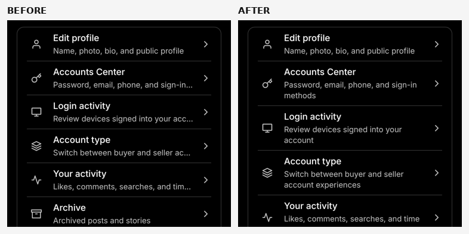
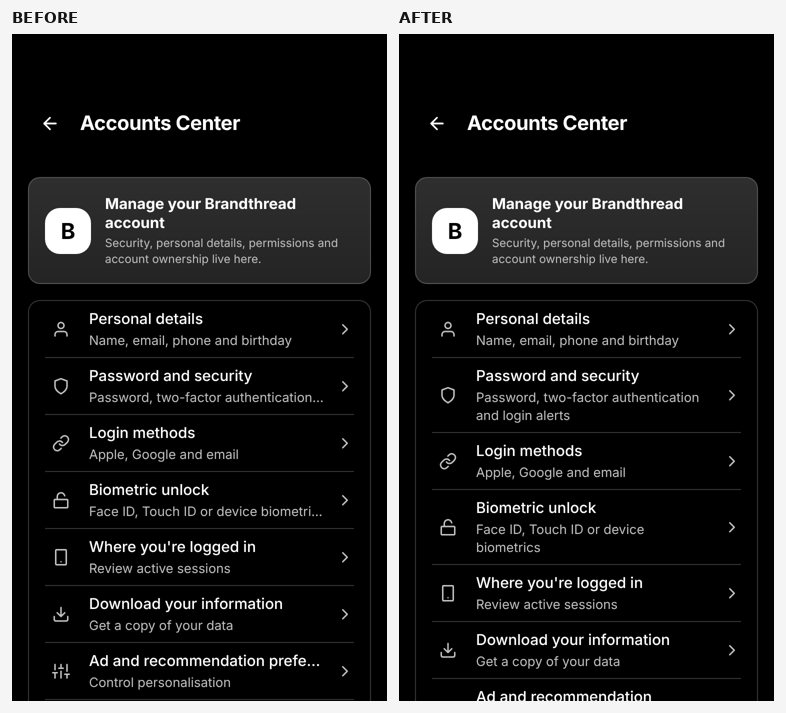
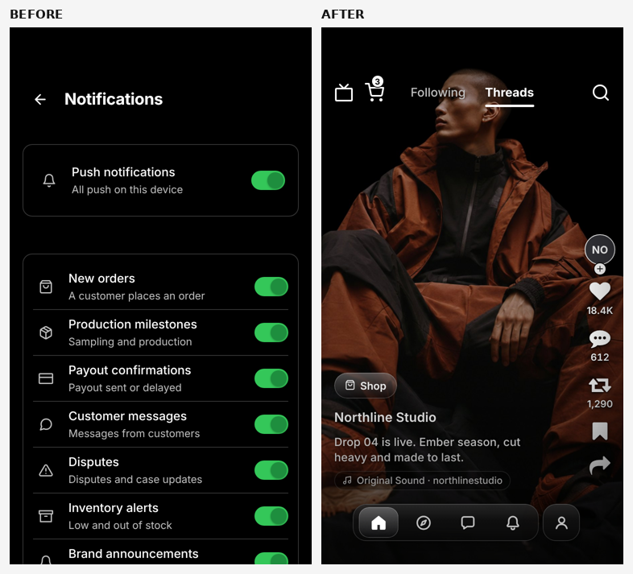
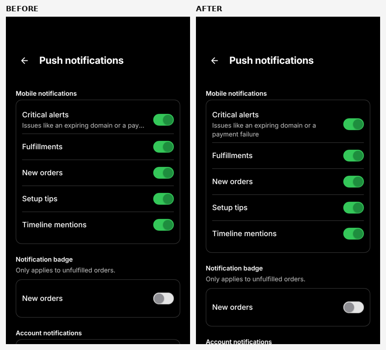
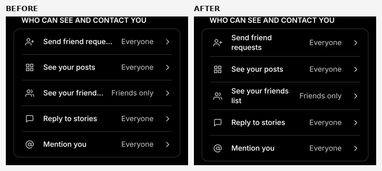
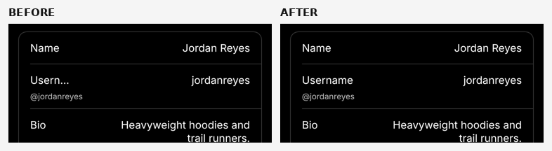
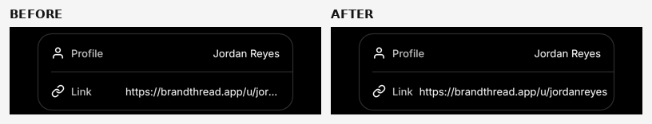

Long names:

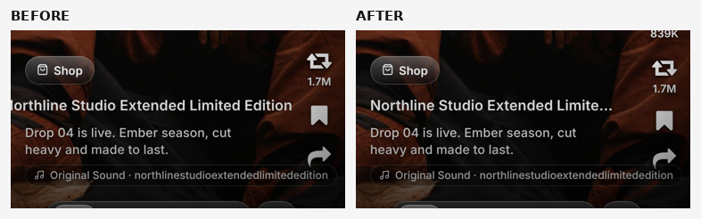
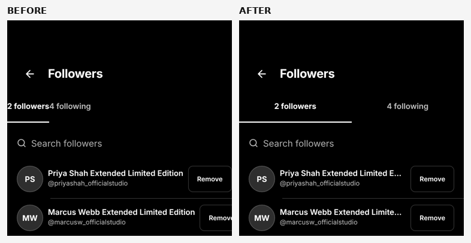
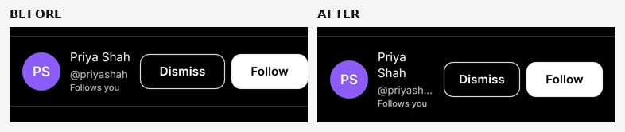
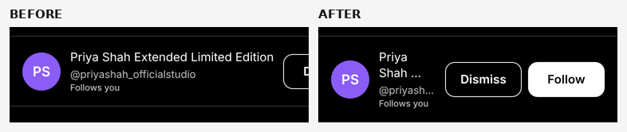

Largest Dynamic Type (web emulation):

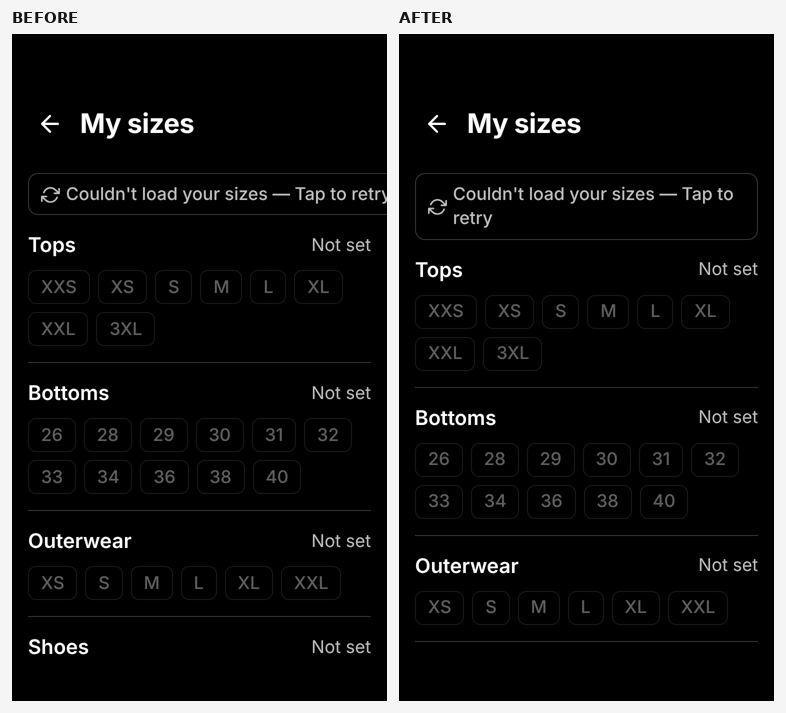

## Screen inventory (154 routes)

Static routes under `app/` that a buyer can reach, plus detail screens
opened with demo ids. Seller-only routes (analytics, studio, store
builder, design, payouts, …) are excluded.

- `/access-code`
- `/account-type`
- `/account-type-settings`
- `/activity`
- `/activity-center`
- `/activity-people`
- `/app-icon`
- `/app-theme`
- `/appearance`
- `/backup-codes`
- `/biometric-unlock`
- `/buyer-account-center`
- `/buyer-account-control`
- `/buyer-addresses`
- `/buyer-archive`
- `/buyer-blocked`
- `/buyer-category`
- `/buyer-category?slug=hoodies&label=Hoodies`
- `/buyer-checkout`
- `/buyer-close-friends`
- `/buyer-collection`
- `/buyer-conversation`
- `/buyer-conversation?id=preview-conversation-01`
- `/buyer-download-data`
- `/buyer-drafts`
- `/buyer-drop-detail`
- `/buyer-drops`
- `/buyer-friend-requests`
- `/buyer-gift-cards`
- `/buyer-highlight-stories`
- `/buyer-highlights-manager`
- `/buyer-invite`
- `/buyer-live`
- `/buyer-login-activity`
- `/buyer-muted`
- `/buyer-my-sizes`
- `/buyer-notifications`
- `/buyer-order-detail`
- `/buyer-order-detail?id=ord_demo`
- `/buyer-other-profile`
- `/buyer-other-profile?userId=user_northline`
- `/buyer-payment-methods`
- `/buyer-personal-details`
- `/buyer-post-comments`
- `/buyer-post-viewer`
- `/buyer-privacy-settings`
- `/buyer-problem-report`
- `/buyer-problem-report?orderId=ord_demo`
- `/buyer-product-detail`
- `/buyer-product-detail?productId=prod_nl_hoodie_ember`
- `/buyer-qr-code`
- `/buyer-recently-watched`
- `/buyer-refund-request`
- `/buyer-refund-request?orderId=ord_demo`
- `/buyer-report`
- `/buyer-restricted`
- `/buyer-return-request`
- `/buyer-return-request?orderId=ord_demo`
- `/buyer-saved`
- `/buyer-search`
- `/buyer-search-history`
- `/buyer-security`
- `/buyer-settings`
- `/buyer-settings-detail`
- `/buyer-settings-menu`
- `/buyer-story-create`
- `/buyer-story-viewer`
- `/buyer-trending`
- `/buyer-your-activity`
- `/call-screen`
- `/camera-capture`
- `/cart`
- `/change-email`
- `/change-password`
- `/change-phone`
- `/checkout`
- `/community`
- `/community-chat`
- `/community-create`
- `/community-guidelines`
- `/community-join`
- `/community-members`
- `/connections`
- `/conversation-details`
- `/conversation-group-create`
- `/conversation-nicknames`
- `/conversation-privacy-safety`
- `/conversation-search`
- `/create-post`
- `/creator-program`
- `/creator-program-join`
- `/delete-account`
- `/disable-two-factor`
- `/discover`
- `/discover-feed`
- `/dispute-detail`
- `/disputes`
- `/edit-profile`
- `/feed`
- `/find-friends-contacts`
- `/first-run-tips-settings`
- `/following`
- `/forgot-password`
- `/friends`
- `/general-settings`
- `/gift-card-buy`
- `/hashtag/streetwear`
- `/help`
- `/inbox`
- `/`
- `/ip-report`
- `/languages`
- `/live`
- `/live-feed`
- `/live-replay`
- `/live-replays`
- `/login-activity`
- `/login-methods`
- `/loyalty`
- `/muted-words`
- `/notification-channels`
- `/notifications-settings`
- `/onboarding`
- `/order-detail`
- `/orders`
- `/privacy`
- `/product-detail`
- `/profile`
- `/push-notifications`
- `/quote-post`
- `/refund-detail`
- `/refund-policy`
- `/return-detail`
- `/return-request`
- `/security`
- `/settings`
- `/setup`
- `/share-profile`
- `/shopping-preferences`
- `/sign-in`
- `/splash`
- `/store/northlinestudio`
- `/story-mention-viewer`
- `/story-mentions`
- `/tag/streetwear`
- `/terms`
- `/thread-cash`
- `/thread-cash-history`
- `/thread-cash-ledger`
- `/thread-checkout`
- `/thread-explainer`
- `/thread-product-detail`
- `/u/northlinestudio`
- `/users`

## Sheets and modals

Screens that open sheets / modals (from the source). Opened by tap in the
scan: profile menu, Share profile, Switch account, other profile More +
Report, Settings Sign out. Keyboard-bearing sheets are listed in the
keyboard PR.

- `/buyer-archive` — Modal ×1
- `/buyer-collection` — Modal ×1
- `/buyer-conversation` — Modal ×2
- `/buyer-highlights-manager` — Modal ×1
- `/buyer-notifications` — BottomSheet ×1
- `/buyer-order-detail` — Modal ×3 ReviewSheet ×1
- `/buyer-other-profile` — Modal ×1
- `/buyer-post-comments` — CommentActionsSheet ×1 Modal ×1
- `/buyer-post-viewer` — Modal ×2
- `/buyer-product-detail` — BottomSheet ×2 SizeGuideSheet ×1
- `/buyer-restricted` — Modal ×1 UnrestrictConfirmSheet ×1
- `/buyer-saved` — BottomSheet ×1 Modal ×1 SaveToCollectionSheet ×1
- `/buyer-settings` — ConfirmSheet ×1
- `/buyer-settings-menu` — ShareProfileSheet ×1
- `/buyer-story-create` — MentionPickerSheet ×1 Modal ×10
- `/buyer-story-viewer` — Modal ×1 StoryQuestionResponsesSheet ×1 TaggedPeopleSheet ×1
- `/community` — BottomSheet ×1
- `/community-members` — BottomSheet ×1 InviteSheet ×1 Modal ×1
- `/conversation-details` — Modal ×1 ThemePickerSheet ×1
- `/first-run-tips-settings` — ConfirmSheet ×1
- `/help` — Modal ×1
- `/inbox` — Modal ×2
- `/login-methods` — Modal ×2
- `/order-detail` — Modal ×2 ShipItemsSheet ×1
- `/profile` — AccountSwitcherSheet ×1 BottomSheet ×1 CoverCoachmarkSheet ×1 CoverManageSheet ×1 CoverTrimSheet ×1 Modal ×1 ProfileMenuSheet ×1 ShareProfileSheet ×1
