# Discover search — in place, TikTok-style (screenshots)

Captured at 390×844 from the web preview (`?bt_preview=buyer&demo=1`; all trending/brand/product content shown is demo data that only appears with `&demo=1`). A 393×852 set is in [`393x852/`](393x852/). Re-capture with `node artifacts/mobile/scripts/discover-search-screenshots.mjs --port <N>`.

## Before — the bar pushed a separate page, and the focused state was empty

| Discover | Pushed search page | Focused | Results |
|---|---|---|---|
|  | 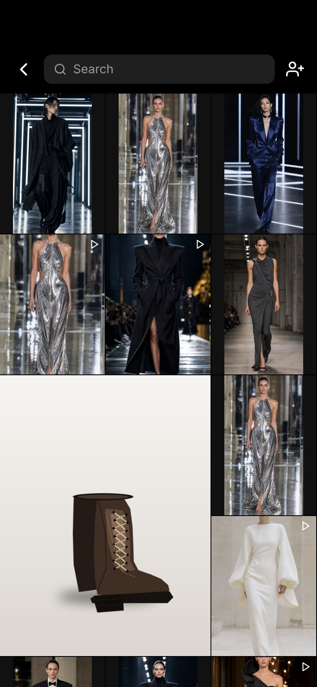 |  |  |

## After — the same bar becomes the search field

| Discover | Tap → focused | Focused with recents | Typing |
|---|---|---|---|
| 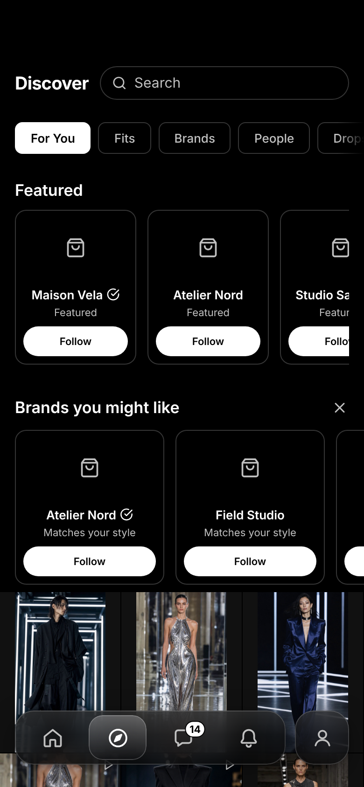 | 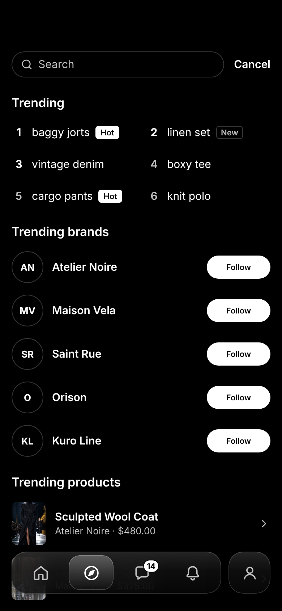 | 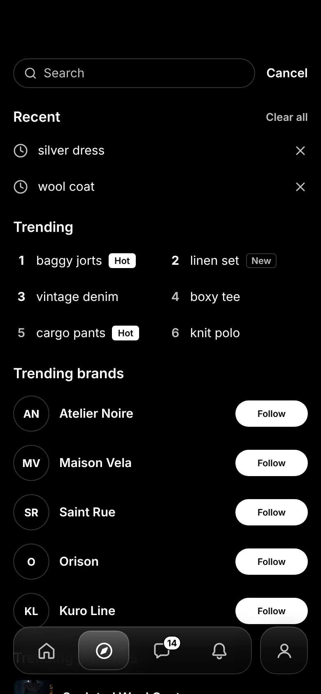 | 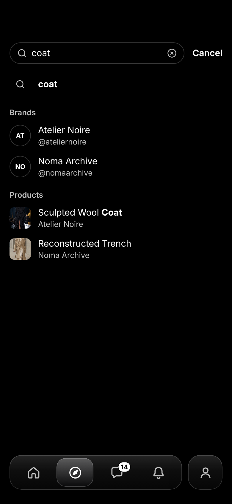 |

| Results · Top | Results · Brands | Results · Products | Results · Fits | Cancel → back on Discover |
|---|---|---|---|---|
| 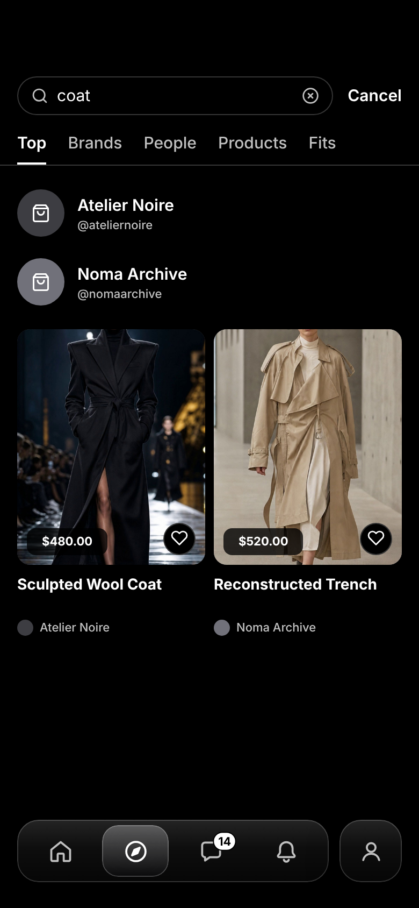 | 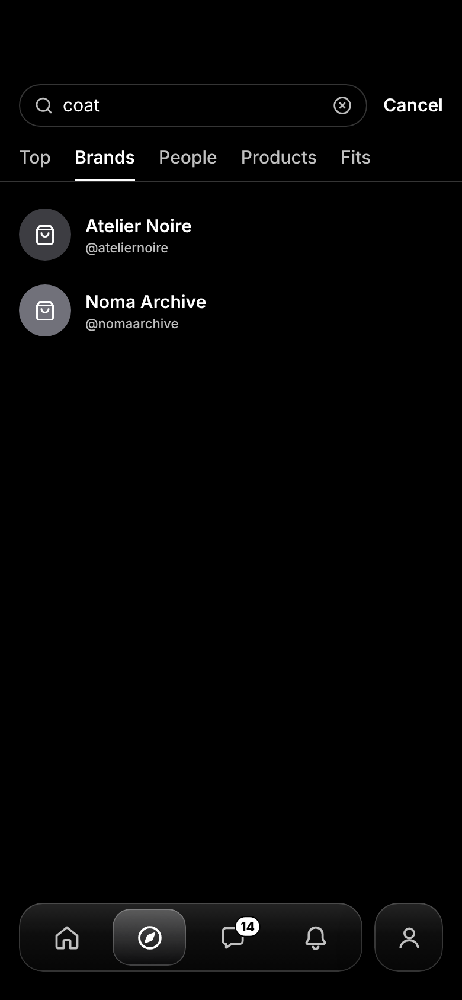 | 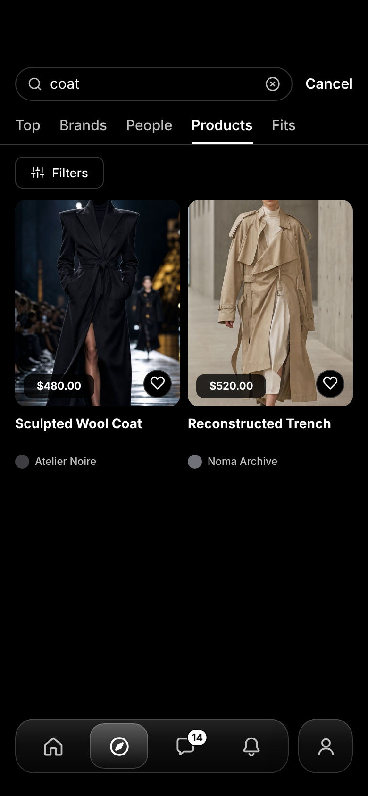 | 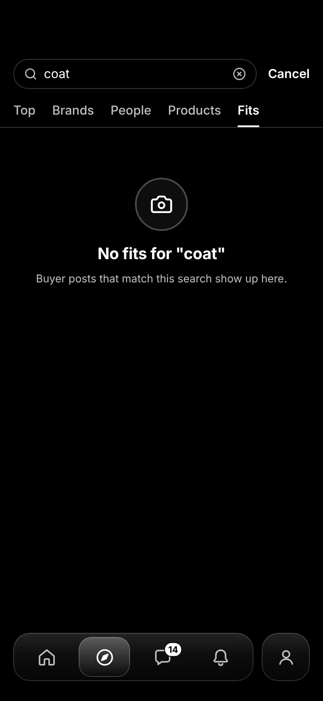 |  |

Mid-animation frames: [opening](390x844/after-2a-opening-midframe.png), [closing](390x844/after-7a-closing-midframe.png). Recording of open/close: [`after-open-close.webm`](390x844/after-open-close.webm).

## TikTok reference (left) vs Brandthread (right)

Reference: Mobbin flow "Searching TikTok" — https://mobbin.com/flows/97a8565f-1675-4edb-b8e0-a2668bf009d7

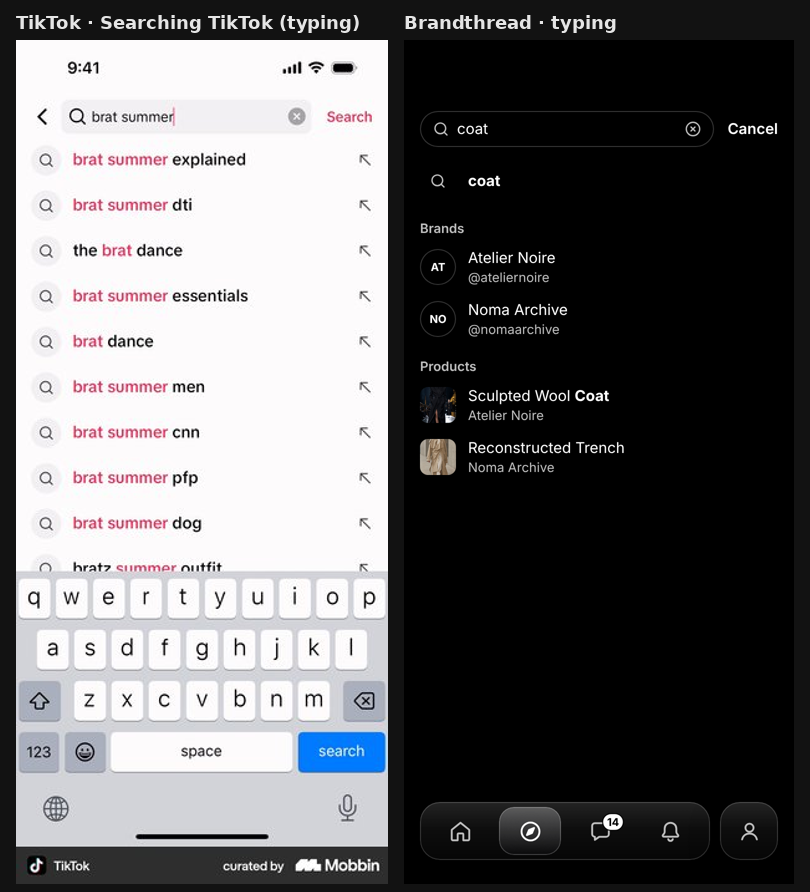 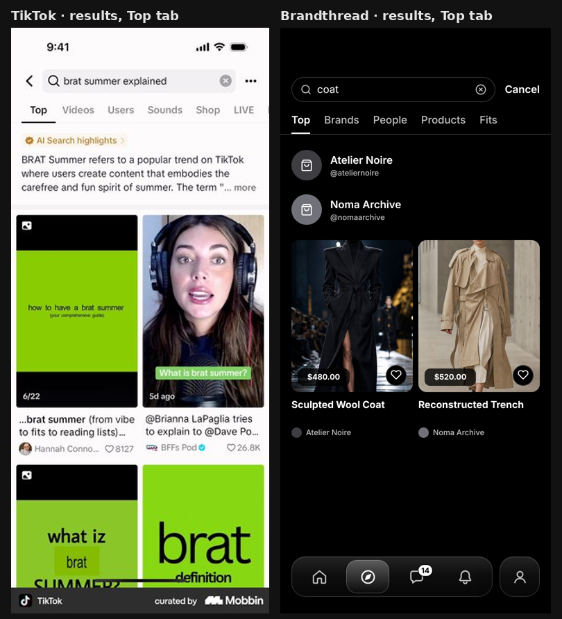 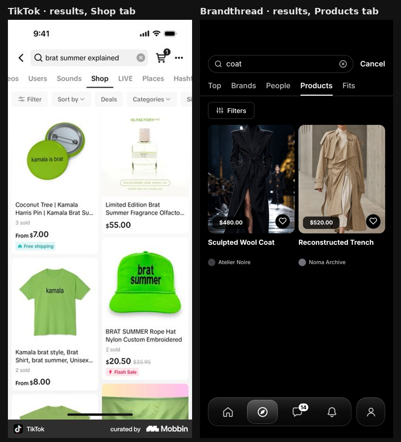
